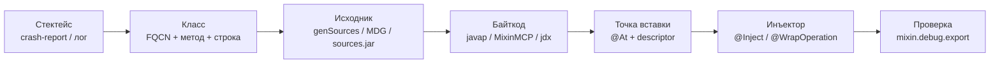
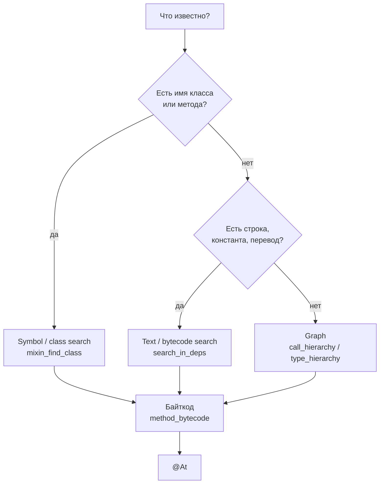

# IDE и навигация по коду

[← К оглавлению](../README.md)

> [!NOTE]
> TL;DR — Плагин **Minecraft Development** даёт навигацию по миксинам и ванильному коду, но видит только то, что подключено к проекту. **MixinMCP** расширяет поиск на весь classpath, включая чужие моды без `-sources.jar`, и умеет отдавать байткод. **jdx** решает ту же задачу из терминала, без IDE. Mappings-браузеры нужны, когда известен только обфусцированный или чужой namespace.

## Содержание

- [1. Маршрут: от стектрейса до инъекции](#1-маршрут-от-стектрейса-до-инъекции)
- [2. IntelliJ IDEA и плагин Minecraft Development](#2-intellij-idea-и-плагин-minecraft-development)
- [3. `genSources` и attached sources](#3-gensources-и-attached-sources)
- [4. MixinMCP](#4-mixinmcp)
- [5. jdx — инспектор джарников из терминала](#5-jdx--инспектор-джарников-из-терминала)
- [6. Mappings-браузеры](#6-mappings-браузеры)
- [7. Практические маршруты навигации](#7-практические-маршруты-навигации)
- [8. Сравнение подходов: текст, call graph, байткод](#8-сравнение-подходов-текст-call-graph-байткод)
- [9. Чеклист навигации](#9-чеклист-навигации)

---

## 1. Маршрут: от стектрейса до инъекции

Навигация в моддинге почти всегда идёт по одному и тому же пути. Разница только в том, на каком шаге вы застряли.



| Что у вас есть | Первый инструмент | Что получить |
| --- | --- | --- |
| Строка crash-report | `mixin_find_class` / `jdx show` | полное имя класса и метод |
| Имя класса, нет исходников | `genSources`, затем `Ctrl+Click` | читаемый исходник |
| Имя метода, неизвестен владелец | `mixin_super_methods` | место объявления |
| Строка в логе | `mixin_search_in_deps` | класс и метод, который её печатает |
| Описание поведения | `mixin_type_hierarchy` + `mixin_call_hierarchy` | кандидаты на инъекцию |
| Нужен точный `@At` | `mixin_method_bytecode` / `javap -c` | owner, name, descriptor, ordinal |

---

## 2. IntelliJ IDEA и плагин Minecraft Development

### 2.1 Что это и где брать

**Minecraft Development** (`MinecraftDev`) — плагин IntelliJ IDEA для проектов Fabric, Forge, NeoForge, Architectury, Sponge, Spigot/Paper, Velocity и Mixin. Это не «магический мод-комбайн», а набор инспекций, reference-провайдеров и шаблонов, которые понимают структуру мод-проекта.

- JetBrains Marketplace: <https://plugins.jetbrains.com/plugin/8327-minecraft-development>
- Исходники и changelog: <https://github.com/minecraft-dev/MinecraftDev>
- Документация проекта: <https://mcdev.io/>

Установка: `Settings → Plugins → Marketplace` → поиск `Minecraft` → `Install` → перезапуск IDE. В changelog плагина с 1.9.2 старый мастер проектов удалён, новые проекты создаются через шаблонный «Minecraft» project creator.

### 2.2 Требования к IDE

| Требование | Значение | Комментарий |
| --- | --- | --- |
| Платформа | IntelliJ IDEA (CE/Ultimate) | Плагин завязан на IntelliJ Platform; Eclipse и VS Code не поддерживаются |
| Версия IDE | сборки под 2026.1, 2026.2, 2026.3 | для проекта на 26.x нужна свежая IDE |
| Устаревшая IDE | предупреждение, если IDE отстаёт больше чем на 3 версии | новые релизы плагина перестают устанавливаться |
| JDK для сборки самого плагина | JDK 21 | нужно только контрибьюторам, не пользователям |
| Gradle-проект | обязателен | плагин импортирует модель Loom/MDG/ForgeGradle |

Практическое правило: версия плагина привязана к версии IDE. Если вы обновили Minecraft до 26.3, а IDE осталась на 2025.x, часть инспекций миксинов будет молча не работать — проверяйте `Settings → Plugins → Installed`.

### 2.3 Что умеет

| Возможность | Как выглядит в работе | Надёжность |
| --- | --- | --- |
| Автодополнение целей `@At` | в `target = "..."` предлагаются owner/name/descriptor из байткода | высокая, но зависит от подключённых sources |
| Автодополнение `@Mixin(target = "...")` | ссылка и completion по строковому имени класса | высокая |
| Инспекции `@At` | «инструкция не поддерживается этим инъектором», предупреждения про `JUMP`, `shift`/`by`, `opcode` | средняя: эвристики |
| Инспекции `@Shadow` | отсутствующий конструктор, abstract shadow в enum-миксине, несовпадение типов | высокая |
| Навигация к ванильному коду | `Ctrl+Click` по имени класса/метода в миксине открывает цель | только при attached sources |
| Навигация к лямбдам | переход к synthetic-методу `lambda$...` | высокая в свежих версиях |
| Access Wideners | подсветка, completion, валидация `.aw` и нового class tweaker формата | высокая |
| Access Transformers | подсветка, copy AT, проверка целей | высокая |
| Генерация run configs | client/server/data для Loom и MDG | высокая |
| Шаблоны файлов | миксин-класс, `fabric.mod.json`, `mods.toml`, datagen | высокая |
| Просмотр переводов | ссылки из кода в `lang`-файлы | средняя |

Важно: автодополнение `NEW` и `FIELD` в свежих версиях читает **байткод**, а не исходник. Это ровно то, что нужно для миксинов: декомпилятор может скрыть synthetic-член, а байткод — нет.

> [!NOTE]
> С Fabric Loader 0.18 и Loom 1.12 **Access Wideners** переименованы в **class tweakers**: файл `*.classtweaker`, первая строка `classTweaker v1 official`, директивы `accessible`/`extendable`/`mutable` плюс `inject-interface` и `extend-enum`, с префиксом `transitive-` для проброса зависимым модам. В `build.gradle` свойство по-прежнему называется `accessWidenerPath`, в `fabric.mod.json` — `accessWidener`: имена сохранили для обратной совместимости.

### 2.4 Ограничения

1. **Плагин статический.** Он не знает, какие миксины применились в рантайме, и не видит трансформации других модов.
2. **Без sources навигация ломается.** Строки `target = "..."` остаются просто строками, `Ctrl+Click` не работает.
3. **Инспекции — не компилятор.** Они могут пропустить ошибку или дать ложное срабатывание на нестандартном проекте.
4. **Только IntelliJ.** Для VS Code есть отдельные, гораздо более скромные расширения; Eclipse поддерживается хуже.
5. **Версионная привязка.** Новая схема имён 26.x, Loom 1.15+ и MDG 2.x требуют свежих релизов плагина.
6. **Чужие моды не индексируются.** Плагин видит project + attached libraries, но не «весь модпак» и не runtime-only jars.

### 2.5 Ravel — миграция mappings

**Ravel** (`badasintended/ravel`) — плагин IntelliJ IDEA для переименования исходников из одного namespace в другой. Главный сценарий в 2026 году: переход с Yarn на Mojang mappings перед обновлением мода на 26.1+.

- Поддерживает Java, Kotlin, Mixin и MixinExtras (кроме `@Expression`), class tweaker/Access Widener.
- Запуск: правый клик → **Refactor → Remap Using Ravel**, выбрать source/target namespace и модули.
- После миграции ищите `TODO(Ravel)` и **вручную проверяйте миксины**: строковые цели не всегда переписываются корректно.
- Loom-альтернатива — задача `migrateMappings`, но она не умеет Kotlin.
- Fabric API мигрировал свои исходники именно Ravel'ом.

- Исходники: <https://github.com/badasintended/ravel>
- Гайд Fabric: <https://docs.fabricmc.net/develop/porting/mappings/>

---

## 3. `genSources` и attached sources

### 3.1 Как Loom готовит исходники

Loom не «скачивает исходники Minecraft» — он их генерирует. Пайплайн из официальной документации:

1. скачивает client и server jar;
2. мержит их в merged jar с `@Environment`;
3. скачивает mappings;
4. ремапит merged jar в intermediary;
5. ремапит в named (Yarn или Mojang);
6. **опционально декомпилирует** mapped jar и строит linemap;
7. добавляет зависимости и ассеты.

Шаг 6 и есть `genSources`. Задачи Loom:

| Задача | Что делает | Актуальность |
| --- | --- | --- |
| `genSources` | декомпилирует дефолтным декомпилятором | с Loom 1.7 дефолт — Vineflower |
| `genSourcesWithVineflower` | явно Vineflower | рекомендуется |
| `genSourcesWithCfr` | явно CFR | когда Vineflower падает |
| `genSourcesWithFernFlower` | явно FernFlower | **удалён в Loom 1.15** |

Запуск:

```bash
# из терминала
./gradlew genSources

# или в IDE: Gradle panel → Tasks → fabric → genSources
```

Где лежат результаты (путь зависит от версии, хеша и mappings):

```text
.gradle/loom-cache/minecraftMaven/net/minecraft/
  minecraft-common-<hash>/<version>-loom.mappings.<...>-v2/
    minecraft-common-<hash>-<version>-<mapping>-sources.jar
  minecraft-clientOnly-<hash>/<version>-loom.mappings.<...>-v2/
    minecraft-clientOnly-<hash>-<version>-<mapping>-sources.jar
```

Пользовательский кеш Loom — `~/.gradle/caches/fabric-loom/`. Самый надёжный способ найти файл:

```bash
find .gradle/loom-cache ~/.gradle/caches/fabric-loom -name '*-sources.jar' -type f
```

`common` — общий код, `clientOnly` — клиентский. Клиент = `common` + `clientOnly`, сервер = только `common`.

### 3.2 Как это делает MDG

ModDevGradle не имеет отдельной задачи `genSources` в пользовательском DSL. По умолчанию он прогоняет **NeoForm decompilation/recompilation pipeline**: получает исходники Minecraft и скомпилированный jar, совпадающий с ними. Это заметно медленнее, но даёт рабочую отладку.

По официальной документации NeoForge, после sync исходники видны в **External Libraries**:

| Плагин | Артефакт с исходниками Minecraft |
| --- | --- |
| ModDevGradle | `minecraft-patched-<version>-merged.jar` |
| NeoGradle | `ng_dummy_ng.net.neoforged:neoforge:<version>` |

Начиная с MDG 2.0.124 декомпиляцию можно отключить:

```groovy
neoForge {
    enable {
        version = "..."
        disableRecompilation = true
    }
}
```

Это полезно в CI, где исходники не нужны, но вредно локально: без них не будет ни `Ctrl+Click`, ни отладки по строкам.

### 3.3 Подключить sources вручную

Если IntelliJ не подхватил jar автоматически:

1. Откройте любой класс Minecraft: `Ctrl+N` → `MinecraftServer` (или `Ctrl+Click` по использованию).
2. Вверху редактора появится баннер **Choose Sources...** (в новых версиях — **Attach Sources...**).
3. Укажите файл, оканчивающийся на `-sources.jar`.
4. Если баннер не появляется, откройте `Project Structure → Libraries`, найдите нужную библиотеку и добавьте source root вручную.

Типичные проблемы:

| Симптом | Причина | Что делать |
| --- | --- | --- |
| `no usages` на всех методах | sources не привязаны | `Choose Sources...`, выбрать `-sources.jar` |
| `Attach Sources` ничего не делает (MDG) | сбой состояния IDE | `Reload Gradle Project`, затем повторить |
| Класс открывается как `.class` | нет source root | `Project Structure → Libraries` |
| Пути не совпадают | другой hash/mappings | перезапустить `genSources` |

### 3.4 Почему поиск нужен в scope «All Places»

По умолчанию **Search Everywhere** (`Shift Shift`) ищет в файлах проекта. Классы Minecraft и чужих библиотек лежат в attached sources, то есть формально вне project source roots.

- В окне Search Everywhere переключитесь на вкладку и выберите scope **All Places** (либо включите **Include non-project items**, `Alt+N`).
- В **Find in Files** (`Ctrl+Shift+F`) выберите scope **Project and Libraries**, а не `Project Files`.
- Если файл исключён из проекта (`Excluded`), IntelliJ не будет искать в нём даже в `All Places`.

Именно поэтому «поиск не находит метод, хотя я его вижу» — почти всегда неверный scope, а не отсутствие sources.

---

## 4. MixinMCP

### 4.1 Что это

**MixinMCP** (`muon-rw/MixinMCP`) — расширение встроенного MCP-сервера IntelliJ IDEA инструментами для моддинга Minecraft. Формально это MCP-сервер для AI-агентов, но набор инструментов полезен и человеку: это один из самых полных на 2026 год способов искать по **всему classpath**, включая зависимости без опубликованных исходников.

Ключевая идея: обычный Grep ищет по файлам проекта. Моддингу же нужно искать по ванильному коду, API лоадера, библиотекам и чужим модам — часто без `-sources.jar`. MixinMCP решает это двумя частями:

| Часть | Что делает |
| --- | --- |
| IntelliJ-плагин | регистрирует `mixin_*` инструменты на MCP-сервере IDE |
| Gradle-плагин `dev.mixinmcp.decompile` | декомпилирует зависимости без sources и складывает в кеш |

Без Gradle-плагина `mixin_search_in_deps` и `mixin_get_dep_source` видят только те зависимости, у которых опубликован `-sources.jar`. Локальные jar, Cursemaven и многие Modrinth-зависимости будут невидимы.

- Репозиторий: <https://github.com/muon-rw/MixinMCP>
- Maven для плагина: `https://maven.muon.rip/releases`
- Кеш mappings: `~/.cache/mixinmcp/mappings/`
- Кеш декомпилированных зависимостей: `~/.cache/mixinmcp/decompiled/<hash>/` (инкрементальный, с `manifest.json`)

### 4.2 Установка

**Требования:** IntelliJ IDEA 2026.1+ и включённый **MCP Server** (обычно bundled).

1. `Settings → Plugins → Marketplace` → `MixinMCP` → `Install`.
2. `Settings → Plugins` → убедиться, что **MCP Server** включён (обычно bundled).
3. `Settings → Tools → MCP Server` → включить **Enable MCP Server**.
4. Подключить MCP-клиент через **Auto-Configure** (имя сервера обычно `user-jetbrains`) и перезапустить клиент.
5. Добавить Gradle-плагин:

```kotlin
// settings.gradle.kts
pluginManagement {
    repositories {
        maven { url = uri("https://maven.muon.rip/releases") }
        gradlePluginPortal()
    }
}
```

```kotlin
// build.gradle.kts
plugins {
    id("dev.mixinmcp.decompile") version "1.2.0" // сверьте актуальную версию в README
}
```

6. Прогнать декомпиляцию:

```bash
./gradlew genDependencySources
```

Задача запускается и после каждого Gradle sync, но иногда её нужно вызвать вручную. Плагин читает кеш при открытии проекта и после sync.

> [!CAUTION]
> MCP-сервер отдаёт наружу исходники, метаданные classpath и инструменты редактирования/рефакторинга. IntelliJ по умолчанию слушает только `localhost` — не меняйте это без причины.

### 4.3 Инструменты

Все имена начинаются с `mixin_`. Ниже — те, которые реально используются при написании миксинов.

**Поиск и чтение исходников**

| Инструмент | Назначение |
| --- | --- |
| `mixin_find_class` | класс по FQCN во всём classpath; опционально члены и декомпилированный исходник |
| `mixin_search_symbols` | поиск классов/методов/полей по подстроке имени |
| `mixin_search_in_deps` | regex-поиск по исходникам всех зависимостей, включая декомпилированные |
| `mixin_get_dep_source` | чтение файла из jar, кеша или любого jar на диске (`url`, `path`, `jarPath` + `entry`) |
| `mixin_list_source_roots` | диагностика: какие source roots реально подключены |

**Семантическая навигация**

| Инструмент | Назначение |
| --- | --- |
| `mixin_type_hierarchy` | полная цепочка supertypes/subtypes |
| `mixin_find_impls` | все реализации интерфейса или абстрактного класса |
| `mixin_find_references` | все использования класса/метода/поля |
| `mixin_call_hierarchy` | callers и callees рекурсивно, с защитой от циклов |
| `mixin_super_methods` | где метод объявлен изначально |
| `mixin_find_overrides` | все переопределения метода в иерархии |
| `mixin_find_targeting_mixins` | все `@Mixin`, которые целятся в класс/метод |

**Байткод**

| Инструмент | Назначение |
| --- | --- |
| `mixin_class_bytecode` | обзор класса на уровне байткода, включая synthetic |
| `mixin_method_bytecode` | инструкции метода; `INVOKE*` показывает реальный owner |

**Mappings**

| Инструмент | Назначение |
| --- | --- |
| `mixin_mappings_lookup` | перевод имени между mojmap, yarn, intermediary, srg, obf |

**Служебные**

`mixin_sync_project` запускает Gradle sync, `mixin_refresh_vfs` обновляет VFS после изменений на диске. Плюс инструменты рефакторинга (rename/move/inline/safe-delete/change-signature), которые обновляют и строковые ссылки в `mixins.json` и `mods.toml`.

> [!NOTE]
> Набор инструментов меняется между релизами. Таблицы сверены с README проекта на 2026-11-21; если инструмента нет в вашей версии — проверьте tool reference своей сборки.

### 4.4 Примеры запросов

> [!NOTE]
> Вызовы ниже иллюстративные: MixinMCP — сторонний проект, и имена параметров меняются между релизами. Сверяйтесь с tool reference в README вашей версии; при опечатке сервер сам подскажет ближайшее допустимое имя.

**Найти класс и его членов**

```json
{
  "tool": "mixin_find_class",
  "className": "net.minecraft.world.entity.LivingEntity",
  "methodName": "tick"
}
```

**Найти, где объявлен метод и кто его переопределяет**

```json
{ "tool": "mixin_super_methods", "className": "net.minecraft.world.entity.monster.Zombie", "methodName": "tick" }
```

```json
{ "tool": "mixin_find_overrides", "className": "net.minecraft.world.entity.LivingEntity", "methodName": "tick" }
```

**Найти всех, кто вызывает метод**

```json
{ "tool": "mixin_call_hierarchy", "className": "net.minecraft.world.level.Level", "methodName": "addFreshEntity", "maxDepth": 2 }
```

**Найти все миксины в модпаке, которые трогают метод**

```json
{
  "tool": "mixin_find_targeting_mixins",
  "className": "net.minecraft.world.entity.LivingEntity",
  "methodName": "hurt"
}
```

Это главный инструмент для анализа **конфликтов между модами**: если два мода целятся в один и тот же `INVOKE` с одинаковым `ordinal`, они подерутся.

**Найти класс по строке из лога**

```json
{
  "tool": "mixin_search_in_deps",
  "pattern": "Player .* tried to move too quickly",
  "contextLines": 6
}
```

**Получить байткод метода с ординалами**

```json
{
  "tool": "mixin_method_bytecode",
  "className": "net.minecraft.world.entity.player.Player",
  "methodName": "tick",
  "regexPattern": "INVOKE"
}
```

Если один и тот же `INVOKE` встречается несколько раз, инструмент покажет Mixin-ординал каждой инструкции — это ровно то число, которое пойдёт в `@At(ordinal = ...)`.

**Найти synthetic-лямбды**

```json
{ "tool": "mixin_class_bytecode", "className": "com.example.MyBlock", "filter": "synthetic" }
```

**Перевести имя между namespace**

Вызовите `mixin_mappings_lookup` с именем символа и укажите исходный и целевой namespace (`mojmap`, `yarn`, `intermediary`, `srg`, `obf`). Mappings скачиваются по требованию и кешируются в `~/.cache/mixinmcp/mappings/`, версия MC определяется из `gradle.properties`.

### 4.5 Чем отличается от обычного Grep

| Критерий | Grep / Find in Files | MixinMCP |
| --- | --- | --- |
| Область поиска | файлы проекта и attached sources | project + все зависимости + JDK + buildscript classpath |
| Jar без `-sources.jar` | не виден | декомпилируется Gradle-плагином |
| Jar-in-jar | вручную распаковывать | читается нативно |
| Семантика | нет | overrides, callers, implementations |
| Байткод | нет | class/method bytecode, ординалы |
| Чужие миксины | только если есть исходники | `find_targeting_mixins`, включая чтение из байткода |
| Стоимость | дёшево | требует индексации и sync |

Правило: **Grep — для строк и констант, MixinMCP — для структуры и чужих jar.** Если вы ищете `"minecraft:zombie"` в lang-файлах — Grep быстрее. Если вы ищете, кто вызывает `hurt(DamageSource;F)Z` — MixinMCP точнее.

### 4.6 Ограничения

- Требует IntelliJ 2026.1+ и включённого MCP Server.
- `mixin_search_in_deps` покрывает compile classpath; runtime-only jar можно читать поштучно через `mixin_get_dep_source(jarPath = ..., entry = ...)` или добавить в декомпиляцию.
- Декомпиляция больших jar может упасть по памяти: поднимите `org.gradle.jvmargs=-Xmx4g..6g` и уменьшите `--threads` у `genDependencySources`.
- Это сторонний проект; API и имена параметров меняются между релизами.
- Инструменты рефакторинга не «заточены» под удалённый доступ.

---

## 5. jdx — инспектор джарников из терминала

### 5.1 Что это

**jdx** — CLI и MCP-сервер для чтения Java/Kotlin jar'ов: метаданные, исходники, декомпиляция, байткод. Автор — Mohammad Mostafa Dastjerdi. Написан на Java, парсит байткод через ASM и **никогда не загружает и не исполняет** инспектируемые классы — это важно для чужих модов.

- Документация: <https://mohammadmd1383.github.io/jdx/>
- Полный справочник команд: <https://github.com/MohammadMD1383/jdx/blob/main/docs/COMMANDS.md>
- Исходники: <https://github.com/MohammadMD1383/jdx>
- Лицензия Apache-2.0, требует JDK 21+. Актуальную версию смотрите в GitHub Releases.

Установка (per-user, без root):

```bash
curl -fsSL https://raw.githubusercontent.com/MohammadMD1383/jdx/main/install-release.sh | bash
jdx version
```

### 5.2 Команды

| Команда | Аналог в IDE | Что делает |
| --- | --- | --- |
| `jdx show <type>` | Go to Declaration | класс целиком: предки, интерфейсы, счётчики членов |
| `jdx members <type>` | completion после `.` | члены, включая inherited |
| `jdx outline <type>` | `Ctrl+F12` | структура файла, только declared |
| `jdx body <member>` | открыть метод | ровно одно тело метода |
| `jdx search <pattern>` | Search Everywhere | glob/regex/fuzzy по classpath |
| `jdx usages <symbol>` | Find Usages | использования |
| `jdx resources` | — | не-`.class` файлы в jar |
| `jdx samples` | — | реальные вызовы из classpath как примеры |
| `jdx literals` | — | поиск строковых констант и ключей `.properties` |
| `jdx diff a.jar b.jar` | — | публичный API-diff двух версий зависимости |

Полный список (включая `signature`, `doc`, `hierarchy`, `services`, `modules`, `manifest`, `batch`) — в `jdx help` и `docs/COMMANDS.md`: набор команд активно растёт.

Ключевые флаги: `--jars`, `--coord`, `--no-jdk`, `--engine vineflower|javap`, `--lines A:B`, `--around '<type>#<member>'`, `--context N`, `--regex`, `--kind`, `--limit`.

### 5.3 Рецепты для Minecraft

**Посмотреть чужой мод без распаковки**

```bash
jdx resources --jars ./mods/SomeMod.jar --no-jdk
jdx resources --cat fabric.mod.json --jars ./mods/SomeMod.jar --no-jdk
jdx resources mixin --jars ./mods/SomeMod.jar --no-jdk
```

**Найти класс и прочитать метод**

```bash
jdx search 'com.example.*' --jars ./mods/SomeMod.jar --no-jdk
jdx outline com.example.SomeMod --jars ./mods/SomeMod.jar --no-jdk
jdx body 'com.example.SomeMod#onInitialize()' --jars ./mods/SomeMod.jar --no-jdk
```

**Прочитать ванильный класс из remapped jar**

```bash
# Путь зависит от версии Loom: найдите named-джарник в кеше
MC_JAR=$(find "$HOME/.gradle/caches/fabric-loom" -name '*named*.jar' | head -1)

jdx members net.minecraft.world.item.ItemStack \
  --jars "$MC_JAR" --jars ./mods/SomeMod.jar

jdx body 'net.minecraft.world.entity.LivingEntity#hurt(net.minecraft.world.damagesource.DamageSource,float)' \
  --jars "$MC_JAR"
```

**Получить именно байткод, а не реконструкцию**

```bash
jdx body 'net.minecraft.world.level.Level#addFreshEntity' --engine javap --jars "$MC_JAR"
```

jdx всегда предпочитает настоящие sources (`-sources.jar`, каталог, `src.zip`). Если их нет — декомпилирует Vineflower и помечает вывод `⚠ reconstructed`. Флаг `--engine javap` показывает сырой байткод. Если Vineflower вернул заглушку `$VF: Could not decompile...`, jdx сам падает на javap.

### 5.4 Чем полезен вне IDE

- Работает на сервере и в CI, где нет IntelliJ.
- Не требует Gradle-проекта: достаточно jar на диске.
- Не исполняет код и не тянет транзитивные зависимости.
- Экономит контекст: `jdx body` отдаёт один метод вместо файла на 60 КБ.
- Точное поведение: `SOURCES_VERSION_MISMATCH` предупреждает, когда sources и binary расходятся.

Ограничения: jdx **не ремапит**. Имена будут в том namespace, в котором собран jar. Для Mojmap/Yarn нужно передать уже remapped jar (например, `minecraft-common.jar` из Loom).

---

## 6. Mappings-браузеры

Когда известен только обфусцированный `class_1309` или, наоборот, имя из чужого мода, нужен браузер mappings.

### 6.1 Linkie

- Web: <https://linkie.shedaniel.dev/mappings>
- Discord-бот: <https://github.com/linkie/linkie-discord>
- Поддерживает MCP (1.8+), Mojang (1.14.4+), Yarn, Intermediary, Quilt, Plasma, Spigot.

Полезные возможности:

| Режим | Зачем |
| --- | --- |
| Mappings | поиск класса/метода/поля по имени |
| **Stacktrace** | вставить строку стектрейса и получить читаемые имена |
| Namespace-конвертация | Yarn ↔ Mojmap ↔ MCP ↔ Intermediary |

Команды бота (префикс `/` в новых версиях, `!` в старых): `/mapping`, `/yarn`, `/mmi`, `/mms`, `/mcp`, а также конвертация вида `/ymm`, `/mmy`, `/mcpmm`.

### 6.2 mappings.dev

<https://mappings.dev/> — браузер client/server mappings по версиям. **Важно:** после анонса Mojang от 29 октября 2025 сайт переведён в архивный режим и больше не обновляется. Последние версии — до 1.21.11. Для 26.x он бесполезен, потому что обфускации больше нет.

### 6.3 MCPBot

Исторический бот в `#mcpbot` на EsperNet с командами `!mcp`, `!mcp.method`, `!mcp.field`. Использовался для MCP-имён до 1.16.5. Сейчас не работает; для старых версий смотрите архивы MCPConfig и Linkie.

### 6.4 Yarn javadoc

Fabric публикует сгенерированный javadoc для сборок Yarn по адресу вида:

```text
https://maven.fabricmc.net/docs/yarn-<mcversion>+build.<n>/
```

Точную версию берите из `gradle.properties` (`yarn_mappings`). Для 26.x этот путь не нужен: имена и параметры приходят с игрой. `[community]`

### 6.5 Как искать класс по описанию

Запрос «класс, который отвечает за...» не работает ни в одном браузере напрямую. Рабочая последовательность:

1. **Сформулируйте английские термины.** «Опыт с моба» → `experience`, `xp`, `drop`, `mob`.
2. **Найдите константу или translation key.** `entity.minecraft.zombie` → Grep по lang → класс сущности.
3. **Найдите строку в логе.** `mixin_search_in_deps` по фрагменту сообщения.
4. **Идите от интерфейса.** `mixin_find_impls` для `Goal`, `BlockEntity`, `ScreenHandler`.
5. **Проверьте иерархию.** `mixin_type_hierarchy` покажет, где поведение реально определено, а где переопределено.
6. **Сверьтесь с mappings.** Если имя обфусцировано — Linkie в режиме Stacktrace.

---

## 7. Практические маршруты навигации

### 7.1 От crash-стека к классу

```text
java.lang.NullPointerException: Cannot invoke "..." because "..." is null
    at com.example.mymod.mixin.ZombieMixin.tick(ZombieMixin.java:42)
    at net.minecraft.world.entity.monster.Zombie.tick(Zombie.java:210)
```

1. Верхняя строка с вашим пакетом — ваш миксин.
2. Следующая ванильная строка — цель. `Zombie.tick` — это `method = "tick"`.
3. `mixin_find_class("net.minecraft.world.entity.monster.Zombie", methodName = "tick")` → исходник.
4. `mixin_super_methods` → где `tick` объявлен на самом деле.
5. `mixin_method_bytecode` → точные `INVOKE`/`FIELD` и ординалы.

Если в стеке `class_1309` или `method_5643` — сначала `mixin_mappings_lookup` или Linkie Stacktrace, потом всё остальное.

### 7.2 От строки в логе к методу

```text
[Server thread/WARN]: Entity type minecraft:zombie moved too quickly!
```

1. `mixin_search_in_deps` с `pattern = "moved too quickly"`.
2. Получите файл и номер строки.
3. `mixin_call_hierarchy` от метода, который печатает лог, вверх — кто его вызывает.
4. Если лог печатается в `ServerGamePacketListenerImpl`, а поведение задаётся в `ServerLevel` — идите по callees.

Ограничение: строки, собранные конкатенацией, ищутся хуже. Ищите самый длинный стабильный фрагмент без подстановок.

### 7.3 От «хочу изменить поведение X» к кандидатам

1. **Определите точку принятия решения.** Урон? `hurt`. Дроп? `dropExperience`/`spawnAtLocation`. Спавн? `checkSpawnRules`/`finalizeSpawn`.
2. **Найдите объявление.** `mixin_super_methods`, затем `mixin_find_overrides`.
3. **Посмотрите реализации.** `mixin_find_impls` для интерфейсов (`Goal`, `Item`, `Block`).
4. **Посмотрите вызывающих.** `mixin_call_hierarchy` — часто менять надо не сам метод, а его вызывающего.
5. **Проверьте байткод.** Если решение — `if (x > 0)`, ищите `if_icmp*` и `CONSTANT`.
6. **Проверьте конфликты.** `mixin_find_targeting_mixins` по выбранному методу.

### 7.4 Поиск по константам и переводам

Самый недооценённый приём. Translation key и строковые константы живут в `lang`-файлах и в байткоде, а не в декомпилированном исходнике в виде «понятного» имени.

```bash
# найти ключ перевода
rg 'entity\.minecraft\.zombie' assets/ src/

# найти, где он используется в jar
jdx resources --jars ./mods/SomeMod.jar --no-jdk | rg 'lang/'
```

```json
{ "tool": "mixin_search_bytecode", "patterns": ["entity.minecraft.zombie"], "kinds": ["string"] }
```

Дальше — `mixin_find_references` на поле/метод, который вернул эту строку. Часто это быстрее, чем угадывать имя класса.

Для чисел: `@At("CONSTANT")` и `@Constant(intValue = 20)` ищутся по байткоду, но **не** найдут `static final int`, который компилятор заинлайнил. Это ограничение не инструмента, а JVM — см. [`3-decompilers-bytecode.md`](3-decompilers-bytecode.md).

### 7.5 Поиск конфликтов с другими модами

```json
{
  "tool": "mixin_find_targeting_mixins",
  "className": "net.minecraft.world.entity.LivingEntity",
  "methodName": "hurt",
  "jarPath": "/path/to/mods",
  "mcVersion": "1.21.1"
}
```

Инструмент читает миксины из байткода, включая jar-in-jar. Для версий до 26.x он сопоставляет имена в Mojang/intermediary/Yarn — потому что разные моды собраны в разных namespace.

---

## 8. Сравнение подходов: текст, call graph, байткод



| Подход | Сильные стороны | Слабые стороны | Когда использовать |
| --- | --- | --- | --- |
| **Текстовый поиск** (Grep, `search_in_deps`) | быстрый, находит строки, комментарии, JSON, lang | не видит структуру; зависит от качества декомпиляции; не находит сгенерированное | известна строка/константа; поиск по ресурсам |
| **Call graph** (`call_hierarchy`, `find_references`, `find_overrides`) | показывает поток управления и реальные связи | не видит рефлексию, события, `invokedynamic`; зависит от индекса | «кто это вызывает», «где переопределено» |
| **Байткод** (`method_bytecode`, `javap -c`) | истина: owner, descriptor, ordinal, synthetic | нечитаем без практики; не показывает намерение | выбор точного `@At`; проверка того, что инструкция вообще есть |
| **Runtime** (`mixin.debug.export`, логи) | показывает, что реально применилось | медленно; требует запуска | отладка уже написанного миксина |

Практическая иерархия доверия:

```text
исходник (удобно)  <  байткод (точно)  <  рантайм (окончательно)
```

Исходник нужен, чтобы понять замысел. Байткод — чтобы выбрать цель. Рантайм — чтобы убедиться, что миксин применился и не конфликтует.

---

## 9. Чеклист навигации

Перед тем как писать `@At`:

- [ ] Sources подключены, `Ctrl+Click` работает, scope поиска — **All Places**.
- [ ] Класс и метод найдены в **том** namespace, в котором работает проект (26.x — Mojmap-имена в рантайме).
- [ ] Проверено, где метод **объявлен**, а где **переопределён** (`mixin_super_methods`, `mixin_find_overrides`).
- [ ] Просмотрены вызывающие (`mixin_call_hierarchy`), а не только сам метод.
- [ ] Целевая инструкция существует в байткоде (`mixin_method_bytecode`, `javap -c -p`).
- [ ] Учтены overloads: descriptor включает параметры и return type.
- [ ] Проверены synthetic-методы и лямбды (`filter = "synthetic"`).
- [ ] Проверены конфликты с другими модами (`mixin_find_targeting_mixins`).
- [ ] Для чужих jar использован `mixin_search_bytecode` / `jdx`, а не Grep по исходникам.
- [ ] После сборки проверено `-Dmixin.debug.export=true`.

---

## Проверено на

**Дата:** 2026-11-21.

Текст ориентирован на:

| Компонент | Версия / состояние |
| --- | --- |
| Minecraft | 26.3 (и исторические 1.20.1 / 1.21.x) |
| IntelliJ IDEA | 2026.2 / 2026.3 |
| Minecraft Development | см. JetBrains Marketplace (версия зависит от IDE) |
| MixinMCP | Gradle-плагин 1.2.x (по README), IntelliJ 2026.1+ |
| jdx | актуальный GitHub Release (на 2026-11-21 — ветка 1.x) |
| Fabric Loom | 1.15–1.19 (FernFlower удалён с 1.15) |
| ModDevGradle | 2.x |

Названия кнопок и пунктов меню могут отличаться между версиями IDE. Всё, что помечено `[community]`, основано на документации сообщества, а не на официальном первоисточнике.

## Источники

**Первоисточники**

- Minecraft Development — JetBrains Marketplace: <https://plugins.jetbrains.com/plugin/8327-minecraft-development>
- MinecraftDev — репозиторий и changelog: <https://github.com/minecraft-dev/MinecraftDev>
- MinecraftDev — сайт проекта: <https://mcdev.io/>
- Fabric Docs — Generating Sources in IntelliJ IDEA: <https://docs.fabricmc.net/develop/getting-started/intellij-idea/generating-sources>
- Fabric Docs — Loom: <https://docs.fabricmc.net/develop/loom/>
- Fabric Docs — Loom Options (decompilers): <https://docs.fabricmc.net/develop/loom/options>
- Fabric Loom 1.15 release notes (удаление FernFlower): <https://github.com/FabricMC/fabric-loom/releases/tag/1.15>
- Fabric Loom 1.7 release notes (Vineflower по умолчанию): <https://github.com/FabricMC/fabric-loom/releases/tag/1.7>
- NeoForge Docs — Getting Started (расположение sources): <https://docs.neoforged.net/docs/gettingstarted/>
- NeoForge Docs — ModDevGradle: <https://docs.neoforged.net/toolchain/docs/plugins/mdg>
- ModDevGradle — README: <https://github.com/neoforged/ModDevGradle>
- MixinMCP — README и tool reference: <https://github.com/muon-rw/MixinMCP>
- jdx — Reading code: <https://mohammadmd1383.github.io/jdx/docs/reading-code>
- jdx — Command reference: <https://mohammadmd1383.github.io/jdx/docs/reference/>
- jdx — репозиторий: <https://github.com/MohammadMD1383/jdx>
- IntelliJ IDEA — Search everywhere (scope All Places): <https://www.jetbrains.com/help/idea/searching-everywhere.html>
- Fabric Wiki — Mappings: <https://wiki.fabricmc.net/tutorial:mappings>

**Community / архив**

- Linkie — mappings browser: <https://linkie.shedaniel.dev/mappings> `[community]`
- Linkie Discord bot: <https://github.com/linkie/linkie-discord> `[community]`
- mappings.dev — архив: <https://mappings.dev/> `[community]`
- Yarn javadoc: <https://maven.fabricmc.net/docs/> `[community]`
- MCPBot — исторический сервис, команды `!mcp`, `!mcp.method` `[community]`, `[unverified]` для текущего состояния
