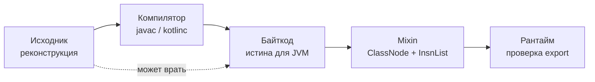

# Декомпиляторы и работа с байткодом

[← К оглавлению](../README.md)

> [!NOTE]
> TL;DR — Декомпилированный исходник — это **реконструкция**, а не оригинал. Миксин же применяется к байткоду. Поэтому цель `@At` всегда проверяют в байткоде: `javap -c -p`, MixinMCP или jdx. Если инструкции нет в байткоде (константа заинлайнена, строка склеена через `invokedynamic`, цикл превращён в итератор) — никакой `@At` её не найдёт.

## Содержание

- [1. Зачем смотреть байткод](#1-зачем-смотреть-байткод)
- [2. Декомпиляторы](#2-декомпиляторы)
- [3. Почему декомпилятор врёт](#3-почему-декомпилятор-врёт)
- [4. Инструменты](#4-инструменты)
- [5. Мини-курс чтения байткода](#5-мини-курс-чтения-байткода)
- [6. Чего нет в байткоде](#6-чего-нет-в-байткоде)
- [7. Практика: descriptor, overload, lambda, owner](#7-практика-descriptor-overload-lambda-owner)
- [8. Чеклист перед `@At`](#8-чеклист-перед-at)

---

## 1. Зачем смотреть байткод

Mixin не редактирует исходники. Он получает `ClassNode` (ASM), находит в нём инструкции и вставляет/заменяет байткод. Поэтому:

- `@At(target = "...")` сравнивается с **owner + name + descriptor** из constant pool;
- `ordinal` считается по **инструкциям**, а не по строкам исходника;
- `@Inject` в `HEAD` вставляет код до первой инструкции, а в конструкторе «первая инструкция» — это часто `aload_0` / `invokespecial Object.<init>`, а не то, что написано в начале тела;
- код, которого нет в байткоде, нельзя перехватить.



Практическое следствие: декомпилятор нужен, чтобы **понять замысел**, а байткод — чтобы **выбрать точку вставки**. Это два разных инструмента, и они не заменяют друг друга.

---

## 2. Декомпиляторы

### 2.1 Сравнение

| Декомпилятор | Статус в 2026 | Сильные стороны | Слабые стороны |
| --- | --- | --- | --- |
| **Vineflower** | дефолт Loom с 1.7, дефолт MDG/NeoForm | лучшее качество вывода, Java 21+ (records, sealed, switch expressions, pattern matching), многопоточность | иногда падает на сложных `invokedynamic`; требует Java 17+ (1.11+) |
| **CFR** | поддерживается, входит в Loom | очень устойчив к странному и обфусцированному байткоду, хорошие сообщения об ошибках | вывод менее читаемый, медленнее на больших jar |
| **FernFlower** | оригинал JetBrains, практически заморожен | историческая совместимость | не понимает современную Java; **удалён из Loom 1.15** |
| **ForgeFlower** | форк FernFlower для Forge | патчи под Forge-байткод | не развивается как общий инструмент; для 26.x не нужен |
| **Procyon** | старый, но живой | хорошо разбирает `finally`, старый обфусцированный код | слабая поддержка новых фич, медленный |
| **Krakatau** | академический/экспериментальный | точность на уровне байткода, свой assembler | не «красивый» Java, сложен в использовании |

### 2.2 Vineflower

Самый практичный вариант по умолчанию. Умеет records, sealed classes, switch expressions, pattern matching, автоматическое форматирование и многопоточную декомпиляцию.

```bash
java -jar vineflower.jar input.jar output-dir
```

Полезные флаги:

| Флаг | Что делает |
| --- | --- |
| `--folder` | сохранить в каталог (не в zip) |
| `--only=<prefix>` | декомпилировать только часть архива |
| `-e <jar>` | добавить внешнюю библиотеку в classpath декомпилятора |
| `--decompile-generics=1` | generics (по умолчанию включено) |
| `--lambda-to-anonymous-class=1` | показать лямбды как анонимные классы |
| `--include-runtime=current` | дать декомпилятору JDK |
| `--log-level=debug` | диагностика |

В Loom декомпилятор настраивается через DSL:

```groovy
loom {
    decompilers {
        vineflower {
            options += [ "dgs": "1" ]
            memory = 4096
            maxThreads = 8
        }
    }
}
```

### 2.3 CFR

Берите, когда Vineflower выдал `$VF: Could not decompile...` или странный результат. CFR чаще «дотягивает» сложный байткод, пусть и менее красиво.

```bash
java -jar cfr.jar minecraft.jar --outputdir out
```

Типичные случаи: обфусцированные jar, старые версии, код после оптимизаторов, Kotlin-байткод с нестандартными конструкциями.

### 2.4 FernFlower и ForgeFlower

FernFlower — предок Vineflower и ForgeFlower. Он всё ещё встречается в туториалах и старых сборках, но:

- не понимает records/sealed/pattern matching;
- в Loom 1.15 **удалён**;
- для 26.x не нужен, потому что игра не обфусцирована.

ForgeFlower — форк с патчами под Forge. Имеет смысл только при работе со старым Forge-кодом и старыми инструментами. Для NeoForge 26.x используется NeoForm + Vineflower.

### 2.5 Как выбрать

| Ситуация | Декомпилятор |
| --- | --- |
| Обычный проект на Loom/MDG | Vineflower (дефолт) |
| Vineflower упал или выдал ерунду | CFR |
| Очень старый обфусцированный jar | CFR или Procyon |
| Нужно понять, как выглядит именно байткод | не декомпилятор, а `javap` |
| Нужно отредактировать класс | Recaf / Bytecode Viewer |
| Нужно только прочитать один метод из jar | jdx |

---

## 3. Почему декомпилятор врёт

Декомпилятор решает обратную задачу: по байткоду восстановить исходник. Задача не имеет единственного решения. Отсюда типовые расхождения.

### 3.1 Synthetic-члены

Компилятор добавляет то, чего не было в исходнике:

| Synthetic | Откуда |
| --- | --- |
| `lambda$foo$0` | тело лямбды |
| `access$000` | доступ к приватному полю из вложенного класса (старые javac) |
| `this$0` | ссылка на внешний экземпляр |
| `$SwitchMap$...` | switch по enum |
| `compareTo(Object)` | bridge-метод после erasure generics |
| `$default` | default-аргументы Kotlin |
| `values()` / `valueOf()` | enum |

Декомпилятор часто **скрывает** их, потому что они «не из исходника». Миксину же иногда нужны именно они.

### 3.2 Лямбды

Исходник:

```java
Runnable r = () -> System.out.println("hi");
```

Байткод (упрощённо):

```text
invokedynamic #7, 0   // InvokeDynamic #0:run:()Ljava/lang/Runnable;
...
private static void lambda$init$0();
```

Декомпилятор покажет обратно `() -> ...` и спрячет и synthetic-метод, и `invokedynamic`. Если вы целитесь в лямбду, смотрите `javap -p -c`.

### 3.3 Инлайнинг констант

```java
public static final int MAX = 20;
// в другом классе:
if (count > MAX) { ... }
```

В байткоде второго класса будет `bipush 20` (или `ldc 20`), а **не** `getstatic ...MAX`. Компилятор подставил значение. Поэтому `@At("FIELD", target = "...MAX:I")` не найдёт ничего.

### 3.4 Generics и bridge-методы

```java
class Box implements Comparable<Box> {
    public int compareTo(Box other) { ... }
}
```

В байткоде появляется:

```text
public int compareTo(Box);          // настоящий
public int compareTo(Object);       // bridge, вызывает compareTo(Box)
```

Если целиться в `compareTo`, нужно понимать, какая из двух перегрузок вызывается в конкретном месте.

### 3.5 Строковая конкатенация

До Java 9:

```text
new StringBuilder()
  .append("a")
  .append(x)
  .toString()
```

Java 9+:

```text
invokedynamic #12, 0  // makeConcatWithConstants:(I)Ljava/lang/String;
```

Декомпилятор покажет `"a" + x`. В байткоде нет ни `StringBuilder`, ни `String.concat` — есть `invokedynamic`, который обычный `@At("INVOKE")` не матчит.

### 3.6 Автобоксинг

```java
list.add(42);          // Integer.valueOf(42)
int x = map.get(k);    // Integer.intValue()
```

В исходнике этого не видно. В байткоде — `invokestatic Integer.valueOf(I)Ljava/lang/Integer;` и `invokevirtual Integer.intValue()I`.

### 3.7 Циклы for-each

```java
for (Entity e : entities) { ... }
```

Компилируется в:

```text
invokeinterface java/util/List.iterator()Ljava/util/Iterator;
...
invokeinterface java/util/Iterator.hasNext()Z
invokeinterface java/util/Iterator.next()Ljava/lang/Object;
checkcast net/minecraft/world/entity/Entity
```

Для массива — в индексный цикл с `arraylength`, `iaload`/`aaload`.

### 3.8 Switch по enum и по строке

- **enum**: синтетический `$SwitchMap$...` (массив int), `ordinal()`, `tableswitch`.
- **String**: `hashCode()`, `equals()`, `tableswitch`/`lookupswitch`.

Декомпилятор покажет красивый `switch`, а в байткоде будут вызовы, в которые можно целиться.

### 3.9 try-with-resources и assert

- try-with-resources → `close()`, `addSuppressed(Throwable)`, `athrow`.
- `assert` → synthetic-поле `$assertionsDisabled` и ветка с `AssertionError`.

### 3.10 Номера строк

После обфускации, оптимизации или Kotlin-компиляции LineNumberTable может отсутствовать или быть неполной. Поэтому `javap` без `-l` не покажет номера, а стектрейс может указывать «не туда».

---

## 4. Инструменты

### 4.1 `javap`

Встроен в JDK, ничего ставить не нужно.

```bash
# сигнатуры + descriptors
javap -s -p MyClass.class

# дизассемблер
javap -c -p MyClass.class

# всё: constant pool, флаги, descriptors, код
javap -c -p -v MyClass.class

# из jar
javap -c -p -classpath minecraft.jar net.minecraft.world.entity.LivingEntity
```

| Флаг | Зачем |
| --- | --- |
| `-c` | печатать байткод |
| `-p` | показать private-члены |
| `-s` | печатать descriptors |
| `-v` | verbose: constant pool, stack maps, аннотации |
| `-l` | LineNumberTable и LocalVariableTable |
| `-classpath` | искать класс в jar |

Именно `javap` — арбитр истины. Если инструмент показывает одно, а `javap` другое, верьте `javap`.

### 4.2 IntelliJ «Show Bytecode»

Правый клик в редакторе → **Show Bytecode** (в некоторых версиях — `View → Show Bytecode`). Показывает javap-подобный вывод для скомпилированного класса. Удобно, когда не хочется выходить из IDE.

Ограничения: показывает то, что скомпилировала IDE; для классов из jar может потребоваться открыть `.class`, а не `.java`; synthetic-члены могут быть скрыты настройкой.

### 4.3 Recaf

<https://github.com/Col-E/Recaf> — редактор байткода с IDE-подобным интерфейсом, версия 4.x.

| Возможность | Детали |
| --- | --- |
| Декомпиляция | CFR, Procyon, Fernflower, переключаются в конфиге |
| Поиск | строки, константы, ссылки на классы, методы, паттерны инструкций |
| Навигация | `Ctrl+Click` / `F3` к ссылкам, `Ctrl+G` поиск |
| Редактирование | правка декомпилированного кода или assembler |
| Skeleton-классы | генерация заглушек для отсутствующих зависимостей |
| Скрипты | scripting API |

Recaf — лучший выбор, когда нужно **не только посмотреть, но и поменять** класс: переименовать, поправить инструкцию, пересобрать jar.

### 4.4 Bytecode Viewer

<https://github.com/Konloch/bytecode-viewer> — «швейцарский нож» реверса, версия 2.11.x.

- 6 декомпиляторов: Krakatau, CFR, Procyon, FernFlower, JADX, JD-GUI.
- 3 дизассемблера и 2 ассемблера (Krakatau, Smali/BakSmali).
- Drag-and-drop jar/apk/dex, поиск, плагины, CLI.
- Умеет запускать несколько декомпиляторов параллельно и сравнивать вывод.

Полезен, когда нужно быстро сравнить, как разные декомпиляторы видят один и тот же метод.

CLI:

```bash
java -jar bytecode-viewer.jar -i input.jar -o out.zip -t all -decompiler cfr
```

### 4.5 JBE (Java Bytecode Editor)

Старый редактор с прямым редактированием инструкций. Сейчас имеет смысл только для очень старых class-файлов и учебных задач: не поддерживает современные версии, интерфейс устарел, развитие остановлено. `[community]`

### 4.6 ASMifier

Утилита ASM, которая печатает Java-код, создающий класс через `ClassWriter`. Незаменима, когда нужно понять, как ASM представляет конкретную инструкцию, или сгенерировать код трансформера.

```bash
java -cp asm-9.7.jar:asm-util-9.7.jar \
  org.objectweb.asm.util.ASMifier MyClass.class
```

Вывод — это буквально последовательность `visitMethodInsn`, `visitFieldInsn`, `visitInsn`. Полезно для отладки собственных `ClassVisitor`/`Mixin`-плагинов.

### 4.7 ASM Bytecode Outline

Плагин IntelliJ, показывающий для класса/метода:
- ASMified-код;
- «plain text» байткод;
- сравнение с исходником.

Совместимость плагина с 2026.x не гарантирована — проверяйте на своей IDE. `[unverified]`

### 4.8 Сводная таблица

| Инструмент | Читать | Править | Показать descriptors | Constant pool | Цена |
| --- | --- | --- | --- | --- | --- |
| `javap -c -p -v` | да | нет | да (`-s`) | да (`-v`) | 0, в JDK |
| IntelliJ Show Bytecode | да | нет | частично | нет | 0, в IDE |
| Recaf | да | да | да | да | бесплатно |
| Bytecode Viewer | да | да | да | да | бесплатно |
| ASMifier | генерация | — | да | да | бесплатно |
| MixinMCP | да | нет | да | да (поиск) | бесплатно, IDE 2026.2+ |
| jdx | да | нет | да | нет | бесплатно, Java 21+ |

---

## 5. Мини-курс чтения байткода

### 5.1 Модель выполнения

У каждого метода есть:

- **локальные переменные** (`LocalVariableTable` / слоты);
- **стек операндов** (`max_stack`);
- массив кода (`Code`).

Инструкции берут значения со стека и кладут обратно. Никаких «переменных» в привычном смысле нет — есть слоты.

```text
// int add(int a, int b) { return a + b; }
0: iload_1     // stack: [a]
1: iload_2     // stack: [a, b]
2: iadd        // stack: [a+b]
3: ireturn
```

Для instance-метода слот `0` — `this`. Аргументы идут следом. `long` и `double` занимают **два** слота.

### 5.2 Descriptors

Descriptor — это сигнатура в формате JVM:

```text
(Lowner;param1;param2;)Ret
```

| Тип | Буква |
| --- | --- |
| `byte` | `B` |
| `char` | `C` |
| `double` | `D` |
| `float` | `F` |
| `int` | `I` |
| `long` | `J` |
| `short` | `S` |
| `boolean` | `Z` |
| `void` | `V` |
| объект | `Lpackage/Class;` |
| массив | `[` + тип |

Примеры:

```text
()V
(I)I
(Lnet/minecraft/world/entity/Entity;)Z
(Lnet/minecraft/world/level/Level;Lnet/minecraft/world/entity/Entity;)Z
([Ljava/lang/String;)V
```

В `@At(target = ...)` используется форма:

```text
Lnet/minecraft/world/level/Level;addFreshEntity(Lnet/minecraft/world/entity/Entity;)Z
```

`L` в начале — owner, затем `;`, затем имя, затем descriptor. Return type **входит** в descriptor.

### 5.3 Семейства инструкций

| Инструкция | Что делает | Типичный источник |
| --- | --- | --- |
| `aload_n` / `astore_n` | загрузить/сохранить ссылку | переменная-объект |
| `iload_n` / `istore_n` | int | `int` |
| `lload_n` / `lstore_n` | long (2 слота) | `long` |
| `fload_n` / `fstore_n` | float | `float` |
| `dload_n` / `dstore_n` | double (2 слота) | `double` |
| `getfield` / `putfield` | поле экземпляра | `this.x`, `obj.x` |
| `getstatic` / `putstatic` | статическое поле | `Foo.X` |
| `invokevirtual` | виртуальный вызов | обычный метод класса |
| `invokeinterface` | вызов через интерфейс | `List.add` |
| `invokespecial` | private, `<init>`, `super.` | конструктор, super-вызов |
| `invokestatic` | статический вызов | `Math.max` |
| `invokedynamic` | bootstrap-вызов | лямбды, string concat, records |
| `new` | создать объект (без `<init>`) | `new Foo()` |
| `anewarray` | массив ссылок | `new Foo[n]` |
| `newarray` | массив примитивов | `new int[n]` |
| `multianewarray` | многомерный массив | `new int[a][b]` |
| `checkcast` | проверка и приведение ссылки | `(Foo) obj` |
| `instanceof` | проверка типа | `obj instanceof Foo` |
| `if_icmp*` | сравнение двух int | `if (a > b)` |
| `ifnull` / `ifnonnull` | сравнение ссылки с null | `if (x == null)` |
| `ifeq` / `ifne` | сравнение int с 0 | `if (flag)` |
| `tableswitch` / `lookupswitch` | switch | `switch (x)` |
| `ldc` | константа из constant pool | строки, классы, большие числа |
| `bipush` / `sipush` / `iconst_*` | маленькие int | `0`, `20`, `1000` |
| `iinc` | инкремент локальной | `i++` |
| `dup` / `pop` / `swap` | работа со стеком | выражения, `new` |
| `athrow` | бросить исключение | `throw` |
| `monitorenter` / `monitorexit` | synchronized | `synchronized` |
| `*return` | возврат | `return x` |

### 5.4 Пример: исходник → байткод → `@At`

Исходник:

```java
public boolean spawn(Level level, Entity entity) {
    if (entity.isAlive()) {
        return level.addFreshEntity(entity);
    }
    return false;
}
```

Байткод:

```text
0: aload_2
1: invokevirtual #21  // Entity.isAlive:()Z
4: ifeq 18
7: aload_1
8: aload_2
9: invokevirtual #25  // Level.addFreshEntity:(Lnet/minecraft/world/entity/Entity;)Z
12: ireturn
13: ...
18: iconst_0
19: ireturn
```

Цель для «перехватить добавление сущности»:

```java
@At(
    value = "INVOKE",
    target = "Lnet/minecraft/world/level/Level;addFreshEntity(Lnet/minecraft/world/entity/Entity;)Z"
)
```

Цель для «изменить результат проверки» — уже не `INVOKE`, а `JUMP`:

```java
@At(value = "JUMP", opcode = Opcodes.IFEQ, ordinal = 0)
```

### 5.5 Таблица «инструкция → `@At`»

| Байткод | `@At` | Формат `target` / примечание |
| --- | --- | --- |
| `invokevirtual`, `invokestatic`, `invokeinterface`, `invokespecial` | `"INVOKE"` | `Lowner;name(desc)ret`; descriptor можно опустить, но тогда рискуете поймать overload |
| результат вызова сохраняется в локал | `"INVOKE_ASSIGN"` | точка перед `STORE`, который принимает результат вызова |
| `xload` (`ILOAD`, `ALOAD`, …) | `"LOAD"` | **только с `@ModifyVariable`**; переменная задаётся дискриминатором на инжекторе |
| `xstore` (`ISTORE`, `ASTORE`, …) | `"STORE"` | **только с `@ModifyVariable`**; вставка сразу после записи |
| `ldc` строки + вызов `(String)V` | `"INVOKE_STRING"` | `target` обязан иметь `(Ljava/lang/String;)V`, плюс `args = "ldc=..."` |
| `getfield`, `putfield`, `getstatic`, `putstatic` | `"FIELD"` | `Lowner;name:desc`; `opcode = Opcodes.GETFIELD` и т.п. |
| доступ к элементу массива-поля | `"FIELD"` + `args` | `args = "array=get"`, `"array=set"`, `"array=length"` |
| `new` | `"NEW"` | имя класса или `Lowner;` + опционально descriptor конструктора |
| `ldc`, `bipush`, `sipush`, `iconst_*`, `aconst_null` | `"CONSTANT"` | `@Constant(intValue = ...)`, `stringValue`, `classValue`, `nullValue` |
| `if_icmp*`, `ifnull`, `ifnonnull`, `ifeq`, `goto` | `"JUMP"` | `opcode = Opcodes.IF_ICMPGE`; при повторах нужен `ordinal` или `@Expression` |
| `return`, `ireturn`, `areturn` | `"RETURN"` | срабатывает перед **каждым** return |
| последний return | `"TAIL"` | конец метода |
| первая инструкция | `"HEAD"` | в конструкторе — см. `CTOR_HEAD` |
| первая инструкция конструктора | `"CTOR_HEAD"` | до delegate-вызова, объект не инициализирован |
| `instanceof` | прямого `@At` нет | MixinExtras `@WrapOperation` с `@Constant(classValue = ...)` или `@Expression` |
| `checkcast` | прямого `@At` нет | `@Expression` / `@ModifyExpressionValue` |
| `anewarray`, `newarray`, `multianewarray` | прямого `@At` нет | ищите через `@Expression` или окружающий вызов |
| `athrow` | прямого `@At` нет | обычно целятся в `INVOKE`, который бросает |
| `invokedynamic` | `"INVOKE"` **не матчит** | цельтесь в synthetic-метод лямбды через `method = "lambda$..."` |
| `tableswitch` / `lookupswitch` | `"JUMP"` **не матчит** | `JUMP` — только `JumpInsnNode`; switch ищите через `@Expression` |
| `monitorenter` | прямого `@At` нет | `@Expression` / окружающий вызов |

> [!IMPORTANT]
> `LOAD` и `STORE` — особые точки: они работают **только** с `@ModifyVariable` и используют дискриминатор (`ordinal`/`index`/`name`) с самого инжектора. Отдельных `@At("INSTANCEOF")`, `@At("CHECKCAST")`, `@At("ARRAY")` в ванильном Mixin нет — для них нужен `@Expression` или кастомный `InjectionPoint`.

---

## 6. Чего нет в байткоде

Это самый важный раздел для тех, у кого «миксин не применяется». Причина часто не в Mixin, а в том, что цели физически нет.

### 6.1 `static final` константы заинлайнены

```java
// Config.java
public static final int MAX_HEALTH = 20;

// Entity.java
if (health > Config.MAX_HEALTH) { ... }
```

В `Entity.class`:

```text
bipush 20
if_icmple ...
```

Нет `getstatic Config.MAX_HEALTH`. Любой `@At("FIELD", target = "...MAX_HEALTH:I")` обречён.

Что делать: целиться в `CONSTANT`/`JUMP` или менять значение через `@ModifyConstant` (Mixin) / `@ModifyExpressionValue` (MixinExtras).

### 6.2 Строковая конкатенация

Java 9+:

```java
String msg = "Player " + name + " joined";
```

Байткод:

```text
invokedynamic #10, 0  // makeConcatWithConstants:(Ljava/lang/String;)Ljava/lang/String;
```

Нет ни `StringBuilder`, ни `String.concat`, ни `append`. `@At("INVOKE")` на `StringBuilder.append` не сработает. Работает `@At("INVOKE")` на `invokedynamic`? Тоже нет: `INVOKE` матчит только `MethodInsnNode`.

Что делать: целиться в окружающий вызов/метод, `@ModifyExpressionValue` на результат конкатенации или `@Expression`.

### 6.3 Автобоксинг

```java
Integer boxed = 42;       // Integer.valueOf(42)
int unboxed = boxed;      // Integer.intValue()
```

`invokestatic Integer.valueOf(I)Ljava/lang/Integer;` — вот реальная цель. В исходнике её не видно.

### 6.4 `for-each` → итератор

```java
for (Entity e : level.getEntities()) { ... }
```

```text
invokeinterface java/util/List.iterator()Ljava/util/Iterator;
invokeinterface java/util/Iterator.hasNext()Z
invokeinterface java/util/Iterator.next()Ljava/lang/Object;
checkcast net/minecraft/world/entity/Entity
```

Целиться в «начало итерации» через `HEAD` бессмысленно — `HEAD` будет до `iterator()`. Нужен `INVOKE` на `iterator()` или `hasNext()`.

### 6.5 `switch` по enum и строке

- enum: synthetic-массив `$SwitchMap$...`, `ordinal()`, `tableswitch`.
- String: `hashCode()`, `equals()`, `tableswitch`/`lookupswitch`.

Красивый `switch` в декомпиляторе — это сахар. В байткоде — вызовы и переходы.

### 6.6 try-with-resources

```java
try (var in = new FileInputStream(f)) { ... }
```

Байткод содержит `close()`, `addSuppressed(Throwable)`, `athrow` и несколько `goto`. Декомпилятор может показать обратно `try (...)`, но структура байткода сложнее, чем выглядит.

### 6.7 Лямбды и method references

```java
list.forEach(this::handle);
```

```text
invokedynamic #15, 0  // accept:(Lcom/example/Foo;)Ljava/util/function/Consumer;
```

`this::handle` — это method handle в bootstrap-аргументах `invokedynamic`, а не `invokevirtual handle`. Прямого `INVOKE` на `handle` в этом месте нет.

### 6.8 Records

`equals`, `hashCode`, `toString` для record генерируются через `invokedynamic ObjectMethods.bootstrap`. В исходнике их нет, в байткоде — indy.

### 6.9 Kotlin-сахар

| Конструкция | Байткод |
| --- | --- |
| non-null параметр | `Intrinsics.checkNotNullParameter` |
| default-аргумент | synthetic `foo$default` |
| property | `getX()` / `setX()` |
| `object` | `INSTANCE` + приватный конструктор |
| `data class` | `componentN`, `copy`, `copy$default` |

Если мод на Kotlin, цель ищите по JVM-именам, а не по исходным.

---

## 7. Практика: descriptor, overload, lambda, owner

### 7.1 Как найти descriptor метода

**Способ 1 — `javap -s`:**

```bash
javap -s -p -classpath build/classes/java/main com.example.MyClass
```

Вывод:

```text
public boolean spawn(net.minecraft.world.level.Level, net.minecraft.world.entity.Entity);
  descriptor: (Lnet/minecraft/world/level/Level;Lnet/minecraft/world/entity/Entity;)Z
```

**Способ 2 — MixinMCP:**

```json
{ "tool": "mixin_method_bytecode", "className": "com.example.MyClass", "methodName": "spawn" }
```

**Способ 3 — jdx:**

```bash
jdx signature 'com.example.MyClass#spawn' --jars ./build/libs/mymod.jar --no-jdk
```

**Способ 4 — вручную по правилам из 5.2.** Ошибка на один символ (`;`, `[`, `L`) — и `@At` не найдёт цель.

### 7.2 Как отличить overload

```java
void hurt(DamageSource source, float amount);
void hurt(float amount);
```

Оба метода называются `hurt`. `@At(target = "Lnet/minecraft/world/entity/Entity;hurt(F)V")` и `...hurt(Lnet/minecraft/world/damagesource/DamageSource;F)V` — разные цели.

Правила:

1. Всегда указывайте полный descriptor, если есть overloads.
2. Помните, что generic-параметры erased: `List<String>` и `List<Integer>` — один descriptor.
3. Varargs — это массив: `foo(String...)` → `([Ljava/lang/String;)V`.
4. Return type входит в descriptor, поэтому `int get()` и `void get()` — разные методы (но javac такое не разрешит в одном классе).
5. Bridge-методы добавляют ещё одну перегрузку с `Object`.

### 7.3 Как увидеть synthetic lambda

```bash
javap -p -c -classpath build/classes/java/main com.example.MyClass
```

Ищите:

```text
private static void lambda$init$0();
  descriptor: ()V
  Code:
     0: getstatic ...
```

и

```text
invokedynamic #7, 0  // InvokeDynamic #0:run:()Ljava/lang/Runnable;
```

В MixinMCP:

```json
{ "tool": "mixin_class_bytecode", "className": "com.example.MyClass", "filter": "synthetic" }
```

Как целиться:

```java
@Inject(method = "lambda$init$0", at = @At("HEAD"))
private void onLambda(CallbackInfo ci) { ... }
```

Имя synthetic-метода зависит от компилятора и версии. Оно может измениться при рефакторинге — это хрупкая цель. По возможности цепляйтесь за вызов, который создаёт лямбду, или за метод, в котором она используется.

### 7.4 Owner и «devirtualization»

В байткоде owner вызова — это **статический тип выражения**, а не runtime-тип. Строго говоря, это не JIT-девиртуализация, а фиксация owner компилятором; в разговорах о миксинах это иногда называют так же, потому что цепочка вызовов «теряется».

```java
LivingEntity entity = ...;
entity.tick();
```

```text
invokevirtual #30  // net/minecraft/world/entity/LivingEntity.tick:()V
```

Даже если в переменной лежит `Zombie`, owner будет `LivingEntity`.

Если переменная объявлена как интерфейс:

```java
Mob mob = ...;
mob.tick();
```

```text
invokeinterface #33  // net/minecraft/world/entity/Mob.tick:()V
```

Практические следствия:

1. `@At(target = "...Zombie.tick()V")` не сработает, если вызов скомпилирован как `LivingEntity.tick`.
2. `super.tick()` компилируется в `invokespecial` с owner суперкласса.
3. Приватный вызов — `invokespecial`, не `invokevirtual`.
4. Method reference и лямбда могут «спрятать» вызов в bootstrap-аргументы `invokedynamic`.
5. В 26.x имена не обфусцированы, но правило owner/descriptor не изменилось.

Что делать: смотреть `mixin_method_bytecode` (он показывает реальный owner для `INVOKE*`) или `javap -c`, а не исходник.

### 7.5 Поле или метод

```java
this.health = 20;
```

```text
aload_0
bipush 20
putfield #12  // com/example/Foo.health:I
```

Цель:

```java
@At(value = "FIELD", target = "Lcom/example/Foo;health:I", opcode = Opcodes.PUTFIELD)
```

Если поле `static final` и значение — константа, `putfield`/`getstatic` может отсутствовать (см. 6.1).

### 7.6 Порядок работы

1. Найдите метод в исходнике.
2. Получите descriptor (`javap -s`).
3. Посмотрите байткод (`javap -c`, MixinMCP, jdx).
4. Определите **точную** инструкцию и её owner.
5. Посчитайте `ordinal`, если инструкция повторяется.
6. Проверьте, нет ли overloads и synthetic-обёрток.
7. Только после этого пишите `@At`.
8. Проверьте `-Dmixin.debug.export=true` и `.mixin.out/class`.

---

## 8. Чеклист перед `@At`

- [ ] Метод существует в **этом** классе и в **этой** версии игры.
- [ ] Указан полный descriptor, включая return type.
- [ ] Учтены overloads; при необходимости добавлен `ordinal`.
- [ ] Проверено, что вызов не `invokespecial`/`invokeinterface` там, где вы ждали `invokevirtual`.
- [ ] Owner в байткоде совпадает с owner в `target` (devirtualization).
- [ ] Цель не является `static final` константой, которую заинлайнил javac.
- [ ] Цель не спрятана в `invokedynamic` (лямбда, string concat, record).
- [ ] Цель не является `checkcast`, `instanceof`, `anewarray` или `switch` — для них нужен `@Expression`, а не `@At`.
- [ ] Если это лямбда — вы целитесь в `lambda$...` осознанно и понимаете хрупкость имени.
- [ ] Проверены synthetic-члены (`javap -p`, `filter = "synthetic"`).
- [ ] Проверено, что другой мод не целится в ту же инструкцию (`mixin_find_targeting_mixins`).
- [ ] `ordinal` не используется там, где хватит `@Expression`/`@Slice`.
- [ ] `shift`/`by` не маскируют неточную цель.
- [ ] Для 26.x имена — рантайм-имена; для ≤1.21.11 — имена в namespace проекта.
- [ ] После запуска проверено `-Dmixin.debug.export=true` и `.mixin.out/class`.

---

## Проверено на

**Дата:** 2026-11-21.

| Компонент | Версия / состояние |
| --- | --- |
| Minecraft | 26.3; исторические 1.20.1 / 1.21.x |
| Java | 21 / 25 |
| Vineflower | 1.12.x (сайт документирует 1.12.0) |
| CFR | актуальная ветка, входит в Loom |
| Loom | 1.15–1.19; FernFlower удалён с 1.15 |
| ModDevGradle | 2.x, NeoForm + Vineflower |
| Mixin | 0.8.x (`@At` коды проверены по исходникам `At.java`) |
| MixinExtras | актуальная ветка LlamaLad7 |
| Recaf | 4.x |
| Bytecode Viewer | 2.11.x |
| jdx | 1.7.0 |

Названия пунктов меню IntelliJ и набор флагов декомпиляторов могут отличаться между версиями. Всё, что помечено `[unverified]` или `[community]`, проверяйте на своей сборке.

## Источники

**Первоисточники**

- Vineflower — репозиторий: <https://github.com/Vineflower/vineflower>
- Vineflower — CLI usage: <https://vineflower.org/usage/>
- Vineflower — сравнение вывода: <https://vineflower.org/output-comparison/>
- CFR — сайт: <https://www.benf.org/other/cfr/>
- ForgeFlower: <https://github.com/MinecraftForge/ForgeFlower>
- Recaf — репозиторий: <https://github.com/Col-E/Recaf>
- Bytecode Viewer — репозиторий: <https://github.com/Konloch/bytecode-viewer>
- Mixin — исходники `@At` и injection points: <https://github.com/SpongePowered/Mixin>
- MixinExtras — репозиторий и wiki: <https://github.com/LlamaLad7/MixinExtras>
- ASM — документация: <https://asm.ow2.io/>
- JVMS — набор инструкций: <https://docs.oracle.com/javase/specs/jvms/se21/html/jvms-6.html>
- Fabric Loom 1.15 (удаление FernFlower): <https://github.com/FabricMC/fabric-loom/releases/tag/1.15>
- Fabric Loom 1.7 (Vineflower по умолчанию): <https://github.com/FabricMC/fabric-loom/releases/tag/1.7>
- ModDevGradle — декомпиляция и sources: <https://github.com/neoforged/ModDevGradle>
- NeoForge Docs — Getting Started: <https://docs.neoforged.net/docs/gettingstarted/>

**Community / legacy**

- Procyon: <https://github.com/mstrobel/procyon> `[community]`
- JBE (Java Bytecode Editor): <https://set.ee/jbe/> `[community]`, legacy
- ASM Bytecode Outline (IntelliJ plugin): <https://plugins.jetbrains.com/plugin/5910-asm-bytecode-outline> `[unverified]` для 2026.x
- Mixin debug flags: <https://github.com/SpongePowered/Mixin/wiki/Advanced-Mixin-Usage> `[community]`
