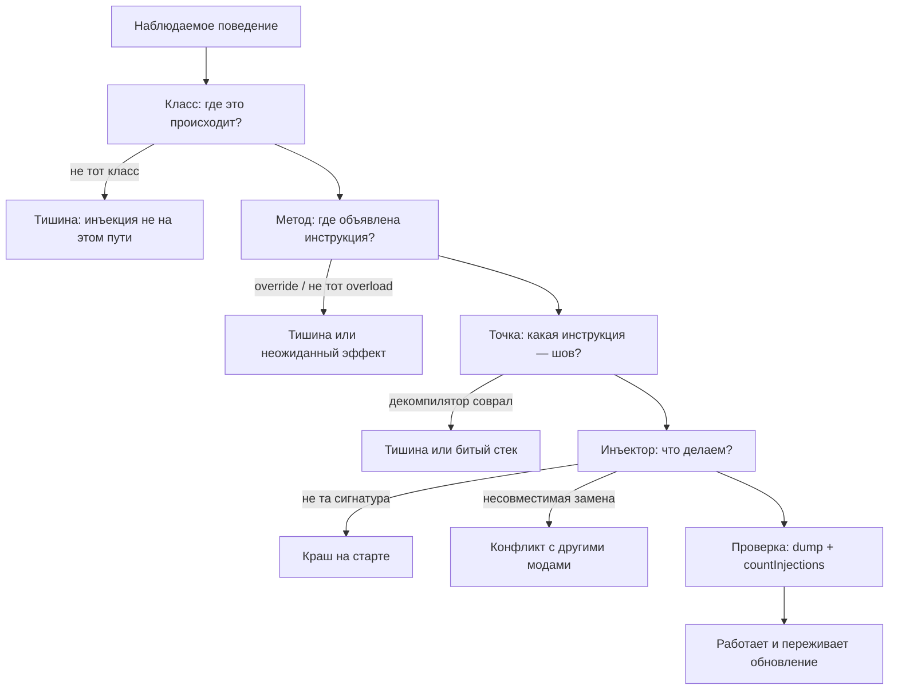
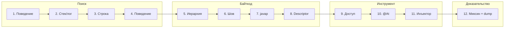
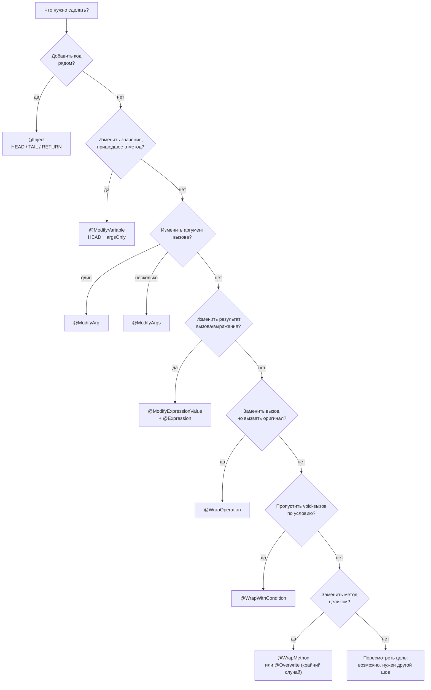
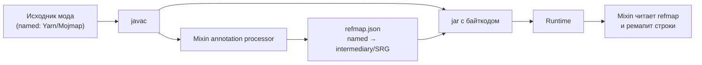

# Как понять, в какую функцию и как встраивать миксин

[← К оглавлению](README.md)

> [!NOTE]
> **TL;DR.** Любая инъекция — это четыре независимых решения: **целевой класс → целевой метод → точка вставки → инъектор**. Ошибка на любом уровне по умолчанию **не роняет игру**, а молча ничего не делает; жёсткий краш обычно случается только тогда, когда не сошлась сигнатура хендлера, не нашёлся `@Shadow` или сработал `require`. Поэтому «миксин не работает» почти всегда значит «я не доказал, что цель существует в байткоде». Этот документ — маршрут доказательства: от наблюдаемого поведения к классу, от класса к методу, от метода к инструкции, от инструкции к инъектору.

## Содержание

- [1. Модель мышления: четыре решения](#1-модель-мышления-четыре-решения)
  - [1.1. Уровни и симптомы](#11-уровни-и-симптомы)
  - [1.2. Fail-soft и fail-hard](#12-fail-soft-и-fail-hard)
  - [1.3. Воронка решений](#13-воронка-решений)
- [2. Маршрут поиска цели: 12 шагов](#2-маршрут-поиска-цели-12-шагов)
- [3. Почему декомпилятор врёт](#3-почему-декомпилятор-врёт)
- [4. Справочник `@At`](#4-справочник-at)
  - [4.1. Как Mixin выбирает инструкцию](#41-как-mixin-выбирает-инструкцию)
  - [4.2. Формат descriptor](#42-формат-descriptor)
  - [4.3. Все точки по отдельности](#43-все-точки-по-отдельности)
  - [4.4. Параметры `@At`](#44-параметры-at)
- [5. Позиционные якоря: источник боли](#5-позиционные-якоря-источник-боли)
- [6. `@Expression` и `@Definition`](#6-expression-и-definition)
  - [6.1. Подключение](#61-подключение)
  - [6.2. Синтаксис языка](#62-синтаксис-языка)
  - [6.3. Восемь примеров](#63-восемь-примеров)
  - [6.4. Ловушки языка](#64-ловушки-языка)
- [7. Выбор инъектора: матрица](#7-выбор-инъектора-матрица)
  - [7.1. Матрица: задача и инъектор](#71-матрица-задача-и-инъектор)
  - [7.2. Сигнатуры хендлеров](#72-сигнатуры-хендлеров)
  - [7.3. Цепочка совместимости](#73-цепочка-совместимости)
  - [7.4. Дерево решений](#74-дерево-решений)
- [8. Локальные переменные](#8-локальные-переменные)
- [9. Доступ к приватному](#9-доступ-к-приватному)
- [10. Namespace и remap](#10-namespace-и-remap)
- [11. Три сквозных примера](#11-три-сквозных-примера)
  - [11.1. Входящий урон](#111-входящий-урон)
  - [11.2. Строка в тултипе предмета](#112-строка-в-тултипе-предмета)
  - [11.3. Отмена ванильного вызова](#113-отмена-ванильного-вызова)
- [12. Чеклист верификации](#12-чеклист-верификации)
- [13. Антипаттерны](#13-антипаттерны)
- [Проверено на](#проверено-на)
- [Источники](#источники)

> [!TIP]
> Обозначения: `[primary]` — первоисточник (javadoc, исходник, официальная документация), `[community]` — вики/сообщество, `[draft]` — документация ещё не устоялась, `[unverified]` — не проверено в живой игре. Имена ванильных членов — **Mojmap**, если не указано иное.

---

## 1. Модель мышления: четыре решения

Миксин — не «патч исходника». Это описание того, **какую инструкцию байткода** нужно обернуть или рядом с какой инструкцией поставить вызов. Поэтому думать нужно не «где в коде это происходит», а «какая инструкция это делает и в каком методе она лежит».

Любая инъекция раскладывается на четыре решения:

| Уровень | Вопрос | Что вы должны предъявить | Чем доказывается |
| --- | --- | --- | --- |
| **1. Класс** | В каком классе живёт поведение? | `Lnet/minecraft/...;` — владелец в байткоде | стектрейс, `javap`, иерархия |
| **2. Метод** | В каком **объявленном** методе лежит нужная инструкция? | имя + descriptor `(...)...` | `javap -s`, LVT |
| **3. Точка** | Какая инструкция является швом? | `@At(...)` с `target`/`@Expression` | `javap -c`, дамп после инъекции |
| **4. Инъектор** | Что именно сделать с инструкцией? | `@Inject` / `@WrapOperation` / ... | сигнатура хендлера, поведение |

Между уровнем 2 и 3 есть ещё скрытое решение: **какой именно overload** вы выбрали. Один и тот же `name` может встречаться несколько раз с разными descriptor'ами. Mixin различает их только по descriptor'у; если descriptor не указан, он может выбрать не тот overload или применить инъекцию к нескольким сразу.

### 1.1. Уровни и симптомы

| Где ошиблись | Что происходит | Как выглядит |
| --- | --- | --- |
| **Класс** | Инъекция применилась к классу, который не участвует в вашем сценарии | «Ничего не произошло». В логе — либо тишина, либо `No candidates` |
| **Класс** | Класс — правильный, но поведение в подклассе | Базовый миксин применился, а на нужном объекте не сработал: подкласс переопределил метод и не вызвал `super` |
| **Метод** | Метод — override, а не объявление | Инъекция легла в override, который не вызывается; или наоборот — в базовый метод, который перекрыт |
| **Метод** | Не тот overload | Инъекция применилась, но к другому вызову; поведение изменилось в неожиданном месте |
| **Метод** | Метод не существует в этой версии | `No candidates` или ошибка remap'а при сборке |
| **Точка** | Инструкция не та (декомпилятор соврал) | «Ничего не произошло» или инъекция в середину выражения с битым стеком |
| **Точка** | `ordinal`/`@Slice` съехали после обновления | Работало вчера, сломалось сегодня; иногда — тихо |
| **Точка** | Вставка до инициализации аргументов/полей | `NullPointerException` или `VerifyError` на старте |
| **Инъектор** | Не та сигнатура хендлера | Жёсткий краш на старте: `InvalidInjectionException` |
| **Инъектор** | Несовместимый способ замены (`@Redirect`/`@Overwrite`) | Конфликт с другим модом: один из миксинов молча не применился |
| **Инъектор** | Взяли `@ModifyArg`, а менять надо полученное значение | Инъекция есть, но меняет не то: аргумент *вызова*, а не *метода* |

Главный вывод таблицы: **симптом «ничего не произошло» не локализует ошибку**. Он одинаков для неверного класса, неверного метода, неверной инструкции и несовместимого инъектора. Локализовать можно только диагностикой: сначала доказать, что класс и метод существуют, потом — что инструкция в них есть, и лишь потом писать миксин.

### 1.2. Fail-soft и fail-hard

Mixin по умолчанию **fail-soft**: если точка вставки не найдена, инъекция пропускается, и это не считается ошибкой. Это сделано специально, чтобы миксины переживали чужие трансформации и небольшие изменения цели. Обратная сторона — ваш собственный миксин тоже «переживёт» вашу ошибку и ничего не сделает.

Жёсткие отказы:

- **несовпадение сигнатуры хендлера** — `InvalidInjectionException` при загрузке класса;
- **`require = N`** — требует минимум N успешных инъекций, иначе `InjectionError`;
- **`expect = N` + `-Dmixin.debug.countInjections=true`** — проверка ожидаемого числа совпадений;
- **`@Overwrite`-конфликт** — два мода overwrite'ят один метод; предсказуемо работает только один;
- **ошибка доступа** (private/final без AW/AT) — на этапе применения или компиляции, в зависимости от того, что именно вы делаете.

Практическое правило: в разработке всегда включайте `countInjections` и ставьте `require = 1` на критичные инъекции. В релизе `require` можно оставить — это дешёвая страховка от тихой поломки после обновления игры.

### 1.3. Воронка решений



---

## 2. Маршрут поиска цели: 12 шагов

Ниже — маршрут, который заканчивается не «я написал миксин», а «я доказал, что он применился туда, куда я думал». Шаги 1–4 — поиск, 5–8 — проверка байткода, 9–11 — выбор инструмента, 12 — доказательство.



### Шаг 1. Сформулировать поведение как наблюдаемое событие

Не «хочу изменить урон», а «игрок в незеритовой броне получает на 20% меньше урона от `mobattack`». Чем конкретнее вход и выход, тем легче искать:

- что происходит (урон, тултип, звук, дроп, сообщение);
- при каких условиях (тип урона, предмет, измерение, фаза игры);
- где это видно (клиент/сервер, GUI/мир, лог).

Если поведение видно только на клиенте — цель почти наверняка в клиентском классе; если только на сервере — в серверной логике. Это сразу отсекает половину дерева.

### Шаг 2. Найти первое звено по стектрейсу или логу

Стек — самый дешёвый источник истины: в нём уже есть классы и методы.

- Включите `-Dmixin.debug.verbose=true`, если в стеке нужны миксины.
- Поставьте **MixinTrace** — он добавляет в стектрейсы кадры миксинов, которые участвовали в вызове.
- В IntelliJ: клик по кадру стека → `Ctrl+B` (Go to Declaration), `Ctrl+Alt+H` (Call Hierarchy).

Если краша нет, ищите лог-строку. Логи Minecraft — это `LOGGER.info("...")` с константной строкой; по ней можно найти класс, даже не зная имени метода.

### Шаг 3. Найти класс по строке

Строки — лучший якорь для первичного поиска, потому что они не зависят от mappings.

```bash
# в директории с декомпилированными исходниками
grep -rn "message.you.died" . --include=*.java
grep -rn "container.chest" . --include=*.java
grep -rn "entity.minecraft.zombie" . --include=*.java
```

Где искать:

- `assets/<ns>/lang/en_us.json` — ключ перевода → `Component.translatable("...")` в коде;
- `data/<ns>/...` — registry id, advancement, loot table;
- звуки, частицы, имена эффектов — тоже константные строки.

Если строка собирается динамически (`"block." + id`), ищите префикс и `ResourceLocation` рядом.

### Шаг 4. Найти класс по поведению

Когда строки нет, работают структурные инструменты:

| Инструмент | Что делает | Когда использовать |
| --- | --- | --- |
| `Ctrl+N` / `Ctrl+Shift+N` | поиск класса/файла по имени | знаете примерное имя |
| `Ctrl+Shift+F` | поиск по тексту | строки, ключи, константы |
| `Ctrl+Alt+H` | call hierarchy | «кто вызывает этот метод» |
| `Alt+F7` | find usages | «где используется это поле/метод» |
| `Ctrl+H` | type hierarchy | «кто наследует этот класс» |
| `mappings.dev` / Linkie | перевод имён между Yarn/Mojmap/SRG | имя в одной системе, код в другой |
| `jdx` / decompiler | быстрый просмотр чужого jar | мод/библиотека без исходников |

Для 26.x `mappings.dev` и Linkie нужны реже: имена в рантайме совпадают с именами в коде. Но для портирования с 1.21.x они всё ещё полезны.

### Шаг 5. Проверить иерархию: где метод реально объявлен

Это шаг, который пропускают чаще всего. «Метод есть у `Player`» не значит «он объявлен в `Player`».

1. `Ctrl+B` на вызове метода — IntelliJ прыгает **в объявление**, а не в override.
2. `Ctrl+Alt+B` (Go to Implementation) — показывает реализации; если их несколько, у метода есть override'ы.
3. `Ctrl+H` на классе — дерево наследников.
4. `javap -p -c` на классе — показывает, есть ли метод в этом классе физически.

Что проверить:

- **Метод объявлен в базовом классе, а вызывается на подклассе.** Инъекция в базовый метод сработает только если override вызывает `super`.
- **Метод абстрактный.** В абстрактном методе нет байткода — инъекция некуда вставлять.
- **Метод объявлен в интерфейсе, а реализация — в классе.** Инжектить нужно в класс-реализацию (или в default-метод, если он там есть).
- **Вызов идёт через `invokeinterface`.** Тогда owner в байткоде — интерфейс, даже если объект конкретного класса.

> [!TIP]
> Правило: **инжектите в тот класс, чей байткод реально исполняется на вашем пути.** Если сомневаетесь — поставьте `@Inject` с `countInjections` в оба кандидата и посмотрите, какой сработал.

### Шаг 6. Прочитать декомпилированный метод и найти «шов»

Шов (seam) — это место, за которое можно зацепиться:

- **вызов** (`this.foo(...)`, `level.bar(...)`, статический `Utils.baz(...)`);
- **доступ к полю** (`this.health`, `entity.fallDistance`);
- **сравнение** (`if (amount > 0.0F)`);
- **константа** (`0.5F`, `"text"`, `20`);
- **создание объекта** (`new ItemStack(...)`);
- **возврат** (`return this.value;`);
- **запись в поле/массив** (`this.flag = true;`).

Читая метод, выпишите для каждого кандидата:

```text
seam:      this.getDamageAfterArmorAbsorb(source, amount)
owner:     net/minecraft/world/entity/LivingEntity
desc:      (Lnet/minecraft/world/damagesource/DamageSource;F)F
kind:      INVOKEVIRTUAL
```

Если шов — **локальная переменная**, это плохой шов. Локальная переменная не является инструкцией; её нельзя обернуть. Ищите выражение, которое её производит, или инструкцию `STORE`, которая её пишет. Захват локальной — последнее средство (раздел 8).

### Шаг 7. Проверить байткод: не соврал ли декомпилятор

Декомпилятор — это реконструкция, а не источник. Проверяйте:

```bash
# class-файл цели (из dev-окружения или из .mixin.out)
javap -c -p -l -s path/to/LivingEntity.class > livingentity.txt

# только интересующий метод — глазами, но с инструкциями
javap -c -p path/to/LivingEntity.class | sed -n '/hurt(/,/^$/p'
```

Что смотреть:

- **`invokevirtual` vs `invokeinterface` vs `invokespecial` vs `invokestatic`** — от этого зависит owner и форма `target`.
- **`invokedynamic`** — лямбда или строковая конкатенация; `target` для неё задаётся иначе.
- **`synthetic`/`bridge`** — метод, которого нет в исходнике.
- **`INVOKE` на `owner`, а не на `this`** — если вызвали `super.foo()`, owner будет родитель.
- **инлайнинг констант** — `static final int` может вообще отсутствовать в байткоде как `getstatic`.
- **`-l`** — LocalVariableTable; без неё `@Local(name=...)` и `LocalCapture` не работают.

Быстрый способ в IDE: плагин **jclasslib Bytecode Viewer** или **ASM Bytecode Viewer** — показывает инструкции рядом с исходником; **MCDev** умеет рисовать байткод как выражения (MixinExtras Flowchart).

### Шаг 8. Получить точный descriptor

Descriptor — это то, что Mixin реально сравнивает. Ошибка в одном символе даёт «ничего не произошло».

Способы:

```bash
javap -s -p path/to/Target.class
```

```text
public boolean hurt(net.minecraft.world.damagesource.DamageSource, float);
  descriptor: (Lnet/minecraft/world/damagesource/DamageSource;F)Z
```

Или в IntelliJ: `Ctrl+Alt+Shift+C` (Copy Reference) → преобразовать в descriptor вручную. Для полей:

```text
private float fallDistance;
  descriptor: F
```

полный вид для `@At`: `Lnet/minecraft/world/entity/Entity;fallDistance:F`.

Правила:

- внутренние классы — через `$`: `Lnet/minecraft/world/item/Item$TooltipContext;`;
- generics стираются: `List<Component>` → `Ljava/util/List;`;
- массивы — `[`: `[Ljava/lang/String;`, `[F`;
- примитивы — одна буква: `Z B C S I J F D V`;
- конструктор в `@At(INVOKE)` — `<init>`, возврат `V`.

### Шаг 9. Проверить модификаторы и доступ

```bash
javap -p path/to/Target.class | grep -E "hurt|fallDistance"
```

| Что нашли | Можно ли инжектить | Что нужно дополнительно |
| --- | --- | --- |
| `public`/`protected` метод | да | ничего |
| `private` метод | да, инъекция в него возможна | чтобы **вызвать** его из своего кода — `@Shadow`/`@Invoker`/AW |
| `final` метод | да, инъекция возможна | override/наследование невозможны; для вызова — обычно можно |
| `static` метод | да | хендлер тоже `static` (для redirect-подобных) |
| `final` класс | инъекция возможна | нельзя наследоваться; `@Mixin` работает |
| поле `private` | чтение/запись — через `@Shadow`/`@Accessor` | `@Shadow @Final` для чтения, `@Mutable` для записи |
| поле `final` | читать можно | писать — только `@Mutable` или AW `mutable` |

Важно не путать две разные проблемы:

1. **Инжектить** в private/final метод можно — Mixin правит байткод класса изнутри.
2. **Обращаться** к private/final члену из своего кода нельзя без `@Shadow`, `@Accessor`, `@Invoker`, AW/AT.

### Шаг 10. Выбрать точку вставки

Точка должна быть **структурной**, то есть описывать инструкцию, а не её номер:

- плохо: «пятый `INVOKE` в методе»;
- хорошо: «вызов `LivingEntity.getDamageAfterArmorAbsorb(DamageSource, float)`»;
- отлично: «сравнение `this.fallDistance > 0.0`» через `@Expression`.

Порядок предпочтений:

1. `@Expression` + `MIXINEXTRAS:EXPRESSION` — если выражение однозначно;
2. `@At(INVOKE/FIELD/NEW/CONSTANT)` с точным `target` — если шов — одна инструкция;
3. `HEAD`/`TAIL`/`RETURN` — если нужен весь метод целиком;
4. `ordinal` — только если все совпадения действительно неразличимы и их порядок стабилен;
5. `@Slice`/`shift = BY` — только как временная мера с комментарием, почему иначе нельзя.

В IDE откройте Bytecode Viewer на кандидате и убедитесь, что инструкция существует и она одна. Если их несколько — сузьте `target` или переходите к `@Expression`.

### Шаг 11. Выбрать инъектор

Инъектор выбирается по вопросу «что я делаю с инструкцией», а не по привычке:

- **добавить код рядом** → `@Inject`;
- **изменить значение, пришедшее в метод** → `@ModifyVariable`;
- **изменить аргумент вызова** → `@ModifyArg`/`@ModifyArgs`;
- **изменить результат вызова/выражения** → `@ModifyExpressionValue`;
- **заменить вызов, сохранив возможность вызвать оригинал** → `@WrapOperation`;
- **пропустить void-вызов или запись в поле по условию** → `@WrapWithCondition`;
- **изменить получателя вызова** → `@ModifyReceiver`;
- **изменить возвращаемое значение метода** → `@ModifyReturnValue`;
- **обернуть метод целиком** (try/catch, тайминг) → `@WrapMethod`;
- **полностью заменить метод** → `@Overwrite` (крайний случай).

Подробная матрица — в разделе 7. Перед тем как писать, сверьте сигнатуру хендлера с javadoc инъектора: MCDev подсказывает её при наведении на аннотацию, но истина — в javadoc и в дампе.

### Шаг 12. Написать миксин и проверить применимость

Минимальный цикл:

```groovy
// build.gradle: флаги должны попасть в JVM игры, а не в JVM Gradle
loom {
    runs {
        client {
            vmArgs "-Dmixin.debug.export=true",
                   "-Dmixin.debug.countInjections=true"
        }
    }
}
```

> [!WARNING]
> `./gradlew runClient -Dmixin.debug.export=true` не гарантирует, что флаг увидит игра: он попадёт в JVM Gradle, а клиент запускается в отдельном форке. Надёжнее — `vmArgs`/`jvmArgs` в конфигурации run'а или переменная `JAVA_TOOL_OPTIONS`.

После этого:

```bash
./gradlew runClient
```

Затем:

1. найдите свой хендлер в дампе `.mixin.out/class/...`;
2. убедитесь, что вызов стоит **до/после нужной инструкции**, а не в другом месте;
3. проверьте, что инъекция не попала в чужой overload;
4. только после этого проверяйте поведение в игре.

Если дампа нет — смотрите раздел 12. Если инъекция не применилась — раздел 4 и `04-mixin-debugging.md`.

---

## 3. Почему декомпилятор врёт

Декомпилятор восстанавливает *читаемый* код, а Mixin работает с *инструкциями*. Между ними есть систематические расхождения. Ниже — те, что чаще всего ломают миксины.

| Исходник | Что в байткоде | Почему миксин промахнётся | Что делать |
| --- | --- | --- | --- |
| `static final int LIMIT = 20;` | `20` прямо в `ldc`/`bipush`, без `getstatic` | `@At(FIELD, target="...LIMIT:I")` не найдёт ничего | искать `CONSTANT`/`@Expression` по значению; либо менять саму константу |
| `"a" + b + "c"` (Java 9+) | `invokedynamic makeConcatWithConstants` | `@At(INVOKE, target="Ljava/lang/StringBuilder;append...")` не сработает | целиться в `invokedynamic` или в метод, где строка используется |
| `for (X x : list)` | `iterator()`, `hasNext()`, `next()`, `checkcast` | в исходнике нет `iterator`, в байткоде есть | целиться в `Iterator.next()` или в тело цикла |
| `Integer x = 5;` | `Integer.valueOf(5)` | `@At(NEW, target="Ljava/lang/Integer;")` не найдёт | `@At(INVOKE, target="Ljava/lang/Integer;valueOf(I)Ljava/lang/Integer;")` |
| `list.forEach(x -> ...)` | `invokedynamic` + `private static synthetic lambda$method$0` | цель — не `forEach`, а synthetic-метод | инжектить в `lambda$...$0` или обернуть `Consumer.accept` |
| `class Foo implements Comparable<Foo>` | `bridge`-метод `compareTo(Object)` → `compareTo(Foo)` | инъекция в `compareTo(Object)` может не выполниться | целиться в конкретный descriptor, проверить `ACC_BRIDGE` |
| анонимный класс | поле `this$0`, конструктор с внешним `this` | в исходнике поля нет | `@Shadow` на `this$0` или инжект в конструктор |
| `assert x > 0;` | `getstatic $assertionsDisabled:Z` + ветка | в исходнике нет поля | не целиться в `assert`; искать реальную проверку |
| `try (var r = ...)` | `close()`, `addSuppressed` | декомпилятор прячет `addSuppressed` | целиться в `close()` |
| `switch (enumValue)` | synthetic `$SwitchMap$...` + `ordinal()` | в исходнике нет `$SwitchMap` | целиться в `ordinal()`/`getstatic` или в `@Expression` |
| `record Point(int x, int y)` | generated `equals/hashCode/toString` через `invokedynamic` | методы есть, но их тело — bootstrap | не инжектить в `equals` record'а без нужды |
| `i++` на поле | `getfield`, `iconst_1`, `iadd`, `putfield` | это не атомарно и не один «шов» | целиться в `putfield` или в метод целиком |
| `synchronized (lock)` | `monitorenter`/`monitorexit` + handler | декомпилятор показывает блок, не инструкции | `@WrapMethod` вместо возни с монитором |
| `foo(1, 2, 3)` при `foo(int...)` | `anewarray` + заполнение | аргумент — массив, а не три int | `@ModifyArg` на массив или `@Expression` |
| `x ? a : b` | `ifeq` + два `goto` | нет «тернарного оператора» как инструкции | `@Expression` не матчит jumps; брать ветку/`@WrapOperation` |

Пример реального расхождения:

```java
// декомпилятор показывает:
if (this.fallDistance > 0.0F) {
    this.doFallDamage();
}

// байткод (упрощённо):
aload_0
getfield   net/minecraft/world/entity/Entity.fallDistance : F
fconst_0
fcmpl
ifle       L123
aload_0
invokevirtual net/minecraft/world/entity/Entity.doFallDamage()V
L123:
```

Здесь нет «сравнения» как отдельной инструкции — есть `fcmpl` + `ifle`. `@At(value = "JUMP", opcode = Opcodes.IFLE)` попадёт в *условие выхода*, а не в «место, где сравниваются значения». `@Expression("this.fallDistance > 0.0")` описывает именно сравнение и устойчивее к перестановке инструкций.

Ещё один типичный случай — **инлайнинг константы**:

```java
private static final int MAX_COUNT = 64;

public int getMaxCount() {
    return MAX_COUNT; // в байткоде: bipush 64; ireturn
}
```

`@At(value = "FIELD", target = "L...;MAX_COUNT:I")` не найдёт ничего: поля в этом методе нет. Нужен `@At(value = "CONSTANT", args = "intValue=64")` или `@Expression("return 64")`.

> [!WARNING]
> Если декомпилятор показывает `this.someMethod()` — это ещё не значит, что в байткоде есть `INVOKEVIRTUAL` на `this`. Это может быть `invokespecial` (private/super), `invokestatic` (после оптимизации) или вообще заинлайненный вызов. Всегда проверяйте `javap -c`.

---

## 4. Справочник `@At`

### 4.1. Как Mixin выбирает инструкцию

Порядок такой:

1. **Injection point** (`@At.value`) сканирует метод и возвращает **список** подходящих инструкций.
2. **Фильтры** (`target`, `opcode`, `args`) сужают список.
3. **`ordinal`** выбирает одну инструкцию из оставшихся (или все, если `-1`).
4. **`shift`/`by`** сдвигает точку вставки на соседнюю инструкцию.
5. **`@Slice`** ограничивает область сканирования.

Ключевое: `target` применяется **до** `ordinal`. Если в методе четыре `INVOKE`, но только два совпадают с `target`, то `ordinal = 1` выберет второй **совпавший**, а не второй вообще.

По умолчанию точка матчит **инструкцию**, и вставка происходит **перед** ней. `shift = AFTER` переносит вставку за инструкцию.

### 4.2. Формат descriptor

| Что | Формат | Пример |
| --- | --- | --- |
| примитив | одна буква | `I`, `F`, `Z`, `V` |
| объект | `Lpkg/Class;` | `Lnet/minecraft/world/entity/LivingEntity;` |
| внутренний класс | `Lpkg/Outer$Inner;` | `Lnet/minecraft/world/item/Item$TooltipContext;` |
| массив | `[` + компонент | `[F`, `[Ljava/lang/String;` |
| метод в `@At` | `Lowner;name(params)ret` | `Lnet/minecraft/world/entity/LivingEntity;getHealth()F` |
| конструктор | `Lowner;<init>(params)V` | `Lnet/minecraft/world/item/ItemStack;<init>(Lnet/minecraft/world/item/ItemLike;)V` |
| поле в `@At` | `Lowner;name:Type` | `Lnet/minecraft/world/entity/Entity;fallDistance:F` |
| `NEW` | `Lowner;` или `(params)Lowner;` | `Lnet/minecraft/world/item/ItemStack;` |
| метод (descriptor) | `(params)ret` | `(Lnet/minecraft/world/damagesource/DamageSource;F)Z` |

Полный `target` для `INVOKE` — это `owner + name + descriptor` без пробелов:

```text
Lnet/minecraft/world/entity/LivingEntity;hurt(Lnet/minecraft/world/damagesource/DamageSource;F)Z
```

Если забыть `L...;` и написать `LivingEntity.hurt(...)`, annotation processor может не заремапить ссылку, а в рантайме `target` не совпадёт.

### 4.3. Все точки по отдельности

Сводка применимых параметров (подробности — в подразделах ниже):

| Точка | `target` | `ordinal` | `opcode` | `args` | `shift` |
| --- | --- | --- | --- | --- | --- |
| `HEAD` | — | — | — | — | да |
| `RETURN` | — | да | — | — | да |
| `TAIL` | — | — | — | — | да |
| `INVOKE` | да | да | — | — | да |
| `INVOKE_ASSIGN` | да | да | — | — | да |
| `FIELD` | да | да | да | да (array) | да |
| `NEW` | да | да | — | да (`class`) | да |
| `CONSTANT` | — | да | — | да | да |
| `JUMP` | — | да | да | — | да |
| `LOAD` / `STORE` | — | да | — | — | — |
| `MIXINEXTRAS:EXPRESSION` | — | да | — | — | да |

`slice` — это id слайса, он передаётся в `@At(slice = "...")` и имеет смысл только для `@Inject` (у остальных инъекторов поддерживается один слайс). `by` используется только вместе с `shift = BY`.

#### `HEAD`

Первая инструкция метода (или первая инструкция слайса). Ровно одна точка.

- Параметры: нет.
- Когда: добавить код в начало, инициализировать состояние, отменить метод до выполнения.
- Осторожно: в конструкторе `HEAD` — это **до** вызова `super(...)` и до инициализации полей.

```java
@Inject(method = "hurt", at = @At("HEAD"), cancellable = true)
private void beforeHurt(DamageSource source, float amount, CallbackInfoReturnable<Boolean> cir) {
    if (MyMod.isImmune(source)) {
        cir.setReturnValue(false); // setReturnValue отменяет метод
    }
}
```

#### `RETURN`

Каждая инструкция `RETURN`/`IRETURN`/... в методе. Если `ordinal` не указан — все.

- Параметры: `ordinal`.
- Когда: нужно увидеть/изменить возвращаемое значение в каждой точке выхода.
- Для не-void метода хендлер получает `CallbackInfoReturnable<T>`; `cir.getReturnValue()` доступен.

```java
@Inject(method = "getMaxDamage", at = @At("RETURN"), cancellable = true)
private void modifyMaxDamage(CallbackInfoReturnable<Integer> cir) {
    cir.setReturnValue(cir.getReturnValue() + 10);
}
```

#### `TAIL`

Последняя `RETURN`-инструкция метода. Не «конец исходника»: при ранних `return` последняя инструкция может быть не той, что вы думаете.

- Параметры: нет.
- Когда: «после всей логики, перед финальным выходом».
- Не используйте `TAIL`, если метод может завершиться исключением: код не выполнится.

```java
@Inject(method = "tick", at = @At("TAIL"))
private void afterTick(CallbackInfo ci) {
    MyMod.onTickEnd((Entity) (Object) this);
}
```

#### `INVOKE`

Инструкции вызова: `invokevirtual`, `invokestatic`, `invokeinterface`, `invokespecial`.

- Параметры: `target` (почти всегда), `ordinal`, `shift`.
- `target` обязателен для точности: без него точка матчит все вызовы.
- Для `super.foo()` owner — родительский класс, не `this`.
- Для конструктора — `<init>` и возврат `V`.

```java
@At(
    value = "INVOKE",
    target = "Lnet/minecraft/world/entity/LivingEntity;getDamageAfterArmorAbsorb(Lnet/minecraft/world/damagesource/DamageSource;F)F"
)
```

#### `INVOKE_ASSIGN`

Точка **после** вызова, но только если у вызова не-void возврат. Если результат сразу сохраняется в локальную (`STORE`), точка встаёт **после `STORE`**.

- Параметры: `target`, `ordinal`, `shift`.
- Когда: нужно значение, которое вернул вызов, уже лежащее в локальной/на стеке.
- Не работает с void-вызовами.

```java
@At(
    value = "INVOKE_ASSIGN",
    target = "Lnet/minecraft/world/entity/Entity;getDeltaMovement()Lnet/minecraft/world/phys/Vec3;"
)
```

#### `FIELD`

`GETFIELD`, `PUTFIELD`, `GETSTATIC`, `PUTSTATIC`.

- Параметры: `target`, `opcode`, `ordinal`.
- `target` — `Lowner;name:Type`.
- `opcode` — сузить до чтения или записи.
- Для массива можно матчить доступ к элементу: `args = "array=get"`, `"array=set"` или `"array=length"` (см. `@Redirect`/`@WrapOperation`).

```java
@At(
    value = "FIELD",
    target = "Lnet/minecraft/world/entity/Entity;fallDistance:F",
    opcode = Opcodes.GETFIELD
)
```

#### `NEW`

Инструкция `NEW` (создание объекта), **не** вызов конструктора.

- Параметры: `target`, `ordinal`.
- `target = "Lowner;"` — любой конструктор этого класса.
- `target = "(params)Lowner;"` — конкретный конструктор (возврат — тип объекта, не `V`).
- Точка стоит **перед** `NEW`; `shift = AFTER` — после `NEW`, но до `<init>` (объект ещё не инициализирован — осторожно).

```java
@At(value = "NEW", target = "(Lnet/minecraft/world/item/ItemLike;)Lnet/minecraft/world/item/ItemStack;")
```

#### `CONSTANT`

`LDC` и специализированные константные инструкции (`bipush`, `sipush`, `iconst_*`, `fconst_*`, `aconst_null` и т.д.).

- Параметры: `ordinal`, named-аргументы `intValue`, `floatValue`, `longValue`, `doubleValue`, `stringValue`, `classValue`, `nullValue`.
- Только **один** дискриминатор за раз; два — ошибка.
- `expandZeroConditions` — для `if (x >= 0)`, где `0` не существует отдельной инструкцией.

```java
// три независимых варианта — в одной инъекции используется один:
@At(value = "CONSTANT", args = "floatValue=0.5")
@At(value = "CONSTANT", args = "stringValue=foo")
@At(value = "CONSTANT", args = {"intValue=0", "expandZeroConditions=GREATER_THAN_ZERO"})
```

#### `JUMP`

Условные и безусловные переходы: `IFEQ`, `IFNE`, `IF_ICMP*`, `IF_ACMP*`, `IFNULL`, `IFNONNULL`, `GOTO`, `JSR`.

- Параметры: `opcode`, `ordinal`.
- Когда: нужно поймать «ветку», а не вызов. Часто проще `@Expression`.

```java
@At(value = "JUMP", opcode = Opcodes.IFLT) // if (value < 0)
```

#### `LOAD` / `STORE`

Это **контекстные** точки: они работают только с `@ModifyVariable` и используют дискриминатор переменной, заданный в самом `@ModifyVariable` (`ordinal`/`index`/`name`), а не в `@At`. Это не универсальные «загрузка/запись любой локальной».

- `LOAD` — `xLOAD` для выбранной переменной.
- `STORE` — `xSTORE` для выбранной переменной.
- Когда: изменить значение локальной в момент чтения/записи.

```java
@ModifyVariable(method = "tick", at = @At("STORE"), ordinal = 0)
private int modifyLocal(int original) {
    return original + 1;
}
```

#### `MIXINEXTRAS:EXPRESSION`

Точка, которая берёт цель из `@Expression`. Требует MixinExtras 0.5.0+ и записи `"mixinextras": {"minVersion": "..."}` в mixin config.

- Параметры: `shift`, `ordinal`, `slice` — как у обычной точки.
- Работает с `@Inject`, `@ModifyExpressionValue`, `@WrapOperation`, `@ModifyReceiver`, `@WrapWithCondition` и другими инъекторами.
- По умолчанию цель — «последняя» инструкция выражения; можно указать `@(...)`.

```java
@At("MIXINEXTRAS:EXPRESSION")
```

### 4.4. Параметры `@At`

| Параметр | Тип | Что делает | Когда использовать |
| --- | --- | --- | --- |
| `value` | `String` | код точки (`HEAD`, `INVOKE`, ...) | всегда |
| `target` | `String` | член/тип для `INVOKE`, `FIELD`, `NEW`, `INVOKE_ASSIGN` | почти всегда для этих точек |
| `ordinal` | `int` | выбрать N-е совпадение (0-based) | только если совпадения неразличимы |
| `opcode` | `int` | фильтр по opcode для `FIELD`/`JUMP` | чтение vs запись, конкретный jump |
| `args` | `String[]` | named-аргументы точки (`intValue=...`, `class=...`, `ldc=...`) | `CONSTANT`, `NEW`, `INVOKE_STRING` |
| `shift` | `At.Shift` | `NONE`, `BEFORE`, `AFTER`, `BY` | вставка после инструкции |
| `by` | `int` | количество инструкций для `shift = BY` | почти никогда; хрупко |
| `slice` | `String` | id слайса для `@Inject` | ограничить область поиска |
| `remap` | `boolean` | ремапить ли `target` | `false` для модовых/своих целей |
| `unsafe` | `boolean` | разрешить инъекцию в конструктор не только на `RETURN` | только осознанно |
| `id` | `String` | id точки, доступный в `CallbackInfo#getId` | несколько точек в одном хендлере |

> [!NOTE]
> `args` — это **не** «типы аргументов вызова». Для `INVOKE` типы уже входят в `target` (descriptor). `args` — named-параметры конкретного класса injection point. Это частая ошибка при чтении чужих примеров.

---

## 5. Позиционные якоря: источник боли

Позиционные якоря — это `ordinal`, `@Slice`, `shift = BY`. Все они описывают **порядок инструкций**, а не их смысл. Любое изменение кода меняет порядок.

### 5.1. Почему `ordinal` ломается

```java
// версия 1
public void tick() {
    this.updateFluid();     // INVOKE #0
    this.updateFire();      // INVOKE #1  <- цель, ordinal = 1
    this.updatePortal();
}
```

```java
// версия 2: добавили лог
public void tick() {
    this.logTick();         // INVOKE #0  <- сдвиг
    this.updateFluid();     // INVOKE #1
    this.updateFire();      // INVOKE #2  <- цель теперь ordinal = 2
    this.updatePortal();
}
```

Mixin не падает: он вставляет код перед `updateFluid` и «ничего не происходит». Если бы `updateFluid` возвращал значение, мог бы измениться смысл.

`ordinal` считается **после** `target`. Поэтому `ordinal = 0` при точном `target` часто безопасен: если вызов один, ordinal ничего не делает. Опасен `ordinal` без `target` или с `target`, который матчит несколько вызовов.

### 5.2. Почему `@Slice` ломается

`@Slice` ограничивает поиск между двумя якорями:

```java
@Slice(
    from = @At(value = "INVOKE", target = "L...;start()V"),
    to   = @At(value = "INVOKE", target = "L...;end()V")
)
```

Проблемы:

- якорь `start()` может быть заинлайнен или переименован;
- между якорями может появиться второй `end()`;
- если `from` и `to` поменялись местами (например, из-за рефакторинга), слайс станет пустым;
- `@Slice` не говорит, **что** вы ищете внутри, — только **где**.

### 5.3. Почему `shift = BY` ломается

`shift = BY, by = 2` означает «сдвинься на две инструкции». Это работает ровно до тех пор, пока компилятор не изменит количество инструкций между якорем и целью. Смена версии Java, `-g`, `-parameters`, другой декомпилятор — и смещение другое.

### 5.4. Правило

> [!IMPORTANT]
> Если вам хочется добавить `ordinal`, `@Slice` или `shift = BY`, сначала попробуйте `@Expression`. Если выражение невозможно — добавьте `target` такой точности, чтобы совпадение было единственным. И только если сам шов физически неразличим (два одинаковых вызова подряд), используйте `ordinal` — с комментарием, почему.

Когда `ordinal` всё-таки уместен:

- два абсолютно одинаковых вызова в одном методе, и вам нужен второй;
- `@Expression` уже сузил область, и внутри неё осталось ровно два кандидата;
- `RETURN` с несколькими точками выхода, и нужна конкретная.

Во всех остальных случаях `ordinal` — это долг, который придётся платить при каждом обновлении.

---

## 6. `@Expression` и `@Definition`

`@Expression` — язык MixinExtras, который описывает **выражение байткода** в Java-подобном виде. Он не «читает исходник»: он сопоставляет инструкции. Но он устойчивее `ordinal`, потому что привязан к структуре (кто кого вызывает, что с чем сравнивается), а не к номеру.

### 6.1. Подключение

Нужен MixinExtras **0.5.0+**. На Fabric он входит в Loader начиная с 0.17.0; на NeoForge (1.20.2+) поставляется с загрузчиком. На Forge 1.20.1 его нужно подключать отдельно (jar-in-jar).

В mixin config:

```json
{
  "required": true,
  "package": "com.example.mixin",
  "compatibilityLevel": "JAVA_21",
  "mixins": ["LivingEntityMixin"],
  "mixinextras": {
    "minVersion": "0.5.0"
  }
}
```

Без `mixinextras.minVersion` выражения могут не включиться или включиться с другим поведением.

`compatibilityLevel` должен соответствовать версии Java игры: `JAVA_17` для 1.20.1, `JAVA_21` для 1.20.5–1.21.11, `JAVA_25` для 26.x. Неподдерживаемое значение — жёсткий отказ на старте.

### 6.2. Синтаксис языка

| Категория | Синтаксис | Пример |
| --- | --- | --- |
| Литералы | строка, число, `true`, `false`, `null` | `'hello'`, `23`, `0xFF`, `1.5`, `null` |
| Унарные | `-x`, `~x` | `-this.health` |
| Бинарные | `+ - * / % << >> >>> & ^` и побитовое ИЛИ | `this.x + 1` |
| Сравнения | `== != < <= > >=` | `this.fallDistance > 0.0` |
| Идентификатор | `name` (load), `name = value` (store) | `this.flag`, `local = ?` |
| Поле | `x.field`, `x.field = value` | `this.fallDistance` |
| Вызов | `x.method(args)`, `staticMethod(args)` | `this.emitGameEvent(EVENT, ?)` |
| Wildcard | `?`, `obj.?`, `obj.?(arg)` | `?.putShort('Fire', ?)` |
| Массив | `arr[i]`, `arr[i] = v` | `this.deltas[?] = ?` |
| Создание массива | `new T[]{...}`, `new T[n]` | `new int[]{1, 2}` |
| Каст | `(Type) expr` | `(ServerPlayer) ?` |
| `instanceof` | `x instanceof Type` | `? instanceof ServerPlayer` |
| Создание объекта | `new Type(args)` | `new ItemStack(?)` |
| Лямбды/ссылки | `::method`, `obj::method`, `Type::new` | `this::tick` |
| `return`/`throw` | `return expr`, `throw expr` | `return this.distance < ? * ?` |
| Явная цель | `@(expr)` | `@(new ItemStack(?))` |

`@Definition` объявляет идентификаторы:

```java
@Definition(id = "fallDistance", field = "Lnet/minecraft/world/entity/Entity;fallDistance:F")
@Definition(id = "hurt", method = "Lnet/minecraft/world/entity/LivingEntity;hurt(Lnet/minecraft/world/damagesource/DamageSource;F)Z")
@Definition(id = "ServerPlayer", type = ServerPlayer.class)
@Definition(id = "blockState", local = @Local(type = BlockState.class))
```

- `id` — имя, которое вы используете в выражении;
- `field`/`method` — тот же формат, что в `@At`;
- `type` — `Class<?>` для `new`, `instanceof`, каста;
- `local` — локальная переменная (по типу/ordinal/index);
- статические члены пишутся **без получателя**: `ENTITY_MOUNT`, а не `GameEvent.ENTITY_MOUNT`.

### 6.3. Восемь примеров

#### Пример 1. Сравнение поля с константой

Исходник:

```java
if (this.fallDistance > 0.0F) {
    this.doFallDamage();
}
```

```java
@Definition(id = "fallDistance", field = "Lnet/minecraft/world/entity/Entity;fallDistance:F")
@Expression("this.fallDistance > 0.0")
@ModifyExpressionValue(method = "fall", at = @At("MIXINEXTRAS:EXPRESSION"))
private boolean keepFalling(boolean original) {
    return original || MyMod.shouldFall(this);
}
```

Здесь `@Expression` возвращает результат сравнения (последняя инструкция — `ifle`), а `@ModifyExpressionValue` меняет `boolean`.

#### Пример 2. `instanceof`

Исходник:

```java
if (entity instanceof ServerPlayer) {
    ...
}
```

```java
@Definition(id = "ServerPlayer", type = ServerPlayer.class)
@Expression("? instanceof ServerPlayer")
@WrapOperation(method = "interact", at = @At("MIXINEXTRAS:EXPRESSION"))
private boolean wrapInstanceOf(Object obj, Operation<Boolean> original) {
    if (obj instanceof MyFakePlayer) {
        return true;
    }
    return original.call(obj);
}
```

`@WrapOperation` для `instanceof` получает `(Object, Operation<Boolean>)` и возвращает `boolean`.

#### Пример 3. Вызов с аргументом

Исходник:

```java
this.emitGameEvent(GameEvent.ENTITY_MOUNT, passenger);
```

```java
@Definition(id = "emitGameEvent", method = "Lnet/minecraft/world/entity/Entity;emitGameEvent(Lnet/minecraft/world/level/gameevent/GameEvent;Lnet/minecraft/world/entity/Entity;)V")
@Definition(id = "ENTITY_MOUNT", field = "Lnet/minecraft/world/level/gameevent/GameEvent;ENTITY_MOUNT:Lnet/minecraft/world/level/gameevent/GameEvent;")
@Expression("this.emitGameEvent(ENTITY_MOUNT, ?)")
@Inject(method = "addPassenger", at = @At(value = "MIXINEXTRAS:EXPRESSION", shift = At.Shift.AFTER))
private void afterMount(CallbackInfo ci) {
    MyMod.onMount((Entity) (Object) this);
}
```

`shift = AFTER` ставит вставку после вызова. Wildcard `?` заменяет второй аргумент, который нам не важен.

> [!NOTE]
> Пакет `GameEvent` — namespace-зависимый: в Mojmap 1.20.1 это `net/minecraft/world/level/gameevent/GameEvent`, в Yarn — `net/minecraft/world/event/GameEvent`. Пример из вики MixinExtras использует Yarn-путь; при копировании всегда сверяйте descriptor со своей IDE/`javap`.

#### Пример 4. Доступ к массиву

Исходник:

```java
this.pistonMovementDelta[i] = d;
```

```java
@Expression("this.pistonMovementDelta[?] = ?")
@WrapOperation(method = "move", at = @At("MIXINEXTRAS:EXPRESSION"))
private void wrapArraySet(double[] array, int index, double value, Operation<Void> original) {
    original.call(array, index, value * 0.5);
}
```

`@WrapOperation` для записи в массив получает `(ElementType[], int, ElementType, Operation<Void>)`.

#### Пример 5. Создание объекта

Исходник:

```java
new BlockStateParticleEffect(ParticleTypes.BLOCK, blockState)
```

```java
@Definition(id = "BlockStateParticleEffect", type = BlockStateParticleEffect.class)
@Definition(id = "BLOCK", field = "Lnet/minecraft/core/particles/ParticleTypes;BLOCK:Lnet/minecraft/core/particles/ParticleType;")
@Expression("new BlockStateParticleEffect(BLOCK, ?)")
@ModifyExpressionValue(method = "spawnSprintingParticles", at = @At("MIXINEXTRAS:EXPRESSION"))
private BlockStateParticleEffect wrapParticle(BlockStateParticleEffect original) {
    return MyMod.replaceParticle(original);
}
```

`new` в выражении — это `NEW` + `<init>`; `@Definition(type=...)` обязателен.

#### Пример 6. Каст

Исходник:

```java
ServerPlayer player = (ServerPlayer) entity;
```

```java
@Definition(id = "ServerPlayer", type = ServerPlayer.class)
@Expression("(ServerPlayer) ?")
@WrapOperation(method = "handle", at = @At("MIXINEXTRAS:EXPRESSION"))
private ServerPlayer wrapCast(Object obj, Operation<ServerPlayer> original) {
    if (obj instanceof MyPlayerProxy proxy) {
        return proxy.delegate();
    }
    return original.call(obj);
}
```

Для каста `@WrapOperation` получает `(Object, Operation<CastType>)`.

#### Пример 7. Проверка на `null`

Исходник:

```java
if (this.vehicle == null) {
    this.stopRiding();
}
```

```java
@Definition(id = "vehicle", field = "Lnet/minecraft/world/entity/Entity;vehicle:Lnet/minecraft/world/entity/Entity;")
@Expression("this.vehicle == null")
@ModifyExpressionValue(method = "tick", at = @At("MIXINEXTRAS:EXPRESSION"))
private boolean isReallyNull(boolean original) {
    return original && !MyMod.hasVirtualVehicle(this);
}
```

`null`-сравнение компилируется в `IFNULL`/`IFNONNULL`; это одна из немногих сравнений, которые в байткоде различимы (в отличие от `== 0`).

#### Пример 8. Вызов `String.equals` с литералом

Исходник:

```java
if (name.equals("Steve")) {
    ...
}
```

```java
@Definition(id = "equals", method = "Ljava/lang/String;equals(Ljava/lang/Object;)Z")
@Expression("?.equals('Steve')")
@ModifyExpressionValue(method = "checkName", at = @At("MIXINEXTRAS:EXPRESSION"))
private boolean allowAlexToo(boolean original, @Local(argsOnly = true, ordinal = 0) String name) {
    return original || "Alex".equals(name);
}
```

Строки в выражении — в **одинарных** кавычках, потому что вся строка выражения уже в двойных.

### 6.4. Ловушки языка

Из официальной документации MixinExtras:

1. **`true`/`false` неотличимы от `1`/`0`.** `? != 0` может сматчить `if (flag)`, а `? == 0` — `if (!flag)`.
2. **`char` — это число.** `'A'` эквивалентно `65`.
3. **Сравнения неотличимы от инверсий.** `x >= y` в байткоде выглядит как `x < y` с противоположным переходом. Для `float`/`double` это не так из-за `NaN`, но для целых — да.
4. **`== 0`/`!= 0` особенно опасны.** Используйте более конкретное выражение, а не wildcard.
5. **Нет `&&`, `||`, `!`.** Логические операторы компилируются в jumps, а выражения с jumps не матчатся. Wildcard `?` может заменить такой фрагмент, но не цельтесь в него инъектором.
6. **Сравнение должно быть верхним уровнем.** Нельзя `print(a == b)`; можно `a == b` целиком.
7. **Не цельтесь в wildcard.** Вы не знаете его конкретный тип, а хендлер должен иметь правильную сигнатуру.
8. **Одинарные кавычки для строк и char.** Внутри `@Expression("...")` двойные кавычки сломают строку.

---

## 7. Выбор инъектора: матрица

### 7.1. Матрица: задача и инъектор

| Задача | Инъектор | Почему именно он | Цепляется? |
| --- | --- | --- | --- |
| Добавить код в начало/конец метода | `@Inject` (`HEAD`/`TAIL`) | не меняет существующие инструкции | да |
| Перехватить возврат метода | `@Inject` (`RETURN`) + `CallbackInfoReturnable` | прямой доступ к `return` | да |
| Заменить возвращаемое значение | `@ModifyReturnValue` | короче и безопаснее, чем `RETURN` + `setReturnValue` | да |
| Изменить полученный аргумент метода | `@ModifyVariable` (`HEAD`/`argsOnly`) | работает с локальной-аргументом | да |
| Изменить локальную переменную | `@ModifyVariable` (`STORE`/`LOAD`) | штатный способ без захвата локалей | да |
| Изменить аргумент вызова | `@ModifyArg` | точечно, по `index` | да |
| Изменить несколько аргументов вызова | `@ModifyArgs` | один хендлер, `Args` API | да |
| Изменить результат вызова/выражения | `@ModifyExpressionValue` | не заменяет вызов, видит результат | да |
| Заменить/обернуть вызов с доступом к оригиналу | `@WrapOperation` | `original.call(...)`, вложенные обёртки | да |
| Условно пропустить void-вызов | `@WrapWithCondition` | возвращает `boolean`, не ломает цепочку | да |
| Условно пропустить запись в поле | `@WrapWithCondition` | то же для `PUTFIELD` | да |
| Изменить получателя вызова | `@ModifyReceiver` | возвращает другой объект | да |
| Обернуть метод целиком | `@WrapMethod` | try/catch, тайминг, логирование | да |
| Заменить метод полностью | `@Overwrite` | нет альтернативы | **нет** |
| Заменить константу | `@ModifyExpressionValue` + `@Expression` | структурно, цепляется | да |
| Заменить константу (старый способ) | `@ModifyConstant` | работает, но не цепляется | **нет** |
| Заменить вызов | `@Redirect` | работает, но не цепляется | **нет** |
| Захватить локальную | `LocalCapture` / `@Local` | sugar, не инъектор | — |
| Передать значение между хендлерами | `@Share` | per-invocation, thread-safe | — |

### 7.2. Сигнатуры хендлеров

| Инъектор | Сигнатура | Пример |
| --- | --- | --- |
| `@Inject` | `<args target method> + CallbackInfo` | `void h(ItemStack s, CallbackInfo ci)` |
| `@Inject` (return) | `<args> + CallbackInfoReturnable<T>` | `void h(CallbackInfoReturnable<Boolean> cir)` |
| `@Inject` (locals) | `<args> + <locals> + CallbackInfo` | `void h(int x, float y, CallbackInfo ci)` |
| `@ModifyArg` | `T h(T original)` или все аргументы вызова | `float h(float y)` |
| `@ModifyArgs` | `void h(Args args)` | `args.set(1, value)` |
| `@ModifyVariable` | `T h(T original)` | `float h(float amount)` |
| `@ModifyConstant` | `T h(T original)` | `int h(int original)` |
| `@ModifyReturnValue` | `T h(T original)` | `boolean h(boolean original)` |
| `@ModifyExpressionValue` | `T h(T original)` | `int h(int original)` |
| `@WrapOperation` | `<receiver>, <args>, Operation<T>` | `int h(Entity e, int n, Operation<Integer> op)` |
| `@WrapWithCondition` | `<receiver>, <args>` → `boolean` | `boolean h(Level l, SoundEvent s)` |
| `@ModifyReceiver` | `<receiver>, <args>` → receiver | `Entity h(Entity e, int n)` |
| `@WrapMethod` | `<args>, Operation<T>` | `int h(int x, Operation<Integer> op)` |
| `@Redirect` | `<receiver>, <args>` (как у цели) | `int h(Entity e, int n)` |
| `@Overwrite` | как у целевого метода | `public boolean hurt(...)` |

`Operation<T>` — из `com.llamalad7.mixinextras.injector.wrapoperation.Operation`.

### 7.3. Цепочка совместимости

Это самое важное для совместимости с другими модами.

**Цепляются** (каждый следующий видит результат предыдущего):

- `@Inject` — несколько инъекций в одну точку просто добавляют несколько вызовов;
- `@ModifyArg`/`@ModifyArgs` — аргумент проходит через цепочку модификаторов;
- `@ModifyVariable` — значение проходит через цепочку;
- `@ModifyExpressionValue` — результат выражения проходит через цепочку;
- `@ModifyReturnValue` — возврат проходит через цепочку;
- `@WrapOperation` — обёртки вкладываются: первый мод получает `Operation` на ванильный вызов, второй — на обёртку первого;
- `@WrapMethod` — то же для метода целиком;
- `@WrapWithCondition` — условия объединяются (все должны вернуть `true`);
- `@ModifyReceiver` — получатели проходят через цепочку.

**Не цепляются**:

- `@Redirect` — заменяет вызов; второй `@Redirect` на ту же инструкцию не найдёт её (или найдёт уже заменённую) и молча не применится;
- `@Overwrite` — заменяет метод; второй `@Overwrite` конфликтует;
- `@ModifyConstant` — по документации MixinExtras не цепляется (в отличие от `@ModifyExpressionValue`);
- `@Accessor`/`@Invoker` — это доступ, а не инъекция; конфликтов обычно нет, но и цепочки нет.

Практический вывод: **в новом коде `@WrapOperation` вместо `@Redirect`, `@ModifyExpressionValue` вместо `@ModifyConstant`, `@ModifyReturnValue` вместо `@Inject(RETURN) + setReturnValue`.**

`@Redirect` остаётся оправданным, когда:

- вы пишете миксин в чужой мод и точно знаете, что конфликтов не будет;
- вам нужно заменить вызов полностью, включая получателя, и `@WrapOperation` не подходит по сигнатуре;
- вы портируете старый код и не хотите менять поведение.

### 7.4. Дерево решений



---

## 8. Локальные переменные

Локальные переменные — это **не инструкции**. Их нельзя «обернуть». Можно только:

- изменить значение в момент `STORE`/`LOAD`;
- прочитать значение в хендлере (`@Local`, `LocalCapture`);
- записать значение через `LocalRef`.

### 8.1. `LocalCapture` (классический способ)

```java
@Inject(
    method = "tick",
    at = @At(value = "INVOKE", target = "Lnet/minecraft/world/entity/Entity;getDeltaMovement()Lnet/minecraft/world/phys/Vec3;"),
    locals = LocalCapture.CAPTURE_FAILHARD
)
private void afterMovement(Vec3 movement, double dx, double dy, double dz, CallbackInfo ci) {
    // сначала локальные, потом CallbackInfo
}
```

Режимы:

| Режим | Поведение при несовпадении |
| --- | --- |
| `NO_CAPTURE` | локальные не захватываются |
| `CAPTURE_FAILSOFT` | при несовпадении — тихо пропустить |
| `CAPTURE_FAILHARD` | при несовпадении — `InvalidInjectionException` |
| `CAPTURE_FAILEXCEPTION` | при несовпадении — исключение |
| `PRINT` | напечатать LVT и не инжектить |

Почему это последнее средство:

- порядок и типы локальных зависят от компилятора, `-g`, версии Java и obfuscation;
- LVT может отсутствовать;
- при обновлении игры меняется не только метод, но и набор локальных;
- ошибка в сигнатуре — жёсткий краш на старте, а не тихий пропуск.

### 8.2. `@Local` (MixinExtras)

```java
@Inject(method = "tick", at = @At("TAIL"))
private void afterTick(CallbackInfo ci, @Local(ordinal = 0) Vec3 movement) {
    ...
}
```

Способы выбрать переменную:

| Способ | Пример | Комментарий |
| --- | --- | --- |
| по типу (implicit) | `@Local Vec3 movement` | только если переменная такого типа ровно одна |
| по ordinal | `@Local(ordinal = 1) BlockPos pos` | вторая переменная этого типа |
| по индексу LVT | `@Local(index = 3) int x` | самый хрупкий |
| по имени | `@Local(name = "movement") Vec3 v` | только для необфусцированного кода |
| только аргументы | `@Local(argsOnly = true) int amount` | дешевле, не читает весь LVT |

На 26.x имена в рантайме совпадают с именами в коде, поэтому `@Local(name = ...)` может быть **наименее хрупким** вариантом — но только если LVT действительно содержит имена. Проверяйте:

```java
@Inject(method = "tick", at = @At("HEAD"))
private void dumpLocals(CallbackInfo ci, @Local(print = true) Object ignored) {
    // print = true печатает таблицу доступных локальных и ПРЕРЫВАЕТ инъекцию
}
```

`@Local(print = true)` — это диагностический режим: он печатает таблицу и **отменяет** инъекцию. Не оставляйте его в релизе.

Для изменения значения используйте `LocalRef`:

```java
@Inject(method = "tick", at = @At("HEAD"))
private void changeLocals(CallbackInfo ci, @Local LocalIntRef count, @Local LocalRef<Vec3> movement) {
    count.set(count.get() + 1);
    movement.set(movement.get().scale(0.5));
}
```

Типы: `LocalIntRef`, `LocalLongRef`, `LocalFloatRef`, `LocalDoubleRef`, `LocalBooleanRef`, `LocalRef<T>`.

### 8.3. `@Share`

`@Share` передаёт одно и то же значение между хендлерами в рамках **одного вызова** целевого метода:

```java
@ModifyArg(method = "render", at = @At(value = "INVOKE", target = "L...;renderSomething(I)V"))
private int saveArg(int arg, @Share("arg") LocalIntRef ref) {
    ref.set(arg);
    return arg;
}

@Inject(method = "render", at = @At("TAIL"))
private void useArg(CallbackInfo ci, @Share("arg") LocalIntRef ref) {
    this.renderSomethingElse(ref.get());
}
```

Почему это лучше поля:

- нет гонок между потоками;
- нет утечки состояния между вызовами;
- нет долгоживущей памяти.

`@Share` не является инъектором: это sugar-параметр. Он работает с большинством инъекторов; у `@WrapMethod` есть специальная поддержка.

### 8.4. Правило

> [!IMPORTANT]
> Захват локальной — это признак того, что вы не нашли **выражение**, которое её производит. Сначала попробуйте `@ModifyVariable` на `STORE`, `@ModifyExpressionValue` на вызове или `@Expression`. `LocalCapture`/`@Local` оставьте для случаев, когда значение действительно больше нигде не доступно.

---

## 9. Доступ к приватному

### 9.1. `@Shadow`

Объявляет член цели, к которому нужен доступ:

```java
@Mixin(LivingEntity.class)
public abstract class LivingEntityMixin {
    @Shadow public float fallDistance;

    @Shadow public abstract float getHealth();

    @Shadow public abstract void setHealth(float health);
}
```

Правила:

- имя и descriptor должны **точно** совпадать с целью;
- `@Shadow`-метод объявляется `abstract` (в abstract-классе) или без тела;
- `@Shadow @Final` — «поле final, только читать»;
- `@Shadow @Mutable` — «разреши писать в final-поле»;
- если поле/метод не найдены — ошибка на старте (это плюс: fail-hard).

```java
@Shadow @Final private int maxStackSize;       // только чтение
@Shadow @Final @Mutable private int useCooldown; // чтение и запись
```

`@Shadow` не создаёт новый член: он подставляет ссылку на существующий. Для собственных полей используйте `@Unique`.

### 9.2. `@Accessor` / `@Invoker`

Интерфейсный миксин, который генерирует геттеры/сеттеры/вызовы:

```java
@Mixin(Entity.class)
public interface EntityAccessor {
    @Accessor("fallDistance")
    float getFallDistance();

    @Accessor("fallDistance")
    void setFallDistance(float value);

    @Invoker("hurt")
    boolean invokeHurt(DamageSource source, float amount);
}
```

Использование:

```java
float distance = ((EntityAccessor) entity).getFallDistance();
```

Плюсы:

- не нужно писать `@Shadow`-методы в каждом миксине;
- компилятор видит интерфейс, IDE подсказывает;
- удобно для доступа из обычного кода мода.

Минусы:

- дополнительный интерфейс в иерархии;
- имя поля/метода всё равно строка, ошибка ловится только на старте.

### 9.3. Access Widener / Access Transformer

AW (Fabric) и AT (Forge/NeoForge) меняют доступ **до** загрузки классов:

```text
# modid.accesswidener
accessWidener v2 named
accessible field net/minecraft/world/entity/Entity fallDistance F
accessible method net/minecraft/world/entity/LivingEntity hurt (Lnet/minecraft/world/damagesource/DamageSource;F)Z
mutable field net/minecraft/world/entity/Entity fallDistance F
```

```text
# META-INF/accesstransformer.cfg
public net.minecraft.world.entity.Entity fallDistance
public net.minecraft.world.entity.LivingEntity hurt(Lnet/minecraft/world/damagesource/DamageSource;F)Z
```

Когда что:

| Ситуация | Инструмент |
| --- | --- |
| Нужен доступ из миксина к приватному полю | `@Shadow` (проще всего) |
| Нужен доступ из обычного кода мода | `@Accessor`/`@Invoker` или AW/AT |
| Нужно расширить класс/сделать поле mutable глобально | AW/AT |
| Нужно добавить интерфейс без миксина | interface injection (NeoForge/Fabric) |
| Нужно добавить поле в ванильный класс | `@Unique` в миксине + duck interface |

AW/AT не зависят от обфускации, поэтому работают и на 26.x. Токен namespace в заголовке (`named`) должен совпадать с тем, что использует ваш Loom/MDG; на 26.x проверьте сгенерированный шаблон, а не копируйте заголовок вслепую. `[draft]`

### 9.4. Duck interface

Если миксин добавляет состояние, которое должно быть видно снаружи:

```java
public interface MyDuck {
    int mymod$getCounter();
    void mymod$setCounter(int value);
}
```

```java
@Mixin(Entity.class)
public abstract class EntityMixin implements MyDuck {
    @Unique private int mymod$counter;

    @Override
    public int mymod$getCounter() {
        return this.mymod$counter;
    }

    @Override
    public void mymod$setCounter(int value) {
        this.mymod$counter = value;
    }
}
```

Использование:

```java
if (entity instanceof MyDuck duck) {
    duck.mymod$setCounter(10);
}
```

Префикс `mymod$` обязателен: он предотвращает конфликт с полями/методами других мод'ов и с ванильными членами.

---

## 10. Namespace и remap

### 10.1. До 26.1

Пайплайн:



- **Fabric:** named (Yarn) → intermediary (`class_XXXX`, `method_XXXX`).
- **Forge 1.20.1:** named (MCP/Mojmap) → SRG (`func_XXXXX_a`, `field_XXXXX_a`).
- **NeoForge:** в зависимости от версии — SRG или Mojmap в рантайме.
- `refmap` генерируется annotation processor'ом; Loom 1.12+ умеет ремапить и сам миксин, поэтому refmap стал необязательным, но всё ещё используется для строковых ссылок.
- `remap = true` (по умолчанию) — «эта строка ссылается на ванильный член, найди его в mappings».
- `remap = false` — «не трогай, это не ванильный член» (свой класс, другой мод, JDK).

### 10.2. 26.1+ `[draft]`

С 26.1 игра поставляется деобфусцированной: имена в рантайме = имена в коде. Следствия:

- refmap не нужен;
- `officialMojangMappings()` в Loom бросает ошибку (используйте `loom` без remap);
- `remap` становится практически no-op: ремапить нечего;
- для не-MC целей `remap` на 26.x фактически ведёт себя как `false`: ремаппера, который мог бы переименовать строку, всё равно нет;
- ошибки «не найден mapping» исчезают, но ошибки «неверное имя» остаются — теперь это просто несовпадение строки.

Для мультиверсионных проектов (1.21.x + 26.x) сохраняйте корректные `remap`-флаги: на 26.x они ничего не сломают, а на 1.21.x — спасут.

### 10.3. Таблица «когда `remap = true/false`»

| Что вы указываете в аннотации | До 26.1 | 26.1+ | Комментарий |
| --- | --- | --- | --- |
| Ванильный класс/метод/поле | `true` | не важно | на 26.x имена совпадают |
| Свой класс/метод в `@At(target=...)` | `false` | не важно | иначе AP будет искать mapping и может упасть |
| Класс/метод другого мода | `false` | `false` | имена — как в рантайме того мода |
| JDK/библиотека (`java/lang/String`) | `false` | `false` | маппингов нет |
| `@Shadow` ванильного члена | `true` | не важно | |
| `@Shadow` модового члена | `false` | `false` | |
| `@Accessor`/`@Invoker` ванильного | `true` | не важно | |
| `@Accessor`/`@Invoker` модового | `false` | `false` | |
| `@At(remap = false)` | `false` | `false` | отдельный флаг у `@At`, не у инъектора |

> [!WARNING]
> `remap` — это не «магическая кнопка, чтобы заработало». Если имя не совпало, `remap = false` просто перестанет искать mapping и оставит строку как есть. Ошибка станет тише, но не исчезнет.

### 10.4. Имена в разных namespace

Один и тот же метод может называться по-разному:

| Mojmap | Yarn | Комментарий |
| --- | --- | --- |
| `LivingEntity#hurt` | `LivingEntity#damage` | 1.20.1–1.21.3 |
| `LivingEntity#hurtServer` | `LivingEntity#damage` (1.21.4+) | 1.21.4+ |
| `Item#appendHoverText` | `Item#appendTooltip` | 1.20.1–1.21.x |
| `Level` | `World` | 1.18+ |
| `BlockPos` | `BlockPos` | совпадает |

В этом документе имена — **Mojmap**, если не указано иное. На Fabric с Yarn сверяйтесь через `mappings.dev` или Linkie.

---

## 11. Три сквозных примера

### 11.1. Входящий урон

**Задача:** уменьшить входящий урон от `mobattack` на 20% для игрока с определённым эффектом.

**Как искали:**

1. Поведение: «игрок получает урон». Стек вызовов: `Player.hurt` → `LivingEntity.hurt`.
2. `Ctrl+B` на `hurt` в `LivingEntity` — объявление там; `Player#hurt` в 1.20.1 переопределяет метод и в конце вызывает `super.hurt` (проверьте на своей версии).
3. Читаем `LivingEntity#hurt`: входящий `float amount` используется в проверках, затем передаётся в `getDamageAfterArmorAbsorb` и `actuallyHurt`.
4. `javap -c -p -s` подтверждает descriptor `(Lnet/minecraft/world/damagesource/DamageSource;F)Z`.
5. Шов: сам параметр `amount` (локальная #2 у instance-метода). Это не инструкция, поэтому `@Inject` не подходит; `@ModifyVariable` на `HEAD` — подходит.

**1.20.1 (Mojmap):**

```java
@Mixin(LivingEntity.class)
public abstract class IncomingDamageMixin {

    @ModifyVariable(
        method = "hurt",
        at = @At("HEAD"),
        argsOnly = true,
        index = 2 // this = 0, source = 1, amount = 2
    )
    private float mymod$reduceIncomingDamage(float amount) {
        LivingEntity self = (LivingEntity) (Object) this;
        if (MyMod.shouldReduceIncoming(self)) {
            return amount * 0.8F;
        }
        return amount;
    }
}
```

> [!TIP]
> В реальном миксине указывайте `method = "hurt(Lnet/minecraft/world/damagesource/DamageSource;F)Z"`, а не просто `"hurt"`: тогда инъекция не «расползётся» на новый overload, если он появится.

Почему `@ModifyVariable`, а не `@ModifyArg`: `@ModifyArg` меняет аргумент **вызова**, а нам нужно значение, **пришедшее в метод**. `@WrapOperation` здесь не нужен: мы не заменяем вызов, а меняем вход.

**1.21.x:**

- 1.21.0–1.21.3: тот же `hurt(DamageSource, float)`, код не меняется.
- 1.21.4+: метод разделён на `hurtServer(ServerLevel, DamageSource, float)` и `hurtClient(DamageSource)`. Цель — `hurtServer`, `index = 3` (this, level, source, amount). Сам `hurt` стал final-обёрткой, а override-точка переехала в `hurtServer` — ещё одна причина проверять иерархию, а не только имя.

```java
@ModifyVariable(
    method = "hurtServer",
    at = @At("HEAD"),
    argsOnly = true,
    index = 3
)
private float mymod$reduceIncomingDamage(float amount) { ... }
```

**26.x:** `[draft]`

Имена те же, что в рантайме; `remap` не нужен. Проверьте сигнатуру `hurtServer` в своей IDE: в 26.x мог появиться новый параметр (например, контекст урона). Если появился — `index` сдвинется, и это надо перепроверить через `javap`.

**Вариант через `@WrapOperation`:** если нужно менять не вход, а результат конкретного этапа (например, `getDamageAfterArmorAbsorb`), оберните вызов:

```java
@WrapOperation(
    method = "hurtServer",
    at = @At(
        value = "INVOKE",
        target = "Lnet/minecraft/world/entity/LivingEntity;getDamageAfterArmorAbsorb(Lnet/minecraft/world/damagesource/DamageSource;F)F"
    )
)
private float mymod$afterArmor(LivingEntity self, DamageSource source, float amount, Operation<Float> original) {
    float result = original.call(self, source, amount);
    return MyMod.shouldReduce(source) ? result * 0.8F : result;
}
```

> [!NOTE]
> Descriptor `getDamageAfterArmorAbsorb(DamageSource, float)` приведён для 1.20.1. В 1.21.4+ у метода мог появиться `ServerLevel` — сверьтесь с `javap -s` и при необходимости добавьте параметр в хендлер.

**Альтернатива без миксина:** NeoForge `LivingIncomingDamageEvent` / `LivingDamageEvent`; в Fabric API есть `ServerLivingEntityEvents.ALLOW_DAMAGE`, но он позволяет отменить урон, а не масштабировать величину, поэтому для «-20%» миксин остаётся рабочим вариантом.

### 11.2. Строка в тултипе предмета

**Задача:** добавить строку в тултип предмета, если у игрока есть определённое достижение.

**Как искали:**

1. Строка тултипа — это `Component`, добавляемый в `List<Component>`. Ищем `appendHoverText` (Mojmap) / `appendTooltip` (Yarn).
2. `Ctrl+Alt+H` на `appendHoverText` — вызывается из `ItemStack#getTooltipLines`.
3. Проверяем иерархию: метод объявлен в `Item`; часть подклассов переопределяет и вызывает `super`, часть — нет.
4. `javap -s` даёт descriptor. Для 1.20.1: `(Lnet/minecraft/world/item/ItemStack;Lnet/minecraft/world/level/Level;Ljava/util/List;Lnet/minecraft/world/item/TooltipFlag;)V`.

**1.20.1:**

```java
@Mixin(Item.class)
public abstract class ItemTooltipMixin {

    @Inject(method = "appendHoverText", at = @At("TAIL"))
    private void mymod$addTooltipLine(
        ItemStack stack,
        Level level,
        List<Component> tooltip,
        TooltipFlag flag,
        CallbackInfo ci
    ) {
        if (MyMod.hasAchievement()) {
            tooltip.add(Component.literal("Right-click to activate")
                .withStyle(ChatFormatting.GRAY));
        }
    }
}
```

Почему `@Inject(TAIL)`: нам нужен весь список уже заполненным; `HEAD` даст пустой список, `RETURN` сработает на каждом выходе (их может быть несколько).

**1.21.x:**

С 1.20.5 `Level` заменён на `Item.TooltipContext`:

```java
@Inject(method = "appendHoverText", at = @At("TAIL"))
private void mymod$addTooltipLine(
    ItemStack stack,
    Item.TooltipContext context,
    List<Component> tooltip,
    TooltipFlag flag,
    CallbackInfo ci
) { ... }
```

**26.x:** `[unverified]`

Сигнатура могла измениться вместе с рефакторингом GUI (`GuiGraphicsExtractor`, `extractRenderState`). Проверьте `appendHoverText` в IDE; если метода нет — ищите `getTooltipLines`/`TooltipContext` и точку, где формируется список. Это тот случай, когда имя метода лучше перепроверить, чем угадывать.

**Проблема override:** если подкласс `Item` переопределяет `appendHoverText` и не вызывает `super`, ваш `TAIL` в `Item` не выполнится. Проверяйте `Ctrl+Alt+B` (implementations) и, если таких классов много, рассмотрите инъекцию в `ItemStack#getTooltipLines` (общая точка) или в `appendHoverText` конкретного класса.

**Альтернативы без миксина:**

- Fabric: `ItemTooltipCallback` (fabric-item-api-v1);
- NeoForge: `ItemTooltipEvent`;
- если предмет ваш — переопределите `appendHoverText` напрямую.

### 11.3. Отмена ванильного вызова

**Задача:** не давать блоку выкидывать дроп, если игрок в определённом режиме.

**Как искали:**

1. `Block#playerDestroy` — вызывается, когда игрок ломает блок; внутри вызывает `Block.dropResources(...)`.
2. `javap -c` подтверждает `invokestatic` на `Block.dropResources`.
3. Вызов void, поэтому `@WrapOperation` вернёт `Operation<Void>`, а `@WrapWithCondition` — `boolean`.

**1.20.1 (иллюстративно; сверьте descriptor):**

```java
@Mixin(Block.class)
public abstract class BlockDropMixin {

    @WrapWithCondition(
        method = "playerDestroy",
        at = @At(
            value = "INVOKE",
            target = "Lnet/minecraft/world/level/block/Block;dropResources(Lnet/minecraft/world/level/block/state/BlockState;Lnet/minecraft/world/level/Level;Lnet/minecraft/world/phys/BlockPos;Lnet/minecraft/world/level/block/entity/BlockEntity;Lnet/minecraft/world/entity/Entity;Lnet/minecraft/world/item/ItemStack;)V"
        )
    )
    private boolean mymod$skipDrops(
        BlockState state,
        Level level,
        BlockPos pos,
        BlockEntity blockEntity,
        Entity entity,
        ItemStack tool
    ) {
        return !MyMod.isNoDropMode(entity);
    }
}
```

Почему `@WrapWithCondition`:

- вызов void — не нужно возвращать значение;
- возврат `false` пропускает вызов;
- цепляется с другими модами: несколько условий объединяются.

**Эквивалент через `@WrapOperation`:**

```java
@WrapOperation(method = "playerDestroy", at = @At(value = "INVOKE", target = "..."))
private void mymod$skipDropsWrap(..., Operation<Void> original) {
    if (!MyMod.isNoDropMode(entity)) {
        original.call(state, level, pos, blockEntity, entity, tool);
    }
}
```

**Почему не `@Redirect`:** `@Redirect` заменяет вызов и не цепляется. Если другой мод тоже решит повлиять на дроп, один из вас молча проиграет. `@WrapOperation`/`@WrapWithCondition` вкладываются.

**1.21.x:** сигнатура `dropResources` могла измениться (loot-таблицы, `ServerLevel`). Проверьте `javap`.

**26.x:** имена совпадают с рантаймом; проверьте, не стал ли `dropResources` частью другого класса/сервиса после рефакторинга 26.x.

---

## 12. Чеклист верификации

### 12.1. Флаги

| Флаг | Что делает | Когда включать |
| --- | --- | --- |
| `-Dmixin.debug.export=true` | дамп пропатченных классов в `.mixin.out/class` | всегда при разработке |
| `-Dmixin.debug.export.decompile=true` | дамп + декомпиляция (если поддерживается) | когда лень читать bytecode |
| `-Dmixin.debug.verbose=true` | подробный лог применения | когда не понятно, применился ли миксин |
| `-Dmixin.debug.countInjections=true` | активирует `expect`, считает инъекции | всегда |
| `-Dmixin.checks=true` | строгие проверки (конфликты, границы) | перед релизом |
| `-Dmixin.dumpTargetOnFailure=true` | дамп цели при ошибке | при разборе краша |

Запуск (Fabric Loom; для MDG используйте `systemProperty`/`jvmArgument` в блоке `runs`):

```groovy
loom {
    runs {
        client {
            vmArgs "-Dmixin.debug.export=true",
                   "-Dmixin.debug.countInjections=true",
                   "-Dmixin.debug.verbose=true"
        }
    }
}
```

Проверить, что флаг доехал до игры, можно по строке в логе (`Mixin` пишет версию и окружение) или по появлению `.mixin.out`.

### 12.2. Чтение дампа

1. Найдите файл:

```bash
find .mixin.out/class -name "LivingEntity.class"
```

2. Дизассемблируйте:

```bash
javap -c -p .mixin.out/class/net/minecraft/world/entity/LivingEntity.class > livingentity.dump.txt
```

3. Найдите свой хендлер:

```bash
grep -n "mymod\$reduceIncomingDamage" livingentity.dump.txt
```

4. Проверьте:

- вызов стоит **до** первой инструкции метода (`HEAD`) или после нужного `INVOKE`;
- аргументы хендлера соответствуют стеку;
- нет `VerifyError`-подобных конструкций (например, вставки между `NEW` и `<init>`);
- инъекция не попала в другой overload (сравните descriptor).

### 12.3. Лестница проверки

| Шаг | Что проверяет | Как |
| --- | --- | --- |
| 0. IDE-инспекция | `@Shadow`/`@At`/`@Expression`, неразрешённые цели | MCDev: инспекции, gutter-иконки, MixinExtras Flowchart |
| 1. Компиляция | синтаксис, типы, annotation processor | `./gradlew compileJava` |
| 2. Старт клиента | миксин загрузился, нет `InvalidInjectionException` | лог |
| 3. `countInjections` | инъекция нашла цель | флаг + `expect`/`require` |
| 4. Дамп | вызов вставлен в нужное место | `javap` |
| 5. Поведение | эффект виден в игре | ручной тест |
| 6. Выделенный сервер | нет клиентских классов в серверном коде | `runServer` |
| 7. Другие моды | нет конфликтов `@Redirect`/`@Overwrite` | тестовый набор модов |

### 12.4. Почему зелёный `compileJava` ничего не значит

`compileJava` проверяет только Java-код. Строки в аннотациях (`method = "hurt"`, `target = "L...;..."`) — это **данные**, а не ссылки. Компилятор не знает, существует ли такой метод в целевой версии игры.

Что действительно проверяется на сборке:

- annotation processor может построить refmap и упасть, если не найдёт mapping (до 26.1);
- `@Shadow`-члены могут проверяться MCDev-инспекцией, но не javac;
- сигнатура хендлера не проверяется вообще — только в рантайме.

Поэтому «собралось» = «синтаксис и типы сходятся», и ничего больше.

### 12.5. Таблица «симптом → что смотреть»

| Симптом | Вероятная причина | Что смотреть |
| --- | --- | --- |
| Тишина, эффекта нет | точка не найдена | `countInjections`, дамп, `target` |
| Тишина, эффекта нет | не тот класс/override | иерархия, `Ctrl+Alt+B` |
| `InvalidInjectionException` | сигнатура хендлера | javadoc инъектора, порядок аргументов |
| `No candidates` | descriptor/имя не совпали | `javap -s`, `remap` |
| `VerifyError` | вставка в середину выражения | `shift`, `@Expression`, дамп |
| `NullPointerException` на старте | `HEAD` в конструкторе до `super` | `RETURN`/`TAIL`, `unsafe` |
| Работает у вас, падает у других | конфликт `@Redirect`/`@Overwrite` | `mixin.checks`, список модов |
| Работало, сломалось после обновления | `ordinal`/`@Slice`/`shift` | заменить на `@Expression` |

---

## 13. Антипаттерны

### 13.1. `@Overwrite`

```java
// плохо
@Overwrite
public boolean hurt(DamageSource source, float amount) {
    return MyMod.handleHurt(this, source, amount);
}
```

Почему плохо:

- заменяет метод целиком;
- ломает все другие миксины на этом методе;
- при обновлении игры вы не узнаете, что ванильная логика изменилась, — вы её просто потеряли;
- конфликт с другим `@Overwrite`: предсказуемо работает только один, остальные могут молча не примениться;

Что вместо: `@Inject` + `@WrapOperation`/`@ModifyVariable`.

### 13.2. `@Redirect` в новом коде

Почему плохо:

- не цепляется: второй мод на ту же инструкцию молча проиграет;
- заменяет вызов целиком, включая побочные эффекты;
- при обновлении легко «переredirect'ить» не туда.

Что вместо: `@WrapOperation` (если нужен оригинал) или `@WrapWithCondition` (если void и условие).

### 13.3. Инъекция в override

```java
// плохо: Player#hurt переопределяет LivingEntity#hurt
@Mixin(Player.class)
public class PlayerHurtMixin {
    @Inject(method = "hurt", at = @At("HEAD"))
    private void onHurt(CallbackInfo ci) { ... }
}
```

Почему плохо: вы ловите только игроков; мобы идут мимо. И наоборот: инъекция в `LivingEntity#hurt` не сработает для подкласса, который переопределил метод и не вызвал `super`.

Что вместо: определить, где **реально** исполняется путь; при необходимости — две инъекции или общая точка выше.

### 13.4. `ordinal` без нужды

```java
// плохо: ordinal без target
@At(value = "INVOKE", ordinal = 3)
```

Почему плохо: ordinal считается по всем вызовам метода; любое изменение сдвигает нумерацию.

Что вместо: точный `target` + `@Expression`. `ordinal` — только если все совпадения неразличимы.

### 13.5. Захват локалей

```java
// плохо: LocalCapture на десяток переменных
@Inject(method = "tick", at = @At("TAIL"), locals = LocalCapture.CAPTURE_FAILHARD)
private void onTick(Vec3 a, double b, double c, double d, int e, CallbackInfo ci) { ... }
```

Почему плохо:

- LVT зависит от компилятора и обфускации;
- при обновлении меняется набор переменных;
- ошибка — жёсткий крах, а не тихий пропуск;
- читать невозможно.

Что вместо: `@Local` по типу/имени, `@ModifyVariable` на `STORE`, `@Share` для передачи значения.

### 13.6. Миксин в конструктор

```java
@Inject(method = "<init>", at = @At("HEAD"))
private void onInit(CallbackInfo ci) {
    this.field = 42; // поля ещё не инициализированы
}
```

Почему плохо: `HEAD` конструктора — до `super(...)` и до инициализаторов полей. `this` может быть в невалидном состоянии; некоторые JVM-проверки это ловят, некоторые — нет. Вдобавок Mixin по умолчанию разрешает инъекции в конструктор только на `RETURN`; для `HEAD` пришлось бы ставить `unsafe = true`, что снимает защиту осознанно.

Что вместо: `RETURN`/`TAIL` конструктора (после инициализации) или отдельный метод `init()`.

### 13.7. `HEAD` + `cancel` без причины

```java
@Inject(method = "tick", at = @At("HEAD"), cancellable = true)
private void onTick(CallbackInfo ci) {
    if (MyMod.shouldSkip()) ci.cancel();
}
```

Почему плохо:

- отменяет весь метод, включая ванильные побочные эффекты, которые могут быть нужны (звуки, синхронизация, статистика);
- другие миксины на `TAIL`/`RETURN` не выполнятся;
- трудно понять, что именно сломано.

Что вместо: `@WrapWithCondition` на конкретном вызове или `@Inject` в точке, где действительно нужно вмешаться.

### 13.8. `@ModifyConstant` для всего

Почему плохо:

- не цепляется с другими модами;
- не различает константы с одинаковым значением;
- при изменении кода константа может исчезнуть (инлайнинг).

Что вместо: `@ModifyExpressionValue` + `@Expression` (структурно) или `@ModifyArg` (если константа — аргумент вызова).

### 13.9. Миксин туда, где есть API

Почему плохо: миксин в ванильный метод — это обязательство сопровождать его при каждом обновлении. Если лоадер даёт событие/API, оно почти всегда лучше.

Что вместо:

- Fabric: `ItemTooltipCallback`, `ServerLivingEntityEvents`, `PlayerBlockBreakEvents` и т.д.;
- NeoForge: `ItemTooltipEvent`, `LivingIncomingDamageEvent`, `BlockEvent.BreakEvent` и т.д.;
- если API нет — миксин, но с `@WrapOperation` и точной целью.

---

## Проверено на

**2026-11-21.**

- Структура и формулировки сверены с **Mixin javadoc** (`@At`, `@ModifyArg`, `@ModifyVariable`, `@Redirect`, `@ModifyConstant`) и **Mixin wiki** (Injection Point Reference).
- Синтаксис `@Expression`, `@Local`, `@Share`, `@WrapOperation`, `@WrapMethod`, `@ModifyReceiver` — по **MixinExtras wiki** (0.5.x) и исходникам аннотаций.
- `hurtServer(ServerLevel, DamageSource, float)` подтверждён по NeoForge javadoc для **1.21.4**, **1.21.5** и **1.21.8**; `hurt(DamageSource, float)` — для **1.20.1–1.21.3**.
- Имена 26.x и поведение `remap`/refmap на 26.1+ взяты из материалов проекта (`README.md`, `00-glossary.md`) и помечены как `[draft]` там, где официальная документация ещё не устоялась.
- В живой игре на **26.3** документ не проверялся: примеры с 26.x требуют проверки сигнатур в вашей IDE.

## Источники

### Mixin

- [SpongePowered/Mixin — javadoc `@At`](https://github.com/SpongePowered/Mixin/blob/master/src/main/java/org/spongepowered/asm/mixin/injection/At.java) — параметры точки, `shift`, `by`, `slice`, `remap`, `unsafe`. `[primary]`
- [SpongePowered/Mixin — javadoc `@ModifyVariable`](https://github.com/SpongePowered/Mixin/blob/master/src/main/java/org/spongepowered/asm/mixin/injection/ModifyVariable.java) — режимы, `LOAD`/`STORE`, `argsOnly`. `[primary]`
- [SpongePowered/Mixin — javadoc `@ModifyArg`](https://github.com/SpongePowered/Mixin/blob/master/src/main/java/org/spongepowered/asm/mixin/injection/ModifyArg.java) — `index`, сигнатуры. `[primary]`
- [SpongePowered/Mixin — javadoc `@Redirect`](https://github.com/SpongePowered/Mixin/blob/master/src/main/java/org/spongepowered/asm/mixin/injection/Redirect.java) — режимы, сигнатуры, array/instanceof. `[primary]`
- [SpongePowered/Mixin — javadoc `@ModifyConstant`](https://github.com/SpongePowered/Mixin/blob/master/src/main/java/org/spongepowered/asm/mixin/injection/ModifyConstant.java) — `constant`, `require`, `expect`. `[primary]`
- [Mixin wiki — Injection Point Reference](https://github.com/SpongePowered/Mixin/wiki/Injection-Point-Reference) — HEAD/RETURN/TAIL/INVOKE/INVOKE_ASSIGN/FIELD/NEW/CONSTANT. `[community]`, страница 2017 года; для `LOAD`/`STORE` см. javadoc `@ModifyVariable`.
- [Mixin wiki — Java System Properties](https://github.com/SpongePowered/Mixin/wiki/Mixin-Java-System-Properties) — `mixin.debug.*`, `mixin.checks`. `[community]`

### MixinExtras

- [MixinExtras wiki — Expressions](https://github.com/LlamaLad7/MixinExtras/wiki/Expressions) — примеры, wildcard, targeted expressions. `[primary]`
- [MixinExtras wiki — Expression Language](https://github.com/LlamaLad7/MixinExtras/wiki/Expression-Language) — литералы, операторы, касты, `instanceof`, `new`. `[primary]`
- [MixinExtras wiki — Expressions Setup](https://github.com/LlamaLad7/MixinExtras/wiki/Expressions-Setup) — `"mixinextras": {"minVersion": ...}`. `[primary]`
- [MixinExtras wiki — Local](https://github.com/LlamaLad7/MixinExtras/wiki/Local) — `ordinal`, `index`, `name`, `LocalRef`. `[primary]`
- [MixinExtras wiki — Share](https://github.com/LlamaLad7/MixinExtras/wiki/Share) — per-invocation sharing, `namespace`. `[primary]`
- [MixinExtras wiki — WrapOperation](https://github.com/LlamaLad7/MixinExtras/wiki/WrapOperation) — таблица сигнатур, chainability. `[primary]`
- [MixinExtras wiki — WrapMethod](https://github.com/LlamaLad7/MixinExtras/wiki/WrapMethod) — обёртка метода, try/catch. `[primary]`
- [MixinExtras wiki — ModifyReceiver](https://github.com/LlamaLad7/MixinExtras/wiki/ModifyReceiver) — замена получателя. `[primary]`
- [MixinExtras wiki — ModifyExpressionValue](https://github.com/LlamaLad7/MixinExtras/wiki/ModifyExpressionValue) — chainability, `original`. `[primary]`
- [MixinExtras wiki — ModifyReturnValue](https://github.com/LlamaLad7/MixinExtras/wiki/ModifyReturnValue) — замена `@Inject(RETURN)`. `[primary]`
- [MixinExtras wiki — WrapWithCondition](https://github.com/LlamaLad7/MixinExtras/wiki/WrapWithCondition) — условный пропуск void-вызова/записи. `[primary]`
- [MixinExtras — исходник `Local.java`](https://github.com/LlamaLad7/MixinExtras/blob/master/src/main/java/com/llamalad7/mixinextras/sugar/Local.java) — `name`, `print`, `type`. `[primary]`

### Fabric / NeoForge

- [Fabric Wiki — Mixin Glossary](https://wiki.fabricmc.net/tutorial:mixin_glossary) — термины, `@WrapOperation`, `@ModifyExpressionValue`, `@Local`, `@Share`. `[community]`
- [Fabric Wiki — `@Inject`](https://wiki.fabricmc.net/tutorial:mixin_injects) — базовые примеры. `[community]`
- [Fabric Wiki — Accessors and Invokers](https://wiki.fabricmc.net/tutorial:mixin_accessors) — `@Accessor`/`@Invoker`. `[community]`
- [Fabric Docs — Access Widening](https://docs.fabricmc.net/develop/class-tweakers/access-widening) — синтаксис AW. `[primary]`
- [Fabric Docs — Interface Injection](https://docs.fabricmc.net/develop/class-tweakers/interface-injection) — альтернатива duck interface. `[primary]`
- [NeoForge Docs](https://docs.neoforged.net/) — Access Transformers, события, регистры. `[primary]`
- [NeoForge Javadoc 1.21.4 — `LivingEntity#hurtServer`](https://aldak0.ru/javadoc/1.21.4-21.4.x/net/minecraft/world/entity/LivingEntity.html) — подтверждение переименования. `[community mirror]`

### Инструменты

- [mappings.dev](https://mappings.dev/) — сравнение Yarn/Mojmap/SRG по версиям. `[community]`
- [Linkie](https://linkie.shedaniel.dev/) — перевод имён между mappings. `[community]`
- [MCDev (Minecraft Development for IntelliJ)](https://mcdev.io/) — инспекции миксинов, `@Expression` flowchart. `[community]`
- [jclasslib Bytecode Viewer](https://github.com/ingokegel/jclasslib) — просмотр байткода. `[community]`

### Внутренние документы

- [`00-glossary.md`](00-glossary.md) — термины: `refmap`, `intermediary`, `@WrapOperation`, `@Expression`. `[primary]`
- [`README.md`](README.md) — конвенции страницы и ключевые выводы проекта. `[primary]`
