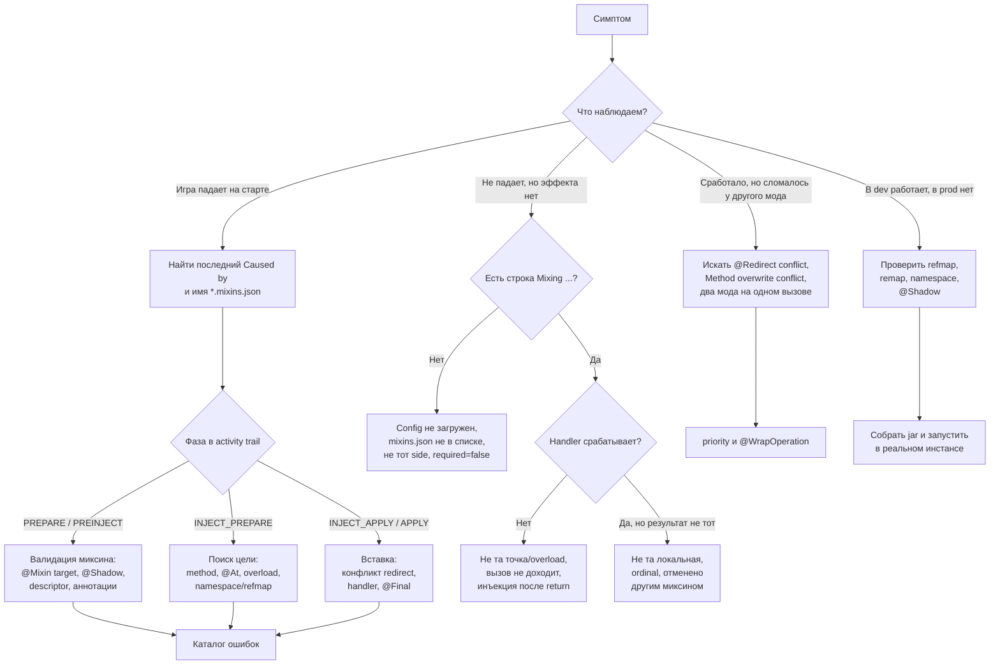

# Почему миксин не применился

[← К оглавлению](README.md)

> [!NOTE]
> TL;DR — Сначала ответьте на три вопроса: загрузился ли `mixins.json`, нашёлся ли target-класс и нашлась ли точка инъекции. Большая часть «миксин не работает» — это неверный namespace, неполный descriptor, не тот overload или отсутствующий refmap, а не баг Mixin. Включайте `-Dmixin.debug.verbose=true`, читайте activity trail в исключении и сверяйтесь с байткодом, а не с догадками.

## Содержание

- [Диагностическое дерево](#диагностическое-дерево)
- [Каталог ошибок](#каталог-ошибок)
  - [`Critical injection failure`: не найдена цель](#critical-injection-failure-не-найдена-цель)
  - [`Critical injection failure`: не найдена точка](#critical-injection-failure-не-найдена-точка)
  - [`Injection validation failed` и `expect`](#injection-validation-failed-и-expect)
  - [`No refMap loaded`](#no-refmap-loaded)
  - [`Reference map ... could not be read`](#reference-map--could-not-be-read)
  - [`Invalid descriptor on ...`](#invalid-descriptor-on-)
  - [`@Mixin target ... was not found`](#mixin-target--was-not-found)
  - [`@Shadow ... was not located`](#shadow--was-not-located)
  - [`@Final` и `@Mutable`](#final-и-mutable)
  - [`@Redirect conflict`](#redirect-conflict)
  - [`Overwrite`-конфликты](#overwrite-конфликты)
  - [`compatibilityLevel` и `Unsupported class file major version`](#compatibilitylevel-и-unsupported-class-file-major-version)
  - [`Mixin config ... was not found`](#mixin-config--was-not-found)
  - [`Cannot locate method` и namespace](#cannot-locate-method-и-namespace)
  - [`target was loaded too early`](#target-was-loaded-too-early)
  - [Обёртки: `Mixin apply failed` и `MixinTransformerError`](#обёртки-mixin-apply-failed-и-mixintransformererror)
- [Почему компилятор молчит](#почему-компилятор-молчит)
- [Refmap и namespace](#refmap-и-namespace)
  - [Кто в каком namespace](#кто-в-каком-namespace)
  - [`remap = true/false`](#remap--truefalse)
  - [До 26.1 и после](#до-261-и-после)
  - [Как понять namespace цели](#как-понять-namespace-цели)
- [Конфликты между модами](#конфликты-между-модами)
  - [`priority`](#priority)
  - [`@Redirect` против `@WrapOperation`](#redirect-против-wrapoperation)
  - [Как найти, кто ещё целится в метод](#как-найти-кто-ещё-целится-в-метод)
- [Dev vs prod](#dev-vs-prod)
  - [Почему `@Shadow` работает в dev и падает в prod](#почему-shadow-работает-в-dev-и-падает-в-prod)
  - [Как проверить prod до релиза](#как-проверить-prod-до-релиза)
- [Чеклист «применился, но эффекта нет»](#чеклист-применился-но-эффекта-нет)
- [Проверено на](#проверено-на)
- [Источники](#источники)

---

## Диагностическое дерево

Начинайте не с чтения миксина, а с классификации симптома. Одна и та же строка `Critical injection failure` может означать «не тот метод», «не тот namespace» и «другой мод сломал вызов» — лечатся они по-разному.



Быстрая триажная последовательность:

```bash
# 1. Что вообще произошло: все mixin-строки, включая вложенные причины
grep -nE "mixin|Mixin" logs/latest.log | tail -200

# 2. Последний Caused by — почти всегда настоящая причина
grep -n "Caused by:" crash-reports/crash-*.txt | tail -5

# 3. Какой конфиг и какой миксин
grep -nE "Mixin apply|FAILED during|mixins\.json" logs/latest.log | tail -30

# 4. Включить подробности и повторить
JAVA_TOOL_OPTIONS="-Dmixin.debug.verbose=true" ./gradlew runClient
```

> [!WARNING]
> Не начинайте с `mixin.debug=true`. Он включает `export`, `verify` и `profiler` одновременно: лог станет огромным, старт — медленным, а `verify` может превратить безобидный warning в падение. Начните с `verbose`, при необходимости добавьте `export`.

---

## Каталог ошибок

Ниже — сообщения, которые реально формирует Mixin 0.8.7 и обёртки лоадеров. Тексты с `<...>` или `...` — шаблоны из исходников; блоки с подписью **Схема** — иллюстрация формата, а не дословная строка из чужого лога. Реальные примеры из issue-тредов приводятся с пометкой.

Если в логе стоит `Mixin apply failed ...: Critical injection failure: ...`, читайте не обёртку, а `Caused by:` и первую строку `Critical injection failure` — дальше ищите её в этом каталоге. Обёртки разобраны в конце раздела.

### `Critical injection failure`: не найдена цель

```text
Critical injection failure: @Inject annotation on stop could not find any targets matching
'Lnet/minecraft/server/MinecraftServer;stop(Z)V' in net.minecraft.server.MinecraftServer.
No refMap loaded.
```

Реальный пример из [Fabric Loom #239] (Kotlin-миксин без refmap).

```text
Critical injection failure: @Inject annotation on beforeEncode could not find any targets matching
'encodeStructuresPacket' in fi/dy/masa/servux/network/packet/ServuxStructuresHandler.
No refMap loaded.
```

Реальный пример из лога сервера (цель — другой мод, не Minecraft).

**Что произошло.** Mixin нашёл target-класс, но не нашёл в нём метод/поле, указанное в `method = "..."`.

**Почему.**

1. Метод переименован или удалён в этой версии игры/мода.
2. Указано только имя, а в классе несколько overload'ов; Mixin выбрал не тот или не выбрал ни один.
3. В `method` указан descriptor, не совпадающий с байткодом (лишний параметр, другой возвращаемый тип, generics).
4. Миксин написан в named-namespace, а target в рантайме — intermediary/SRG (см. [Refmap и namespace](#refmap-и-namespace)).
5. Цель — метод другого мода, а версия этого мода другая.
6. Метод существует, но в суперклассе, а `@Mixin` нацелен на подкласс; Mixin ищет в иерархии, но не всегда там, где вы думаете (см. `@Mixin(targets = ...)` и `@Shadow`).

**Что делать.**

- Указать полный descriptor: `method = "tickServer()V"` или `method = "stop(Z)V"`.
- Посмотреть байткод target'а: `javap -p -c -s <target>` или `mixin.debug.export` + CFR.
- Проверить, что имя — из runtime-namespace, а не из Yarn/MCP.
- Для целей в другом моде — сверить версию мода и использовать `remap = false`, если мод не обфусцирован.
- В dev включить `mixin.debug.verbose=true` и посмотреть, какие `Mixing ...` вообще произошли.

> [!NOTE]
> Строка `Target method ... was not found` — это пересказ, а не текст Mixin. Реальные варианты: `could not find any targets matching ...`, `@Mixin target ... was not found`, `@Shadow method ... was not located in the target class ...`. Ищите в логе именно их.

### `Critical injection failure`: не найдена точка

```text
Critical injection failure: Redirector init(Lnet/minecraft/server/integrated/IntegratedServer;Lnet/minecraft/world/GameMode;ZI)Z
in og.mixins.json:ExampleMixin failed injection check, (0/1) succeeded.
Scanned 1 target(s). No refMap loaded.
```

Реальный пример из [Fabric API #577].

**Что произошло.** Метод найден, но `@At` не совпал ни с одной инструкцией внутри него.

**Почему.**

1. Вызов, в который вы целитесь, перемещён, удалён или заинлайнен в этой версии.
2. Неверный `owner` в `@At(target = "Lowner;name(...)...")`: invokevirtual может быть объявлен на супертипе, а не на том классе, где вы его видите в исходнике.
3. Неверный descriptor: у вызываемого метода другие параметры/возврат.
4. `ordinal` указывает на несуществующее вхождение.
5. Цель — конструктор: `<init>` вызывается инструкцией `INVOKE` (или `NEW` + `<init>`), а не «обычным методом»; для инъекции в сам конструктор используют `RETURN`/`TAIL`.
6. Инструкция находится в другом методе (например, в synthetic-lambda или bridge-методе).
7. Вы целитесь в `INVOKEDYNAMIC` (лямбда/конкатенация строк), а пишете его как обычный `INVOKE`.

**Что делать.**

- Смотреть `javap -c` именно того метода и искать точный `invoke*`/`field`/`ldc`.
- Использовать полный descriptor и `@At(value = "INVOKE", target = "Lowner;name(Args)Ret;")`.
- Для повторяющихся вызовов — не `ordinal`, а `@Expression`/`@Slice` с якорем, а лучше MixinExtras `@WrapOperation` + `@Expression`.
- Для конструктора — `@At(value = "INVOKE", target = "L...;<init>(...)V")` или `@At("TAIL")`, в зависимости от задачи.
- Включить `mixin.debug.export=true` и проверить, что вызов вообще есть в post-mixin классе (возможно, его уже убрал другой мод).

### `Injection validation failed` и `expect`

Схема (шаблон из `InjectionInfo`):

```text
Injection validation failed: @Inject annotation on onTick expected 2 invocation(s) but 1 succeeded.
Scanned 1 target(s). No refMap loaded.
```

Это сообщение появляется при `mixin.debug.countInjections=true`, если задан `expect`, но реальное число вставок меньше. Оно же ловит «тихие» промахи, которые при `require = 0` прошли бы молча.

**Что делать.** Либо исправить цель/точку, либо честно понизить `expect`. Не ставьте `expect = 0`, чтобы «убрать ошибку»: это маскирует баг. Для dev полезно `defaultRequire: 1` в `mixins.json` и `require = 1` на важных инъекциях.

### `No refMap loaded`

Это не отдельная ошибка, а **суффикс** к сообщению об инъекции. Он означает, что `ReferenceMapper` находится в default-состоянии: refmap не указан, не найден или не прочитан. Подробности — в [Refmap и namespace](#refmap-и-namespace).

Типичные комбинации:

```text
... could not find any targets matching 'foo' in com.example.Target. No refMap loaded.
... failed injection check, (0/1) succeeded. Scanned 1 target(s). No refMap loaded.
```

В dev на Fabric это часто нормально: Loom 1.12+ ремапит миксины TinyRemapper'ом, и refmap не нужен. В prod на обфусцированной версии это почти всегда признак того, что soft-ссылки не переведены в runtime-имена.

### `Reference map ... could not be read`

Схема:

```text
Reference map '<file>' for <config> could not be read.
If this is a development environment you can ignore this message
```

**Что произошло.** В `mixins.json` есть ключ `refmap`, но файла нет, он битый или лежит не там.

**Почему.**

1. Refmap не сгенерировался (AP не запускался).
2. Refmap не попал в jar (забыли `include`/`jarJar`, исключили ресурс).
3. Имя в `refmap` не совпадает с фактическим файлом.
4. Refmap от другой версии/лоадера.
5. NeoForge: refmap не нужен, а ключ остался с Forge-сборки — будет warning, не более.

**Что делать.**

- В dev: проверить, не включён ли `useLegacyMixinAp`, и не сломан ли AP; часто проще удалить `refmap` из конфига, если Loom ремапит сам.
- В prod: `unzip -l mod.jar | grep refmap`; если файла нет — пересобрать с правильным пайплайном.
- Не «лечить» это `mixin.env.disableRefMap=true` в проде: вы отключите единственный механизм перевода имён.

### `Invalid descriptor on ...`

Точный шаблон из `CallbackInjector`:

```text
Invalid descriptor on <injection info>! CallbackInfoReturnable is required!
```

Второй вариант:

```text
Invalid descriptor on <injection info>! Expected <callback desc> but found <handler desc>
```

**Что произошло.** Сигнатура handler'а не совпала с target'ом.

**Почему.**

1. Target возвращает значение, а handler принимает `CallbackInfo` вместо `CallbackInfoReturnable<T>`.
2. Пропущен/лишний параметр target'а.
3. Generics стёрлись: `List<ItemStack>` в исходнике — это `List` в descriptor'е.
4. Взят не тот overload: параметры совпадают по смыслу, но не по типу.
5. `@ModifyVariable`/`@ModifyArg` объявляют тип, не совпадающий с локальной/аргументом.

**Что делать.**

- Сверить descriptor с `javap -s -p`.
- Для non-void: `CallbackInfoReturnable<T>` и `cir.setReturnValue(...)`.
- Для `void`: `CallbackInfo` и `ci.cancel()`.
- Для `@ModifyVariable`: тип и `ordinal`/`index`; в 26.x можно `@Local(name = "...")`, до 26.1 — только тип/ordinal/индекс.
- Не добавлять `@Local` в обычный `@Inject` без необходимости: MixinExtras sugar меняет сигнатуру.

### `@Mixin target ... was not found`

```text
@Mixin target com.simibubi.create.foundation.config.ui.SubMenuConfigScreen was not found
copycats-forge.mixins.json:featuretoggle.SubMenuConfigScreenMixin
```

Реальный пример из лога (цель — класс другого мода).

**Что произошло.** Класс из `@Mixin(...)` не найден в runtime.

**Почему.**

1. Опечатка/старое имя класса.
2. Класс есть только на клиенте, а миксин в common/серверной секции.
3. Класс принадлежит моду, которого нет в этом инстансе (опциональная интеграция).
4. Класс загружается другим classloader'ом (ModLauncher, jar-in-jar, Connector).
5. Класс переименован в новой версии игры/мода.
6. `@Mixin(targets = "net.minecraft....")` написан строкой и не проверяется компилятором.

**Что делать.**

- Для опциональных целей — `@Pseudo` + `require = 0`, а не «жёсткий» `@Mixin`.
- Разнести client-only миксины в `client`-секцию конфига.
- Проверить наличие класса: `jar tf mod.jar | grep SubMenuConfigScreen` или MixinMCP `mixin_find_class`.
- Включить `mixin.debug.strict.targets=true` в dev, чтобы опечатка падала, а не молчала.
- Не путать с `The specified mixin '<class>' was not found` — это не target, а сам класс миксина (не включён в jar/конфиг).

### `@Shadow ... was not located`

Точный шаблон из `MixinPreProcessorStandard`:

```text
@Shadow field <name> was not located in the target class <target>. <refmap status><dynamic info>
```

Для метода:

```text
@Shadow method <name> in <mixin> was not located in the target class <target>. <refmap status><dynamic info>
```

**Что произошло.** `@Shadow`-заглушка не нашла реальный член в target'е.

**Почему.**

1. Поле/метод переименовано или удалено.
2. Другой тип/descriptor (особенно `int` vs `Integer`, generics).
3. `static` не совпадает: `STATIC modifier of @Shadow field ... does not match the target`.
4. `@Shadow` указывает на приватное поле, но имя не совпадает; Mixin умеет alias только для private/synthetic.
5. Refmap не загружен, и dev-имя не переведено в runtime-имя.
6. `@Shadow` объявлен в интерфейсном миксине, где он избыточен (`Ignoring redundant @Shadow field ...`).
7. Поле помечено `@Final`, но `@Shadow` без `@Final` (или наоборот) — это warning, не всегда fatal.

**Что делать.**

- Сверить имя и descriptor через `javap -p -s`.
- Для private-поля использовать точное имя; alias допустим только для private/synthetic.
- Проверить `remap`: для модовой цели, которая не обфусцирована, `@Shadow(remap = false)`.
- Для `final`-поля — `@Final`; если нужно писать — `@Mutable` (и понимать последствия).
- В 26.x имена читаемые, поэтому чаще виноват реальный рефакторинг, а не mappings.

### `@Final` и `@Mutable`

Три разных сообщения (схемы):

```text
Write access detected to @Final field <name> in <mixin>::<method>
```

```text
@Shadow target <mixin>::<field> is final but shadow is not decorated with @Final
```

```text
Overwrite prohibited for @Final method <method> in <mixin>. Skipping method.
```

**Что произошло.**

- Первое: вы пишете в `@Shadow @Final`-поле без `@Mutable`. По умолчанию это **ERROR в логе, но не исключение**; исключение будет только при `mixin.debug.verify=true`.
- Второе: target-поле `final`, а `@Shadow` не помечен `@Final` — warning о несоответствии.
- Третье: другой миксин пометил метод `@Final`, и ваш `@Overwrite`/merge пропущен.

**Что делать.**

- Если запись действительно нужна: `@Shadow @Final @Mutable` и понимать, что вы ломаете инвариант (особенно для `record`/`ItemStack`).
- Если запись не нужна: убрать `@Final`/`@Mutable` и использовать `@Accessor`/`@Invoker`.
- Для чужого `@Final`-метода: не пытаться перебить `@Overwrite`; использовать `@Inject`/`@WrapOperation`.
- В dev включать `mixin.debug.verify=true` точечно, чтобы такие записи падали сразу, а не «работали» до первого релиза.

> [!WARNING]
> `@Mutable` на `final`-поле — это не «разрешение», а обещание JVM, что вы не сломаете оптимизации. Для полей, которые JIT считает константами (особенно `static final`), запись может не дать эффекта или дать его не сразу. Для `static final` используйте AT/AW или замену метода; рефлексия на `static final` в современных JDK ненадёжна.

### `@Redirect conflict`

Схема (шаблон из `RedirectInjector`):

```text
@Redirect conflict. Skipping <injection info> with priority <N>, already redirected by <other> with priority <M>
```

```text
@Redirect conflict: <injection info> failed because target was already remapped by <other>
```

**Что произошло.** Два миксина целятся в одну и ту же инструкцию (`INVOKE`, `FIELD`, `NEW`).

**Почему это важно.** `@Redirect` — **эксклюзивный** инъектор: он заменяет вызов, и второй такой же не может встать рядом. Один из них будет пропущен (WARN) или упадёт (если чужой помечен `@Final`).

**Что делать.**

- Заменить `@Redirect` на `@WrapOperation` (MixinExtras): обёртки цепляются друг за друга, каждая получает `original`, и конфликт исчезает.
- Если нужен именно redirect — не пытаться «перебить» чужой; договориться о `priority` или использовать `@ModifyExpressionValue`/`@ModifyReturnValue`.
- Найти второго участника: warning называет оба миксина; дополнительно см. [Как найти, кто ещё целится в метод](#как-найти-кто-ещё-целится-в-метод).
- Проверить, не является ли ваш redirect лишним: возможно, вы заменяете вызов, который уже обёрнут другим модом, и достаточно `@ModifyArg`.

### `Overwrite`-конфликты

Схемы:

```text
Method overwrite conflict for <method> in <mixin>, previously written by <owner>. Skipping method.
```

```text
Overwrite target "<method>" was not located in target class <target>
```

```text
Mixin <mixin> contains non-private static field <name>:<desc>
```

**Что произошло.**

- Первое: два `@Overwrite` (или merge-метода) на одно имя; второй пропущен.
- Второе: `@Overwrite` не нашёл метод с таким именем/descriptor'ом.
- Третье: публичное static-поле в миксине — ранняя привязка Java делает такое поле бессмысленным; Mixin запрещает.

**Что делать.**

- Не использовать `@Overwrite` без крайней необходимости: он ломает совместимость. Заменить на `@Inject(HEAD, cancellable = true)` + `setReturnValue`, `@WrapOperation`, `@ModifyReturnValue`.
- Если `@Overwrite` неизбежен — полный descriptor и `require = 1`; но помните, что он всё равно конфликтует с другими.
- Static-поля делать `private` или `@Unique`; для констант — `private static final`.
- `@Overwrite` на методе, который другой мод уже переписал, не «выиграет» по priority: используйте `@WrapMethod`/`@Inject`, а не гонку.

### `compatibilityLevel` и `Unsupported class file major version`

Схемы (шаблоны из `MixinConfig`/`MixinInfo`):

```text
Mixin config <name> specifies compatibility level <LEVEL> which is not recognised
```

```text
Mixin config <name> requires compatibility level <LEVEL> which is too old
```

```text
Mixin config <name> requires compatibility level <LEVEL> which is prohibited by <CURRENT>
```

```text
Unsupported mixin, <mixin> requires the following unsupported language features:
<FEATURES>, these features require compatibility level <LEVEL>
```

```text
java.lang.IllegalArgumentException: Unsupported class file major version 69
```

Это уже не Mixin, а ASM: `ClassReader` не знает такой class-file version.

**Что произошло.**

- `compatibilityLevel` — это **уровень языковых фич**, а не версия Java-компилятора. Он должен быть не ниже того, что использует ваш миксин, и поддерживаться текущим Mixin.
- Class-file version: Java 17 = 61, Java 21 = 65, Java 25 = 69. Если миксин скомпилирован под 25, а Mixin/ASM в лоадере старее — будет `Unsupported class file major version 69`.

**Что делать.**

- Для 26.x ставьте `"compatibilityLevel": "JAVA_25"` и убедитесь, что лоадер несёт Mixin-форк, который знает `JAVA_25` (Fabric Loader 0.18.x умеет; официальный SpongePowered Mixin 0.8.7 — только до `JAVA_21`).
- Для 1.21.x — `JAVA_21`, для 1.20.1 — `JAVA_17`.
- Если обновить Mixin нельзя — компилировать миксин под более старый `--release`, но это не поможет, если target-класс сам class version 69: ASM всё равно должен его прочитать.
- `Unsupported class file major version` лечится обновлением ASM/Mixin/лоадера, а не правкой `compatibilityLevel`.

> [!NOTE]
> `compatibilityLevel` проверяется при инициализации конфига. Опечатка (`JAVA_2I`) даёт `... which is not recognised`; слишком новый уровень, который текущий Mixin не может поддержать, — `... which is prohibited by ...`; уровень ниже сервисного минимума обычно лишь логируется как `Compatibility level ... is lower than the default level supported ...`.

### `Mixin config ... was not found`

**Важно:** строки `Mixin config ... was not found` в Mixin 0.8.7 **нет**. Это собирательный образ из нескольких разных сообщений. Реальные варианты (имена файлов/модов здесь условные):

```text
Error encountered reading mixin config example.mixins.json: java.io.FileNotFoundException: ...
```

Из `Mixins.createConfiguration`: Mixin ловит `Exception` (например, `FileNotFoundException`), логирует и **пропускает конфиг**. Ошибки инициализации вроде `MixinInitialisationError` — это `Error`, они здесь не ловятся; Fabric оборачивает их в `RuntimeException` с текстом `Error parsing or using Mixin config ...`, и загрузка падает.

```text
Error parsing or using Mixin config example.mixins.json for mod examplemod
```

Обёртка Fabric Loader вокруг `Mixins.addConfiguration`.

```text
The specified mixin 'com.example.mixin.FooMixin' was not found
```

Это не конфиг, а класс миксина: его нет в jar или он не указан в списке конфига.

**Почему конфиг «не находится».**

1. `fabric.mod.json` → `"mixins": [...]` или `META-INF/neoforge.mods.toml` → `[[mixins]] config = "..."` не содержит файл.
2. Опечатка/регистр в имени (`Example.mixins.json` vs `example.mixins.json`).
3. Файл лежит не в корне resources/jar.
4. Конфиг исключён `exclude`/`processResources`/shading-правилом.
5. Дублирующееся имя конфига у двух модов — Fabric падает с `Non-unique Mixin config name ... used by the mods ...`.
6. Мод не загрузился вообще (нет зависимости, не тот loader, отключён).

**Что делать.**

- `unzip -l mod.jar | grep mixins.json` — файл на месте?
- `unzip -p mod.jar fabric.mod.json | jq '.mixins'` (или `neoforge.mods.toml`) — имя совпадает?
- `unzip -p mod.jar example.mixins.json | jq '.package, .mixins, .client'` — классы перечислены?
- Проверить, что имя класса в JSON соответствует FQCN без package-префикса (в конфиге `package` + имя класса).
- Для NeoForge — `[[mixins]]`, для Fabric — `mixins`, для старых Forge — `MixinConfigs` в `MANIFEST.MF`.

### `Cannot locate method` и namespace

Строки `Cannot locate method` в Mixin 0.8.7 тоже нет. Реальные проявления (схемы):

```text
Critical injection failure: ... could not find any targets matching 'tickServer' in net.minecraft.server.MinecraftServer. No refMap loaded.
```

```text
@Shadow method tickServer was not located in the target class net.minecraft.server.MinecraftServer.
```

```text
@Mixin target net.minecraft.class_310 was not found ...
```

**Что произошло.** Имя, написанное в аннотации, не соответствует имени в runtime. Это классическая проблема namespace'ов.

**Почему.**

1. Dev-имена (Yarn/Mojmap) не переведены в prod-имена (intermediary/SRG).
2. Refmap не загружен/не собран.
3. `remap = false` стоит там, где нужен `true` (или наоборот).
4. Цель — метод другого мода: моды не обфусцированы, но override обфусцированного метода всё равно требует remap.
5. Сборка multi-loader: common-jar собран с Yarn-refmap, а запускается на NeoForge с Mojmap.

**Что делать.** См. следующий раздел — там таблица по эпохам и способ определить namespace по сообщению/байткоду.

### `target was loaded too early`

Схема:

```text
Critical problem: <config>:<Mixin> target <target> was loaded too early.
```

**Что произошло.** Класс загрузился раньше, чем Mixin смог его трансформировать. Если конфиг `required`, это `MixinTargetAlreadyLoadedException`.

**Почему.**

1. Другой early-трансформер/coremod трогает класс до Mixin.
2. Мод обращается к классу из `premain`/очень раннего инициализатора.
3. Неправильный порядок загрузки в кастомном лоадере/DevLaunch.
4. Класс загружен системным classloader'ом раньше игрового.

**Что делать.**

- Не трогать target-класс из статических инициализаторов своего мода до применения миксинов.
- Проверить другие coremod'ы/трансформеры; временно отключить подозрительные моды.
- Для NeoForge/Forge — проверить, не загружает ли класс ваш `MixinConnector`/plugin слишком рано.
- Это не лечится `priority`: порядок миксинов не влияет на «класс уже загружен».

### Обёртки: `Mixin apply failed` и `MixinTransformerError`

Схема (Fabric):

```text
Mixin apply for mod <mod> failed <config>:<Mixin> from mod <mod> -> <target>:
<exception class>: <exception message>
```

Fabric-обёртка. Смотрите на последний `Caused by:` — там настоящая причина.

Схема (NeoForge/Forge; формат может отличаться по версии):

```text
Mixin apply failed <config>:<Mixin> -> <target>:
<exception class>: <exception message>
```

```text
org.spongepowered.asm.mixin.transformer.throwables.MixinTransformerError: An unexpected critical error was encountered
```

Тоже обёртка: Mixin поймал исключение при трансформации и завернул его. Без вложенного `Caused by` она бесполезна.

**Что делать.** Читать снизу вверх: последний `Caused by` → первый кадр с вашим пакетом → имя `*.mixins.json` → имя миксина → activity trail. Не лечить по тексту обёртки.

---

## Почему компилятор молчит

Java-компилятор проверяет только то, что видит в **вашем** классе. Миксин устроен так, что цель находится в другом классе, которого на момент компиляции может не быть в том же виде:

1. **`method = "tickServer"` — это строка.** Компилятор не знает, что она указывает на метод; опечатка — валидный Java-код.
2. **`@At(target = "Lnet/minecraft/...")` — это тоже строка.** Descriptor не парсится компилятором и не сверяется с target'ом.
3. **`@Shadow` — заглушка.** Компилятор проверяет, что объявление корректно само по себе, но не что такой член есть в target'е. Более того, `@Shadow`-метод может быть `abstract` (в abstract-миксине), и компилятор это пропустит.
4. **Generics стираются.** `List<ItemStack>` в исходнике и `Ljava/util/List;` в descriptor'е — разные вещи; компилятор не подскажет, что вы написали не тот тип в `@At`.
5. **Overload'ы.** Компилятор не знает, какой из пяти `tick(...)` вы имеете в виду, потому что имя — строка.
6. **Namespace.** Компилятор видит dev-имена; runtime-имена могут быть другими (до 26.1).
7. **Порядок применения.** Даже если все имена верны, другой мод может изменить байткод до вас; компилятор этого не моделирует.

Как компенсировать:

| Способ | Что ловит | Ограничения |
| --- | --- | --- |
| Полный descriptor в `method`/`@At` | Не тот overload, не тот тип | Не ловит переименование в новой версии |
| `defaultRequire: 1` + `require = 1` | Промах точки в dev | Может ломать опциональные интеграции; для них — `require = 0` осознанно |
| `mixin.debug.verbose=true` | «Миксин вообще не применялся» | Не показывает, какая именно точка не нашлась |
| `mixin.debug.countInjections=true` | Несовпадение `expect` | Только если `expect` задан |
| `mixin.debug.export=true` + diff/CFR | Что реально стало с классом | Дорого по диску/времени; дамп нужно копировать до перезапуска |
| `mixin.dumpTargetOnFailure=true` | Состояние target'а до миксинов | Только при падении |
| IDE-инспекции (Minecraft Development plugin) | `@Shadow`, `@At`, target | Требует настроенного проекта и mappings; не все версии поддерживаются |
| MixinMCP | Семантический поиск target'ов, чужие миксины, байткод | Community-инструмент, нужен IntelliJ 2026.x и Gradle-плагин |
| Mixin AP (annotation processor) | Часть ошибок в `@Shadow`/`@Overwrite` на этапе сборки | В Loom 1.12+ по умолчанию выключен; для 26.x не нужен |
| GameTest/prod-smoke | «Работает ли в реальном запуске» | Не заменяет чтение байткода, но ловит refmap/namespace |

Практический минимум для нового миксина:

```java
@Mixin(ServerLevel.class)
public abstract class ServerLevelMixin {
    @Inject(
        method = "tick(Ljava/util/function/BooleanSupplier;)V", // полный descriptor
        at = @At("HEAD"),
        require = 1                                            // падать сразу в dev
    )
    private void example$onTick(BooleanSupplier hasTimeLeft, CallbackInfo ci) {
        // ...
    }
}
```

И проверка:

```bash
# descriptor target'а
javap -p -s -cp <minecraft.jar> net.minecraft.server.level.ServerLevel | grep -A2 "tick"

# что реально применилось (из рабочей директории запуска)
cp -r .mixin.out /tmp/dump && \
  java -jar cfr.jar /tmp/dump/class/net/minecraft/server/level/ServerLevel.class | grep -n "example\$onTick"
```

> [!NOTE]
> `@Shadow` не проверяется компилятором ещё и потому, что Mixin подставляет член на этапе трансформации. Это одновременно удобство (нет жёсткой зависимости от target'а) и ловушка (опечатка видна только в runtime). Для часто меняющихся целей лучше `@Accessor`/`@Invoker`: они генерируют код и хотя бы явно называются.

---

## Refmap и namespace

### Кто в каком namespace

| Эпоха / лоадер | Dev-имена | Prod-имена | Refmap | `remap` по умолчанию |
| --- | --- | --- | --- | --- |
| Forge ≤ 1.16.5 | MCP | SRG (`func_...`, `field_...`) | Нужен | `true` |
| Forge 1.17–1.20.1 | Mojmap | SRG (`m_...`, `f_...`) | Нужен | `true` |
| NeoForge 1.20.2–1.21.11 | Mojmap | Mojmap | Не нужен; ключ `refmap` обычно удаляют | `true`, но при отсутствии refmap — no-op |
| Fabric 1.14–1.21.11 | Yarn/Mojmap | Intermediary (`class_...`, `method_...`, `field_...`) | До Loom 1.12 — AP/refmap; с 1.12 — TinyRemapper | `true` |
| Fabric/NeoForge 26.1+ | Mojmap | Mojmap (игра не обфусцирована) | Не нужен | `true` — no-op, т.к. refmap нет |

> [!WARNING]
> Таблица — ориентир, а не гарантия. NeoForge 1.20.1 ещё использовал SRG, а NeoForge 1.20.2+ перешёл на Mojmap. В multi-loader-сборках common-модуль может компилироваться с одним набором имён, а запускаться с другим. Всегда проверяйте фактический runtime, а не название версии.

### `remap = true/false`

`remap` есть у `@Mixin`, `@Inject`, `@Redirect`, `@ModifyArg`, `@ModifyArgs`, `@ModifyConstant`, `@ModifyVariable`, `@At`, `@Shadow`, `@Overwrite`. Смысл: **применять ли refmap к soft-ссылке**.

- `remap = true` (default) — имя в аннотации считается dev-именем и переводится в runtime через refmap.
- `remap = false` — имя считается уже runtime-именем; refmap не применяется.
- Атрибут на инъекторе переопределяет атрибут класса; `@At(remap = ...)` — отдельно для target'а внутри точки.
- Если refmap нет (26.x, NeoForge, Loom 1.12+), `remap = true` фактически ничего не делает: `ReferenceMapper` возвращает ссылку как есть. Это не ошибка и не повод всюду ставить `false`.

Когда `false` обязателен (до 26.1):

- цель — класс/метод **другого мода**, который не обфусцирован;
- цель — ваш собственный класс, который не ремапится;
- вы намеренно пишете runtime-имя (intermediary/SRG) и не хотите, чтобы refmap его «испортил».

Когда `false` опасен:

- цель — ванильный метод, который в prod переименован; с `false` вы ищете dev-имя в обфусцированном классе и получаете «not found»;
- `@Shadow` на ванильное поле: без remap имя останется dev-именем.

### До 26.1 и после

**До 26.1.** Игра обфусцирована. Fabric в prod работает в intermediary, Forge/NeoForge (старые) — в SRG, NeoForge 1.20.2+ — в Mojmap. Mixin аннотации хранят строки, которые компилятор/ремаппер не может обновить автоматически, поэтому появился refmap: JSON, который переводит `method = "tick"` → `method_1574` (intermediary) или `m_12345_` (SRG).

С Loom 1.12+ `useLegacyMixinAp` по умолчанию выключен, и TinyRemapper ремапит сами миксины; refmap больше не обязателен. Это не значит, что «refmap не нужен вообще»: если вы включили legacy AP или используете старый тулчейн, он снова нужен.

**26.1+.** Mojang убрал обфускацию: игра поставляется с Mojang-именами, Loom `net.fabricmc.fabric-loom` ничего не ремапит, `officialMojangMappings()` больше не нужен (и в новых Loom бросает ошибку). Имена в миксине = имена в runtime. Refmap отсутствует, `remap` становится no-op, а причины падений — реальные переименования/рефакторинги, а не mappings.

Практические следствия:

- не тащите `refmap` из старой сборки в 26.x — получите warning `Reference map ... could not be read`;
- не добавляйте `remap = false` «на всякий случай» в 26.x: это ничего не сломает, но и не поможет;
- если миксин таргетит мод, который сам не обфусцирован, `remap = false` остаётся корректным и в 26.x (просто потому, что ремапить нечего);
- `compatibilityLevel` для 26.x — `JAVA_25` (если Mixin-форк его знает).

### Как понять namespace цели

1. **По тексту ошибки.** Mixin печатает и имя, которое искал, и класс, в котором искал:
   - `class_310`, `method_1574` → intermediary;
   - `func_71217_p`, `m_12345_` → SRG;
   - `MinecraftServer`, `tickServer` → Mojmap/named.
2. **По jar'у target'а.** `javap -p -cp target.jar <class>` или `jar tf target.jar | head`.
3. **По своему build-скрипту.** `mappings loom.officialMojangMappings()` / `mappings "net.fabricmc:yarn:..."` / `neoForge.version` + MDG (Mojmap).
4. **По `.mixin.out/class`.** Экспортированный post-mixin класс показывает, какие имена реально в runtime; сравните с исходником.
5. **По `mixin.debug.verbose`.** Строка `Mixing ... into net.minecraft.class_310` сразу выдаёт intermediary.
6. **По refmap.** Если он есть, посмотрите ключи: `"tick()V": "Lnet/minecraft/class_310;method_1574()V"` — это ответ.

Пример refmap (иллюстративный, структура настоящая):

```json
{
  "mappings": {
    "com/example/mixin/MinecraftMixin": {
      "tick()V": "Lnet/minecraft/class_310;method_1574()V",
      "fov": "Lnet/minecraft/class_4184;field_18713:F"
    }
  },
  "data": {
    "named:intermediary": {
      "com/example/mixin/MinecraftMixin": {
        "tick()V": "Lnet/minecraft/class_310;method_1574()V"
      }
    }
  }
}
```

> [!NOTE]
> В 26.x refmap нет, поэтому вопрос «какой namespace» превращается в «какой версии target». Если имя не находится, это не mappings, а переименование/удаление метода. Проверяйте `javap` и порт-праймеры версии.

---

## Конфликты между модами

### `priority`

- `priority` миксина по умолчанию **1000**.
- Миксины применяются в порядке **возрастания** priority: меньше число — раньше.
- В `mixins.json` есть `priority` (для всего конфига) и `mixinPriority` (default для миксинов конфига); в `@Mixin(priority = ...)` — для конкретного класса.
- Для `@Redirect` действует отдельное правило из `RedirectInjector`: если уже стоящий redirect имеет priority **≥** вашего, ваш пропускается с WARN; если меньше — ваш заменяет его; если чужой помечен `@Final`, будет ошибка. Поэтому «я поставлю priority 999 и перебью» — не стратегия.
- Для `@Inject`/`@ModifyVariable` priority влияет на порядок вызовов, но не отменяет чужие инъекции.
- Менять priority стоит только для осознанной координации (например, ваш `@ModifyVariable` должен увидеть значение после другого мода), а не чтобы «победить».

### `@Redirect` против `@WrapOperation`

| Свойство | `@Redirect` | `@WrapOperation` (MixinExtras) |
| --- | --- | --- |
| Заменяет вызов | Да | Оборачивает, оригинал доступен через `original.call(...)` |
| Цепляется с другими | Нет (эксклюзивен) | Да, обёртки образуют цепочку |
| Конфликт | WARN `@Redirect conflict` или ошибка | Обычно нет |
| Видит аргументы | Да | Да |
| Может не вызвать оригинал | Да | Да (но это осознанное решение) |
| Когда использовать | Один мод, простая замена | Совместимость, несколько модов, тонкая правка |

`@WrapOperation` не «серебряная пуля»: если ваша обёртка не вызывает `original`, вы ломаете цепочку для остальных. И если другой мод уже сделал `@Redirect` на тот же вызов, `@WrapOperation` может не найти исходную инструкцию — проверяйте порядок применения и дамп, а не предполагайте.

Родственные инструменты:

- `@ModifyExpressionValue` — изменить результат вызова/поля, не заменяя вызов;
- `@ModifyReturnValue` — изменить возврат метода;
- `@ModifyArg`/`@ModifyArgs` — изменить аргументы вызова;
- `@WrapWithCondition` — условие выполнения void-вызова;
- `@WrapMethod` — обернуть весь метод (логирование, try/catch, замеры).

### Как найти, кто ещё целится в метод

1. **MixinMCP** (community): `mixin_find_targeting_mixins` находит `@Mixin`-классы, которые целятся в указанный класс/метод. С `jarPath="mods"` читает байткод прямо из jar'ов, включая jar-in-jar; для версий до 26.x умеет матчить Mojang/intermediary/Yarn. Это самый быстрый способ, если инструмент установлен.
2. **`zipgrep` по jar'ам** (без зависимостей):

   ```bash
   for jar in mods/*.jar; do
     zipgrep -l 'MinecraftServer' "$jar" 2>/dev/null \
       | grep '\.class$' \
       | sed "s|^|$jar :: |"
   done
   ```

   Строка `MinecraftServer` живёт в constant pool миксин-класса (значение `@Mixin`/`targets`), поэтому находится даже без исходников. Метод ищется так же:

   ```bash
   for jar in mods/*.jar; do
     zipgrep -l 'tickServer' "$jar" 2>/dev/null \
       | grep '\.class$' \
       | sed "s|^|$jar :: |"
   done
   ```

   Минус: `zipgrep` медленный и может дать ложные совпадения (строки в ассетах/локализации). Фильтруйте `.class` и проверяйте `javap`.

3. **`javap` по подозрительному классу**:

   ```bash
   javap -v -p -cp mods/othermod.jar com.othermod.mixin.ServerMixin \
     | grep -A8 'RuntimeInvisibleAnnotations'
   ```

   В аннотациях будут `@Mixin(value=..., targets=...)`, `@Inject(method=...)`, `@At(target=...)`.

4. **`mixin.debug.verbose=true`**: строки `Mixing <mixin> from <config> into <target>` показывают всех, кто применяется к классу. Метод они не называют, но сужают круг до нескольких конфигов.

5. **Сами warning'и**: `@Redirect conflict ... already redirected by <other>` и `Method overwrite conflict ... previously written by <owner>` называют оба миксина. Это бесплатный ответ на вопрос «кто ещё».

6. **Бинарный поиск по mods/**: если подозреваете конфликт, а лог молчит, делите mods пополам и запускайте; это грубо, но работает, когда инструменты недоступны.

7. **Crash report / MixinTrace**: блок «Mixins in Stacktrace» показывает, какие миксины участвовали в сломанном вызове. Полезно, когда конфликт не выдал warning, а просто изменил поведение.

---

## Dev vs prod

### Почему `@Shadow` работает в dev и падает в prod

В dev target-класс обычно в **named**-namespace (Yarn/Mojmap), и `@Shadow`-поле с тем же именем находится напрямую. В prod (до 26.1) target может быть в **intermediary/SRG**, и имя нужно перевести. Перевод делает один из механизмов:

1. **Mixin AP + refmap** — annotation processor пишет refmap, Mixin применяет его в runtime.
2. **TinyRemapper + Loom** — Loom ремапит сам миксин-класс (включая `@Shadow`-члены) на этапе сборки; refmap не нужен.
3. **NeoForge/MDG** — dev и prod уже в Mojmap, переводить нечего.

Если шаг 1/2 пропущен, получается:

- в dev всё работает (имена совпали);
- в prod `@Shadow field ... was not located in the target class ... No refMap loaded.` или `@Shadow method ... was not located ...`;
- либо `could not find any targets matching ...` для `@Inject`.

Частные причины:

- **Refmap не попал в jar.** Собрали с `useLegacyMixinAp=true`, но забыли `annotationProcessor`/`include`, или `processResources` исключил `*.refmap.json`.
- **Смена Loom ≤1.11 → 1.12+ без чистого билда.** AP выключен, refmap больше не генерируется; старый refmap в `build/` может маскировать проблему, а новый — отсутствовать.
- **Цель — другой мод.** Моды не обфусцированы, но если вы таргетите override ванильного метода в моде, имя всё равно может требовать remap. Для обычных модовых методов — `remap = false`.
- **Multi-loader common.** Common-модуль собрался с Yarn-refmap, а NeoForge-модуль ждёт Mojmap; в prod имена не совпадают.
- **`remap = false` на классе.** Вы отключили перевод для всех инъекторов, включая те, что таргетят ваниль.
- **Другой mappings-набор.** Мод собран с Yarn, а запущен на NeoForge (Mojmap) или наоборот.
- **26.1+.** Здесь refmap нет; если `@Shadow` не находится, это не mappings, а реальное переименование/удаление члена. Проверяйте `javap` и порт-праймеры.

> [!WARNING]
> «В dev работает» — не доказательство корректности миксина. Dev-окружение часто имеет другие имена, другой порядок загрузки, другие classloader'ы и может «прощать» отсутствие refmap. Единственная надёжная проверка — собранный jar в чистом prod-инстансе (или MC-Runtime-Test).

### Как проверить prod до релиза

1. `./gradlew build`, взять **remapped/production** jar, а не `-dev`.
2. Проверить содержимое:

   ```bash
   unzip -l build/libs/mod-1.0.0.jar | grep -E 'mixins\.json|refmap'
   unzip -p build/libs/mod-1.0.0.jar example.mixins.json | jq .
   ```

3. Запустить в отдельном инстансе с тем же лоадером и версией игры, без dev-флагов.
4. Включить `-Dmixin.debug.verbose=true` на один запуск и убедиться, что все ожидаемые `Mixing ...` есть.
5. Прогнать MC-Runtime-Test (см. [`01-toolchain/4-debug-and-diagnostics.md`](01-toolchain/4-debug-and-diagnostics.md#mc-runtime-test-и-headlessmc)) или ручной smoke: зайти в мир, вызвать затронутую функцию.
6. Для Fabric Loom полезны production-run задачи (`ClientProductionRunTask`/`runProductionClientGameTest`), но они не заменяют запуск в настоящем лаунчере: classpath и namespace могут отличаться.
7. Для NeoForge/MDG проверьте задачу `runGameTestServer` и, если есть, prod-конфигурацию; иначе — настоящий сервер/клиент.

---

## Чеклист «применился, но эффекта нет»

Проверяйте по порядку, не перескакивая. Большинство пунктов — дешёвые.

- [ ] **Конфиг загружен.** `mixins.json` указан в `fabric.mod.json`/`neoforge.mods.toml`; имя файла совпадает; миксин-класс есть в списке `mixins`/`client`/`server`.
- [ ] **Строка `Mixing ... into ...` есть.** Включите `mixin.debug.verbose=true`; если строки нет — миксин не применялся (не тот side, `required=false` после ошибки, класс уже загружен).
- [ ] **Handler существует в дампе.** `mixin.debug.export=true` → `.mixin.out/class/...` → `javap -p` или CFR: есть ли `handler$...`/`modid$...`?
- [ ] **Правильный overload.** У метода несколько вариантов — указан ли полный descriptor? `javap -s` подтверждает?
- [ ] **Правильный owner.** В `@At(target = "Lowner;...")` owner — тот, где инструкция реально объявлена, а не тот, где вы её ожидали (invokevirtual на супертипе!).
- [ ] **Точка достижима.** `@At("RETURN")`/`TAIL` не сработает, если до неё не доходит управление; `@At` после `return` бессмыслен; для void-метода `RETURN` — это `return`.
- [ ] **Инъекция не отменена.** Другой миксин делает `ci.cancel()`, `@Redirect` возвращает заглушку, `@Overwrite` заменяет метод. Проверьте `ci.isCancelled()` и warning'и конфликтов.
- [ ] **Вызов вообще происходит.** Метод вызывается на этом пути? Не client-only? Не заменён ли вызов в новой версии? Не вызывается ли `super`, минуя вашу цель?
- [ ] **Не synthetic/bridge/lambda.** Если цель — лямбда, имя `lambda$...` и `INVOKEDYNAMIC`; ищите её в `javap`, а не в исходнике.
- [ ] **`static` vs instance.** `@Inject` в `static`-метод не получает `this`; `@Shadow` статического поля должен быть `static`.
- [ ] **`<init>` vs `<clinit>`.** Инъекция в конструктор и в статический инициализатор — разные вещи; для `NEW` нужен особый `@At`.
- [ ] **`@Final`/`@Mutable`.** Запись в `final`-поле без `@Mutable` — ошибка: Mixin пишет ERROR в лог (и бросает исключение при `mixin.debug.verify=true`), а JVM запрещает `putfield` в final-поле вне конструктора (в рантайме это может дать `IllegalAccessError`). `@Final` без `@Mutable` — только чтение.
- [ ] **`@Shadow` правильный.** Имя, тип, `static`, `private`; для модовой цели — `remap = false`.
- [ ] **Нет конфликта.** В логе нет `@Redirect conflict`, `Method overwrite conflict`, `Overwrite prohibited`.
- [ ] **Правильный side.** Client-only класс не загрузится на dedicated server; `client`-секция конфига не применится на сервере.
- [ ] **Класс не загружен слишком рано.** `Critical problem: ... target ... was loaded too early` — миксин не успел; ищите early-трансформер.
- [ ] **Не hotswap-иллюзия.** После правки миксина без агента/рестарта работает старый код. Перезапустите игру или настройте `-javaagent` + `-Dmixin.hotSwap=true`.
- [ ] **Проверено в prod.** Собранный jar, чистый инстанс, без dev-флагов; в идеале — MC-Runtime-Test.

Дополнительные приёмы диагностики:

```java
// Временно: убедиться, что handler вообще вызван
@Inject(method = "tick()V", at = @At("HEAD"))
private void example$debug(CallbackInfo ci) {
    new Throwable("example$debug reached").printStackTrace();
}
```

```java
// Проверить, не отменена ли инъекция другим модом
if (ci.isCancelled()) {
    LOGGER.warn("tick was cancelled before example$afterTick");
}
```

Если handler вызывается, но эффект «не тот»:

- проверьте, не читаете ли вы локальную переменную до её присваивания (`@ModifyVariable` с `at = STORE` vs `LOAD`);
- проверьте `ordinal`: одинаковые вызовы в методе нумеруются по порядку, и любой рефакторинг сдвигает номер;
- проверьте `@Slice`: якоря могли переехать;
- проверьте, не перезаписывает ли другой `@ModifyReturnValue`/`@Redirect` ваш результат;
- проверьте, не возвращает ли target раньше, чем вы ожидаете (`@At("RETURN")` сработает на каждом `return`, а не в конце метода).

> [!WARNING]
> Не «лечите» промах инъекции через `require = 0` + `expect = 0`. Это превращает ошибку в тихое отсутствие эффекта, которое потом ищут днями. `require = 0` допустим только для осознанно опциональных целей (другой мод, другая версия), и тогда рядом должен быть комментарий, почему цель может отсутствовать.

---

## Проверено на

- **2026-11-21**, Mixin `0.8.7` (коммит `4053421aa10aaac6127d969028a29c94fe3054f6`): тексты `Critical injection failure`, `Invalid descriptor`, `@Shadow ... was not located`, `@Redirect conflict`, `Mixin config ... compatibility level`, `Reference map ... could not be read`, `Mixing ...`, `target ... was loaded too early`, `Overwrite ...`.
- **2026-11-21**, `MixinInfo`/`MixinConfig`/`CallbackInjector`/`RedirectInjector`/`TargetSelectors` — точные шаблоны сообщений и фазы.
- **2026-11-21**, Fabric Loader `main`: `FabricMixinBootstrap`, `mixin.env.remapRefMap`, обёртка `Error parsing or using Mixin config ...`.
- **2026-11-21**, Fabric Loom docs: `useLegacyMixinAp` по умолчанию выключен с 1.12; property-based run API с 1.17.
- **2026-11-21**, Fabric Wiki (draft) и Fabric 26.1 blog: отсутствие обфускации с 26.1, отсутствие refmap, `net.fabricmc.fabric-loom`.
- **2026-11-21**, NeoForge docs/MDK: Mojmap в runtime, `[[mixins]]`, GameTest.
- Версии class-файлов: Java 17 = 61, Java 21 = 65, Java 25 = 69.

## Источники

### Первоисточники

- [Mixin Java System Properties] — официальный список флагов (в т.ч. отсутствие `mixin.remap`).
- [SpongePowered/Mixin: MixinEnvironment.java, 0.8.7] — `Option`, `CompatibilityLevel`, `mixin.debug.strict.targets`.
- [SpongePowered/Mixin: InjectionInfo.java, 0.8.7] — `Critical injection failure`, `Injection validation failed`.
- [SpongePowered/Mixin: CallbackInjector.java, 0.8.7] — `Invalid descriptor on ...`, `CallbackInfoReturnable is required`.
- [SpongePowered/Mixin: TargetSelectors.java, 0.8.7] — `could not find any targets matching ...`, `failed to select into child`.
- [SpongePowered/Mixin: MixinPreProcessorStandard.java, 0.8.7] — `@Shadow field/method ... was not located`, `@Final` warnings.
- [SpongePowered/Mixin: MixinTargetContext.java, 0.8.7] — `Write access detected to @Final field ...`.
- [SpongePowered/Mixin: RedirectInjector.java, 0.8.7] — `@Redirect conflict`.
- [SpongePowered/Mixin: MixinApplicatorStandard.java, 0.8.7] — `Method overwrite conflict`, `Overwrite prohibited for @Final method`.
- [SpongePowered/Mixin: MixinConfig.java, 0.8.7] — compatibility level, `minVersion`, `Reference map ... could not be read`.
- [SpongePowered/Mixin: MixinInfo.java, 0.8.7] — `@Mixin target ... was not found`, `target ... was loaded too early`.
- [SpongePowered/Mixin: ReferenceMapper.java, 0.8.7] — `No refMap loaded.`, поведение remap без refmap.
- [SpongePowered/Mixin: Mixins.java, 0.8.7] — `Error encountered reading mixin config ...`.
- [Fabric Loader: FabricMixinBootstrap.java] — `Error parsing or using Mixin config ...`, `Non-unique Mixin config name ...`.
- [Fabric Docs: Loom Options] — `useLegacyMixinAp`, `mixin`/`runs`.
- [Fabric Wiki: Mixins and Obfuscation (DRAFT)] [draft] — refmap, `remap`, 26.1.
- [Fabric Blog: Fabric for Minecraft 26.1] — деобфускация, новый Loom, Java 25.
- [Fabric Docs: Migrating Mappings] — Yarn → Mojmap, проверка миксинов.
- [NeoForged Docs: Game Tests] — GameTest, `runGameTestServer`.
- [MixinExtras wiki] — `@WrapOperation`, `@ModifyExpressionValue`, `@ModifyReturnValue`.
- [Loom: MixinExtensionAPI] — как Loom ремапит миксины (для понимания, почему refmap не нужен).

### Community / вторичные

- [MixinMCP] [community] — `mixin_find_targeting_mixins`, поиск по байткоду и чужим модам.
- [Not Enough Crashes] [community] — mixin source filenames/line numbers в отчётах.
- [Crash Assistant] [community] — анализ крашей и логов.
- [MixinTrace] [community] — «Mixins in Stacktrace» (Fabric/Quilt; для 1.21+ проверяйте форки).
- [Fabric Loom #239] [community] — реальный пример `No refMap loaded` на Kotlin-миксине.
- [Fabric API #577] [community] — реальный пример `failed injection check, (0/1) succeeded`.
- [Linen: Mixin target not found] [community] — практическая классификация ошибок (проверять по исходникам).
- [Linen: Mixins on 26.1] [community] — заметки по 26.x.

[Mixin Java System Properties]: https://github.com/SpongePowered/Mixin/wiki/Mixin-Java-System-Properties
[SpongePowered/Mixin: MixinEnvironment.java, 0.8.7]: https://github.com/SpongePowered/Mixin/blob/4053421aa10aaac6127d969028a29c94fe3054f6/src/main/java/org/spongepowered/asm/mixin/MixinEnvironment.java
[SpongePowered/Mixin: InjectionInfo.java, 0.8.7]: https://github.com/SpongePowered/Mixin/blob/4053421aa10aaac6127d969028a29c94fe3054f6/src/main/java/org/spongepowered/asm/mixin/injection/struct/InjectionInfo.java
[SpongePowered/Mixin: CallbackInjector.java, 0.8.7]: https://github.com/SpongePowered/Mixin/blob/4053421aa10aaac6127d969028a29c94fe3054f6/src/main/java/org/spongepowered/asm/mixin/injection/callback/CallbackInjector.java
[SpongePowered/Mixin: TargetSelectors.java, 0.8.7]: https://github.com/SpongePowered/Mixin/blob/4053421aa10aaac6127d969028a29c94fe3054f6/src/main/java/org/spongepowered/asm/mixin/injection/selectors/TargetSelectors.java
[SpongePowered/Mixin: MixinPreProcessorStandard.java, 0.8.7]: https://github.com/SpongePowered/Mixin/blob/4053421aa10aaac6127d969028a29c94fe3054f6/src/main/java/org/spongepowered/asm/mixin/transformer/MixinPreProcessorStandard.java
[SpongePowered/Mixin: MixinTargetContext.java, 0.8.7]: https://github.com/SpongePowered/Mixin/blob/4053421aa10aaac6127d969028a29c94fe3054f6/src/main/java/org/spongepowered/asm/mixin/transformer/MixinTargetContext.java
[SpongePowered/Mixin: RedirectInjector.java, 0.8.7]: https://github.com/SpongePowered/Mixin/blob/4053421aa10aaac6127d969028a29c94fe3054f6/src/main/java/org/spongepowered/asm/mixin/injection/invoke/RedirectInjector.java
[SpongePowered/Mixin: MixinApplicatorStandard.java, 0.8.7]: https://github.com/SpongePowered/Mixin/blob/4053421aa10aaac6127d969028a29c94fe3054f6/src/main/java/org/spongepowered/asm/mixin/transformer/MixinApplicatorStandard.java
[SpongePowered/Mixin: MixinConfig.java, 0.8.7]: https://github.com/SpongePowered/Mixin/blob/4053421aa10aaac6127d969028a29c94fe3054f6/src/main/java/org/spongepowered/asm/mixin/transformer/MixinConfig.java
[SpongePowered/Mixin: MixinInfo.java, 0.8.7]: https://github.com/SpongePowered/Mixin/blob/4053421aa10aaac6127d969028a29c94fe3054f6/src/main/java/org/spongepowered/asm/mixin/transformer/MixinInfo.java
[SpongePowered/Mixin: ReferenceMapper.java, 0.8.7]: https://github.com/SpongePowered/Mixin/blob/4053421aa10aaac6127d969028a29c94fe3054f6/src/main/java/org/spongepowered/asm/mixin/refmap/ReferenceMapper.java
[SpongePowered/Mixin: Mixins.java, 0.8.7]: https://github.com/SpongePowered/Mixin/blob/4053421aa10aaac6127d969028a29c94fe3054f6/src/main/java/org/spongepowered/asm/mixin/Mixins.java
[Fabric Loader: FabricMixinBootstrap.java]: https://github.com/FabricMC/fabric-loader/blob/master/src/main/java/net/fabricmc/loader/impl/launch/FabricMixinBootstrap.java
[Fabric Docs: Loom Options]: https://docs.fabricmc.net/develop/loom/options
[Fabric Wiki: Mixins and Obfuscation (DRAFT)]: https://wiki.fabricmc.net/drafts:mixin_obfuscation
[Fabric Blog: Fabric for Minecraft 26.1]: https://fabricmc.net/2026/03/14/261.html
[Fabric Docs: Migrating Mappings]: https://docs.fabricmc.net/develop/porting/mappings/
[NeoForged Docs: Game Tests]: https://docs.neoforged.net/docs/misc/gametest/
[MixinExtras wiki]: https://github.com/LlamaLad7/MixinExtras/wiki
[Loom: MixinExtensionAPI]: https://github.com/FabricMC/fabric-loom/blob/dev/0.11/src/main/java/net/fabricmc/loom/api/MixinExtensionAPI.java
[MixinMCP]: https://github.com/muon-rw/MixinMCP
[Not Enough Crashes]: https://github.com/natanfudge/Not-Enough-Crashes
[Crash Assistant]: https://github.com/KostromDan/Crash-Assistant
[MixinTrace]: https://github.com/comp500/mixintrace
[Fabric Loom #239]: https://github.com/FabricMC/fabric-loom/issues/239
[Fabric API #577]: https://github.com/FabricMC/fabric/issues/577
[Linen: Mixin target not found]: https://www.linenide.com/docs/troubleshooting/mixin-target-not-found
[Linen: Mixins on 26.1]: https://www.linenide.com/docs/porting/mixins
