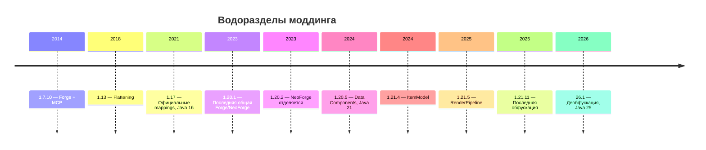

# Эволюция API: 1.7.10 → 26.3

> [!NOTE]
> Индексный документ: таймлайн версий, пять водоразделов и таблица «где искать то, что переехало». Детали — в файлах эпох.

## Содержание

- [Как пользоваться](#как-пользоваться)
- [Шесть эпох](#шесть-эпох)
- [Хронология](#хронология)
- [Пять водоразделов](#пять-водоразделов)
- [Где искать переехавшее](#где-искать-переехавшее)
- [Проверено на](#проверено-на)
- [Источники](#источники)

## Как пользоваться

1. Найдите свою версию в [хронологии](#хронология).
2. Перейдите в файл эпохи — там таблицы «было → стало» и последствия для миксинов.
3. Если портируете мод, читайте эпохи **последовательно**: изменения накапливаются, и пропущенный водораздел объясняет половину ошибок компиляции.

## Шесть эпох

| Эпоха | Версии | Java | Лоадеры | Сборка | Mappings | Файл |
| --- | --- | --- | --- | --- | --- | --- |
| Legacy Forge | 1.7.10–1.12.2 | 8 | Forge | ForgeGradle 1–3, RFG | MCP | [1-legacy-forge.md](1-legacy-forge.md) |
| Flattening | 1.13–1.16.5 | 8 | Forge, Fabric | FG 3–5, Loom | MCP + Yarn | [2-flattening.md](2-flattening.md) |
| Modern rename | 1.17–1.19.4 | 16 → 17 | Forge, Fabric, Quilt | FG 5/6, Loom | Mojmap + Yarn | [3-modern-rename.md](3-modern-rename.md) |
| Data components | 1.20.x | 17 → 21 | NeoForge, Forge, Fabric | FG 6, MDG, Loom | Mojmap + Yarn | [4-data-components.md](4-data-components.md) |
| Render rewrite | 1.21.x | 21 | NeoForge, Fabric | MDG, NG, Loom | Mojmap + Yarn | [5-render-rewrite.md](5-render-rewrite.md) |
| Unobfuscated | 26.1–26.3 | 25 | NeoForge, Fabric | MDG 2.x, NG 7.x, Loom 1.14+ | нет (имена Mojang) | [6-unobfuscated.md](6-unobfuscated.md) |

## Хронология

Даты — релизы Java Edition. Патчи внутри эпохи опущены, кроме тех, что ломали API.

| Версия | Дата | Java | Ключевое изменение |
| --- | --- | --- | --- |
| 1.7.10 | 2014-06-26 | 8 | Последняя «старая» версия с огромной базой модов; Forge + MCP |
| 1.8.9 | 2015-12-09 | 8 | `BlockPos`, `EnumFacing`, JSON-модели блоков |
| 1.9.4 | 2016-05-10 | 8 | Двурукость (`EnumHand`), `ItemStack` capabilities, `ITickable` |
| 1.10.2 | 2016-06-23 | 8 | Стабильная «долгоживущая» версия Forge-модпаков |
| 1.11.2 | 2016-11-15 | 8 | `RegistryEvent`, уход от `GameRegistry.register` |
| 1.12.2 | 2017-09-18 | 8 | `IForgeRegistry`, JSON-рецепты, финальная версия MCP-эпохи |
| 1.13.2 | 2018-10-22 | 8 | **Flattening**: blockstates, `ResourceLocation` для всех реестров |
| 1.14.4 | 2019-07-19 | 8 | `DeferredRegister`, `RegistryObject`, `IRecipe` |
| 1.15.2 | 2020-01-21 | 8 | `MatrixStack`, `RenderType`, рефакторинг рендера |
| 1.16.5 | 2021-01-15 | 8 | Финал Java 8; последняя версия с MCP по умолчанию |
| 1.17.1 | 2021-07-06 | 16 | **Официальные mappings Mojang**, `Level`, `BlockEntity`, `PoseStack` |
| 1.18.2 | 2022-02-28 | 17 | Worldgen, `saveAdditional`, `Holder` |
| 1.19.2 | 2022-08-05 | 17 | `Holder`, `Registry`, чат-компоненты |
| 1.19.4 | 2023-03-14 | 17 | Последняя версия перед 1.20 |
| 1.20.1 | 2023-06-12 | 17 | Последняя «общая» версия Forge/NeoForge; `GuiGraphics` |
| 1.20.2 | 2023-09-21 | 17 | **NeoForge отделяется от Forge** |
| 1.20.4 | 2023-12-07 | 17 | Стабилизация NeoForge |
| 1.20.5 | 2024-04-23 | 21 | **Data Components**: NBT предметов → компоненты, datapack-реестры |
| 1.20.6 | 2024-04-29 | 21 | Патч к 1.20.5 |
| 1.21 | 2024-06-13 | 21 | Компоненты окончательно, `Recipe` codecs |
| 1.21.1 | 2024-08-08 | 21 | «Стабильная» цель для модов 2024–2025 |
| 1.21.4 | 2024-12-03 | 21 | **ItemModel**: `assets/<ns>/items/*.json` |
| 1.21.5 | 2025-03-25 | 21 | **RenderPipeline**, рефакторинг GUI-рендера |
| 1.21.6 | 2025-06-17 | 21 | Большой рендер-рефакторинг Mojang (render states) |
| 1.21.8 | 2025-07-17 | 21 | Финальная стабильная 1.21.x для многих модов |
| 1.21.9 | 2025-09-30 | 21 | Подготовка к смене версионирования |
| 1.21.11 | 2025-12-09 | 21 | **Последняя обфусцированная версия** |
| 26.1 | 2026-03-24 | 25 | **Деобфускация**, Java 25, `GuiGraphicsExtractor`, `ItemStackTemplate` |
| 26.1.2 | 2026-04-09 | 25 | Хотфиксы первого drop'а |
| 26.2 | 2026-06-16 | 25 | Chaos Cubed; экспериментальный Vulkan-бэкенд |
| 26.3 | 2026-09-15 | 25 | Wilderness Bound; Renderpearl, SDL3, OIT — текущий стабильный релиз |
| 26.4 | 2026 Q4 | 25 | В снапшотах на момент проверки |

## Пять водоразделов

Их пять, а не двадцать: если понимать эти переходы, остальное — детали.

### 1. Flattening (1.13)

Числовые metadata блоков и предметов заменены на состояния и отдельные реестры. Всё, что хранило `meta`, пришлось переписать. Для миксинов это означало: целиться в `getStateFromMeta` больше некуда.

### 2. Официальные mappings (1.17)

Forge перешёл с MCP на Mojmap. Имена вроде `func_12345_a` исчезли, но вместе с ними исчезла и «народная» документация: старые туториалы перестали совпадать с кодом. Fabric остался на Yarn, поэтому одно и то же место в игре называлось по-разному в двух лагерях.

### 3. Data Components (1.20.5)

`ItemStack.getTag()` и произвольный NBT заменены типизированными компонентами. Это не косметика: изменилась модель данных, сериализация, сеть и способ добавлять предметам своё состояние. Моды, которые хранили данные в NBT, переписывались целиком.

### 4. ItemModel и RenderPipeline (1.21.4–1.21.6)

Сначала модели предметов переехали в `assets/<ns>/items/*.json`, затем Mojang начал переписывать рендер на `RenderPipeline` и render states. Для модов на Sodium/Iris и для всего, что рисует вручную, это самая болезненная эпоха.

### 5. Деобфускация (26.1)

Mojang убрал обфускацию. Пропали mappings как прослойка: имена в миксине — это имена в рантайме. Yarn/intermediary/refmap для 26.x не нужны, `officialMojangMappings()` в Loom падает. Параметры методов тоже стали настоящими, поэтому `@Local(name = "...")` заработал.

## Где искать переехавшее

| Что ищете | 1.16.5 | 1.20.1 | 26.3 |
| --- | --- | --- | --- |
| Мир | `World` | `Level` | `Level` |
| Тикающая сущность блока | `TileEntity` | `BlockEntity` | `BlockEntity` |
| Стек трансформаций | `MatrixStack` | `PoseStack` | `PoseStack` |
| Контекст GUI | — | `GuiGraphics` | `GuiGraphicsExtractor` |
| NBT предмета | `ItemStack#getTag` | `ItemStack#getTag` (до 1.20.5) | Data Components / `ItemStackTemplate` |
| Реестры | `RegistryEvent` | `DeferredRegister` | `DeferredRegister` + datapack-реестры |
| Модели предметов | `models/item/*.json` | `models/item/*.json` | `assets/<ns>/items/*.json` |
| Mappings | MCP | Mojmap | нет |
| Java | 8 | 17 | 25 |
| Сборка | FG 5 | FG 6 | MDG 2.x |

## Проверено на

- 2026-11-21: Minecraft 26.3, 26.2, 26.1; Java Edition 1.21.11 как последняя обфусцированная.
- Источники: Minecraft Wiki (version history, 26.3), официальные статьи Mojang, NeoForge docs/primers, Fabric docs.

## Источники

1. [Java Edition version history — Minecraft Wiki](https://minecraft.wiki/w/Java_Edition_version_history)
2. [Java Edition 26.3 — Minecraft Wiki](https://minecraft.wiki/w/Java_Edition_26.3)
3. [Minecraft's new version numbering system — minecraft.net](https://www.minecraft.net/en-us/article/minecraft-new-version-numbering-system)
4. [NeoForge for Minecraft 26.1 — neoforged.net](https://neoforged.net/news/26.1release/)
5. [1.21.11 → 26.1 Mod Migration Primer — NeoForged docs](https://docs.neoforged.net/primer/docs/26.1/)
6. [Fabric Documentation](https://docs.fabricmc.net/develop/)
