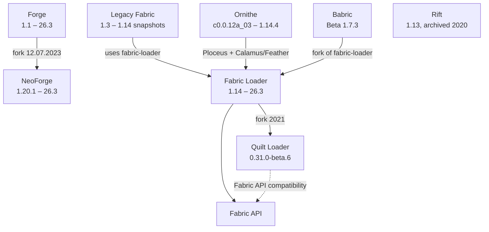
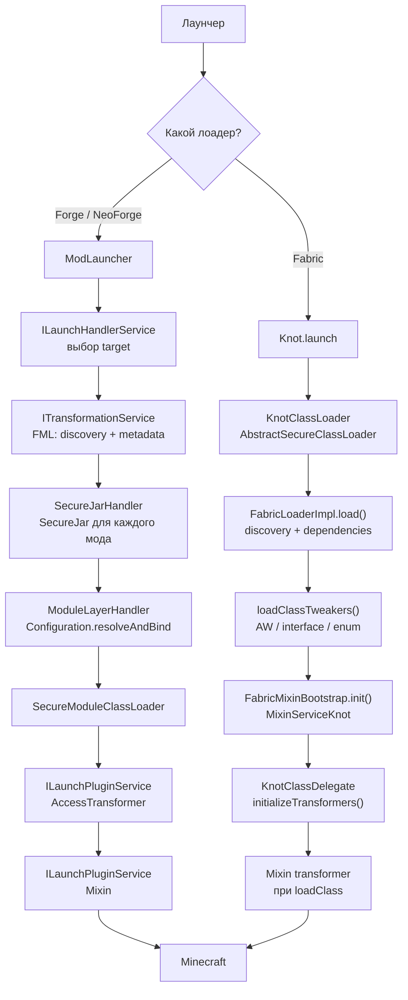
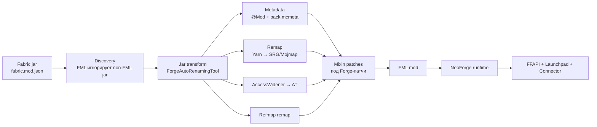

# Лоадеры, mappings и совместимость

[← К оглавлению](README.md)

> [!NOTE]
> **TL;DR.** В 2026 году главный водораздел — **26.1**: Mojang убрал обфускацию, официальные имена Mojang стали именами рантайма, Yarn и Intermediary для 26.x больше не существуют, а Parchment из обязательного слоя превратился в опцию «для javadoc'ов».
>
> Forge и NeoForge грузят моды через **ModLauncher** и JPMS-модули, Fabric — через **Knot** и изолирующий classloader. Оба семейства используют Mixin, но по-разному включают его и по-разному регистрируют контент: `DeferredRegister`/`RegisterEvent` против `Registry.register`, EventBus против `Event<T>`-callbacks.
>
> Мульти-лоадер в 2026 — это Architectury, MultiLoader или Unimined. Sinytra Connector позволяет запускать Fabric-моды на NeoForge, но это трансляция, а не эмуляция: миксины в чужие моды, class tweakers и отдельные модули Fabric API всё равно ломаются.

## Содержание

- [1. Карта экосистемы](#1-карта-экосистемы)
  - [1.1 Сводная таблица](#11-сводная-таблица)
  - [1.2 Forge → NeoForge: как появился форк](#12-forge--neoforge-как-появился-форк)
  - [1.3 Fabric → Quilt: родство и расхождение](#13-fabric--quilt-родство-и-расхождение)
  - [1.4 Mermaid: отношения лоадеров](#14-mermaid-отношения-лоадеров)
- [2. Архитектура загрузки модов](#2-архитектура-загрузки-модов)
  - [2.1 Forge/NeoForge: ModLauncher, SecureJarHandler, JPMS](#21-forgeneoforge-modlauncher-securejarhandler-jpms)
  - [2.2 Fabric Loader: Knot, classloader, entrypoints](#22-fabric-loader-knot-classloader-entrypoints)
  - [2.3 JPMS-модули: что это значит на практике](#23-jpms-модули-что-это-значит-на-практике)
  - [2.4 Ранние трансформеры, Access Transformers и Mixin](#24-ранние-трансформеры-access-transformers-и-mixin)
  - [2.5 Mermaid: путь мода от лаунчера до игры](#25-mermaid-путь-мода-от-лаунчера-до-игры)
- [3. Mappings: хронология и современность](#3-mappings-хронология-и-современность)
  - [3.1 Три пространства имён](#31-три-пространства-имён)
  - [3.2 Хронология](#32-хронология)
  - [3.3 MCP, SRG, TSRG: что это было](#33-mcp-srg-tsrg-что-это-было)
  - [3.4 Таблица «версия → что используют лоадеры»](#34-таблица-версия--что-используют-лоадеры)
  - [3.5 Что случилось с mappings в 26.1](#35-что-случилось-с-mappings-в-261)
  - [3.6 Parchment после 26.1](#36-parchment-после-261)
  - [3.7 Refmap и `remap`: практическое правило](#37-refmap-и-remap-практическое-правило)
- [4. Реестры и события](#4-реестры-и-события)
  - [4.1 Forge/NeoForge: `DeferredRegister` и `RegisterEvent`](#41-forgeneoforge-deferredregister-и-registerevent)
  - [4.2 Fabric: `Registry.register` и callbacks](#42-fabric-registryregister-и-callbacks)
  - [4.3 Сравнение](#43-сравнение)
  - [4.4 Data-driven реестры](#44-data-driven-реестры)
  - [4.5 Что это значит для миксинов](#45-что-это-значит-для-миксинов)
- [5. Мульти-лоадер](#5-мульти-лоадер)
  - [5.1 Architectury](#51-architectury)
  - [5.2 MultiLoader (шаблон Jared'а)](#52-multiloader-шаблон-jaredа)
  - [5.3 Unimined](#53-unimined)
  - [5.4 Сравнение подходов](#54-сравнение-подходов)
  - [5.5 Когда мульти-лоадер не нужен](#55-когда-мульти-лоадер-не-нужен)
- [6. Sinytra Connector](#6-sinytra-connector)
  - [6.1 Что это и из чего состоит](#61-что-это-и-из-чего-состоит)
  - [6.2 Как Fabric-мод превращается в NeoForge-мод](#62-как-fabric-мод-превращается-в-neoforge-мод)
  - [6.3 Что ломается](#63-что-ломается)
  - [6.4 Как проверять совместимость](#64-как-проверять-совместимость)
  - [6.5 Поддерживаемые версии и статус](#65-поддерживаемые-версии-и-статус)
- [7. Порт между лоадерами](#7-порт-между-лоадерами)
  - [7.1 Fabric → NeoForge: чеклист](#71-fabric--neoforge-чеклист)
  - [7.2 NeoForge → Fabric: чеклист](#72-neoforge--fabric-чеклист)
  - [7.3 Общие грабли](#73-общие-грабли)
- [8. Legacy-стек](#8-legacy-стек)
  - [8.1 Legacy Fabric](#81-legacy-fabric)
  - [8.2 Ornithe: Calamus, Feather, Ploceus](#82-ornithe-calamus-feather-ploceus)
  - [8.3 Babric](#83-babric)
  - [8.4 Rift](#84-rift)
  - [8.5 Почему это ниша](#85-почему-это-ниша)
- [9. Как выбрать лоадер в 2026](#9-как-выбрать-лоадер-в-2026)
  - [9.1 По версии Minecraft](#91-по-версии-minecraft)
  - [9.2 По аудитории](#92-по-аудитории)
  - [9.3 По зависимостям](#93-по-зависимостям)
  - [9.4 По CI и сборке](#94-по-ci-и-сборке)
  - [9.5 Короткое решение](#95-короткое-решение)
- [Проверено на](#проверено-на)
- [Источники](#источники)

---

## 1. Карта экосистемы

В 2026 году «лоадер» — это не только загрузчик jar'ов. Это ещё и:

- набор API (Fabric API, NeoForge API, QSL);
- политика mappings (Yarn/Intermediary против Mojmap);
- способ вмешательства в байткод (Mixin, Access Transformers, class tweakers);
- экосистема сборки (Loom, ModDevGradle, NeoGradle, ForgeGradle, Unimined);
- совместимость с модами другой платформы (Quilt → Fabric, Connector → NeoForge).

### 1.1 Сводная таблица

| Лоадер | Версии Minecraft | Чем отличается | Жив? (2026-11-21) | Ссылка |
| --- | --- | --- | --- | --- |
| **Forge** | 1.1–26.3; актуальные ветки: `1.20.1-47.4.29`, `1.21.1-52.1.21`, `26.3-66.1.9` | Исторический «тяжёлый» лоадер. ModLauncher, EventBus, `DeferredRegister`, Access Transformers, JPMS-модули. С 1.20.6 официальный MDK ставит `reobf = false` — runtime на official names. | Да. Ветка 1.20.1 до сих пор обновляется, есть сборки 26.3. | [minecraftforge.net](https://minecraftforge.net/), [GitHub](https://github.com/MinecraftForge/MinecraftForge) |
| **NeoForge** | 1.20.1 (совместим с Forge), 1.20.2–26.3; последняя `26.3.0.115` | Форк Forge 2023 года. С 20.2 — пакеты `net.neoforged.*`, mod id `neoforge`, реестры и capabilities переписаны, SRG заменён на Mojmap. С 26.1 — четырёхкомпонентные версии. | Да, основная площадка Forge-семейства на 1.21.1+ и 26.x. | [neoforged.net](https://neoforged.net/), [GitHub](https://github.com/neoforged/NeoForge) |
| **Fabric** | 1.14–26.3; Loader `0.20.1` (stable) | Минималистичный loader: сам по себе почти не даёт API. Всё удобное — в Fabric API. Основной механизм — Mixin; с Loader 0.18 / Loom 1.12 — ещё и class tweakers. | Да. | [fabricmc.net](https://fabricmc.net/), [GitHub](https://github.com/FabricMC/fabric-loader) |
| **Quilt** | Fabric-совместимый; Loader `0.31.0-beta.6`; 26.3 — `[unverified]` | Форк Fabric Loader 2021 года. Совместим с Fabric-модами, но имеет собственный `quilt.mod.json`, Quilt Config и расширения. QSL и Quilt Mappings прекращены; loader живёт. | Loader — да; API и mappings — нет. Экосистема небольшая. | [quiltmc.org](https://quiltmc.org/), [GitHub](https://github.com/QuiltMC/quilt-loader) |
| **Legacy Fabric** | 1.3–1.14 snapshots | Fabric для старых версий: тот же `fabric-loader`, но свои Legacy Yarn mappings (`net.legacyfabric:yarn`) и Loom-ветка. | Да, но ниша. | [legacyfabric.net](https://legacyfabric.net/) |
| **Ornithe** | `c0.0.12a_03`–`1.14.4`; loader `0.1.2` | Точные mappings для древних версий: **Calamus** (intermediary) + **Feather** (named), Gradle-плагин **Ploceus** поверх Loom, библиотека OSL. Запускает Fabric и Quilt. | Да, ниша. | [ornithemc.net](https://ornithemc.net/), [GitHub](https://github.com/OrnitheMC) |
| **Babric** | Beta 1.7.3 | Форк Fabric для беты: свой intermediary, **Barn** (форк Yarn), StationAPI как API-слой. | Да, ниша. | [babric.github.io](https://babric.github.io/), [StationAPI](https://github.com/ModificationStation/StationAPI) |
| **Rift** | 1.13 | Исторический лёгкий лоадер. Репозиторий архивирован 28 апреля 2020 года. | Нет. Только для археологии/истории. | [GitHub](https://github.com/DimensionalDevelopment/Rift) |

> [!IMPORTANT]
> «Жив» в таблице означает «есть свежие сборки и работающий канал поддержки», а не «рекомендуется для нового проекта». Quilt Loader, Legacy Fabric, Ornithe и Babric — нишевые проекты; для нового мода на 26.3 они не являются первым выбором.

### 1.2 Forge → NeoForge: как появился форк

Короткая версия:

1. **12 июля 2023** проект NeoForged объявил о форке Forge. Почти вся команда Forge перешла в новый проект; с Forge остался LexManos, которому принадлежит бренд и часть инфраструктуры.
2. **NeoForge для 1.20.1** был ещё совместим с Forge: моды часто работали на обоих.
3. **NeoForge 20.2 для 1.20.2** (30 октября 2023) — жёсткий разрыв: пакеты `net.minecraftforge.*` → `net.neoforged.*`, mod id `forge` → `neoforge`, реестры и capabilities переписаны, SRG заменён на Mojang mappings.
4. **1.20.1 NeoForge** команда сознательно не поддерживает: для 1.20.1 рекомендуется Forge.
5. **С 1.21.1** NeoForge стал основной площадкой Forge-семейства: к концу 2024 года на нём было больше 4000 модов.
6. **26.1** — NeoForge перешёл на четырёхкомпонентные версии (`26.1.0.10-beta`) и Java 25; **26.3** — актуальная ветка `26.3.0.x`.

Что это значит для порта:

- Мод, собранный под Forge 1.20.1, **не** является NeoForge-модом для 1.20.2+.
- Пакеты, имена событий, реестры и `mods.toml` отличаются.
- Для 1.20.1 берите Forge; для 1.20.2+ — NeoForge, если нет причин оставаться на Forge.
- Forge при этом не умер: на 2026-11-18 последняя сборка — `26.3-66.1.9`.

### 1.3 Fabric → Quilt: родство и расхождение

Quilt вырос из Fabric в 2021 году. Это не «другой лоадер с нуля», а **форк Fabric Loader** с совместимостью:

- Quilt Loader читает `fabric.mod.json` и умеет загружать Fabric-моды;
- в исходниках Quilt Loader есть отдельные каталоги `src/fabric/api`, `src/fabric/impl`, `src/fabric/legacy` — совместимость с Fabric API поддерживается на уровне кода;
- у Quilt есть собственный `quilt.mod.json`, Quilt Config и расширения загрузчика;
- **Quilt Standard Libraries (QSL)** и **Quilt Mappings** прекращены. QSL была альтернативой Fabric API, Quilted Fabric API — мостом; после 2025 года их не развивают. Quilt Mappings стали не нужны после удаления обфускации.

Практический вывод: Quilt Loader — это «Fabric-совместимый loader с другим управлением зависимостями и конфигом». Если мод уже работает на Fabric и не трогает внутренности loader'а, шанс запуска на Quilt высокий. Но это не гарантия: QSL-специфичные моды и моды, завязанные на внутренности Fabric Loader, могут не работать.

### 1.4 Mermaid: отношения лоадеров



Читать схему нужно так: стрелка — это происхождение или использование, а не «полная совместимость». NeoForge не совместим с Forge после 1.20.2; Quilt совместим с Fabric-модами, но не с QSL; Legacy Fabric/Ornithe/Babric используют инфраструктуру Fabric, но каждый со своими mappings и API.

---

## 2. Архитектура загрузки модов

Оба семейства решают одну задачу: **найти моды до старта игры, дать им возможность изменить байткод и передать управление Minecraft**. Но делают это разными способами.

### 2.1 Forge/NeoForge: ModLauncher, SecureJarHandler, JPMS

Forge и NeoForge используют **ModLauncher** — launch-библиотеку, которая стартует раньше игры и строит для неё отдельный module layer.

Ключевые участники (по документации ModLauncher и исходникам):

- **`ILaunchHandlerService`** — выбирает, какой main class запускать (`--launchTarget`). У Forge/NeoForge это их launch target, а не ванильный `Main`.
- **`ITransformationService`** — сервис, который может добавить трансформеры и аргументы командной строки. FML реализует именно этот интерфейс: он находит моды, читает метаданные, строит список модов и подготавливает классы.
- **`ILaunchPluginService`** — «системный» плагин трансформации. В схеме ModLauncher именно сюда относятся **Mixin** и **Access Transformers**.
- **`ITransformer`** — конкретный трансформер, который получает байткод класса и может его изменить.
- **SecureJarHandler** (проект `securejarhandler`) — работа с «безопасными» модульными jar'ами: `SecureJar` даёт модульное описание, список пакетов и ресурсов.
- **`ModuleLayerHandler`** — строит JPMS-слои: `Configuration.resolveAndBind(SecureModuleFinder.of(jars), ...)`, затем `ModuleLayer.defineModules(...)` с `SecureModuleClassLoader`.

Упрощённо:

```text
launcher
  └─ ModLauncher
       ├─ ILaunchHandlerService  → выбрать target (forgeclient / forgeserver / neoforgeclient)
       ├─ ITransformationService → FML: найти моды, прочитать metadata, собрать mod list
       ├─ ILaunchPluginService   → Mixin, AccessTransformer
       ├─ SecureJarHandler       → SecureJar для каждого мода
       └─ ModuleLayerHandler     → module layer + SecureModuleClassLoader
            └─ Minecraft
```

Мод для NeoForge — это не просто jar с классами. Это:

- `META-INF/neoforge.mods.toml` с метаданными;
- `@Mod`-класс (или несколько), который получает `IEventBus`, `ModContainer`, `Dist`;
- при необходимости — `META-INF/accesstransformer.cfg`, mixin config, `[[mixins]]` в TOML;
- набор пакетов, которые не должны пересекаться с другими модулями (split packages запрещены).

Именно из-за JPMS в Connector'е пришлось отдельно решать проблему split packages: Fabric-моды часто состоят из «платформенного» и «core» jar'а с общими пакетами, а модульная система такое не прощает.

### 2.2 Fabric Loader: Knot, classloader, entrypoints

Fabric Loader не строит JPMS-слой. Он запускает игру через **Knot** и подменяет classloader.

По исходникам Fabric Loader:

- **`Knot.launch(...)`** — точка входа. Создаёт `Knot`, инициализирует `KnotClassLoader` и передаёт управление game provider'у.
- **`KnotClassLoader`** — наследник `AbstractSecureClassLoader`; `loadClass` делегирует в `KnotClassDelegate`.
- **`KnotClassDelegate`** — содержит `IMixinTransformer`, инициализирует трансформеры и применяет Mixin при загрузке классов.
- **`FabricLoaderImpl.load()`** — обнаруживает моды, читает `fabric.mod.json`, строит зависимости, вызывает entrypoints.
- **`FabricLoaderImpl.loadClassTweakers()`** — загружает class tweakers (бывшие access wideners).
- **`FabricMixinBootstrap.init(...)`** — выставляет системные свойства `mixin.bootstrapService` и `mixin.service`, вызывает `MixinBootstrap.init()`.
- **`MixinServiceKnot`** / **`MixinServiceKnotBootstrap`** — реализация Mixin-сервиса для Knot.
- **`MixinServiceKnot.getTransformer()`** возвращает `IMixinTransformer`, который потом использует `KnotClassDelegate`.

Упрощённо:

```text
launcher
  └─ Knot
       ├─ KnotClassLoader (AbstractSecureClassLoader)
       │    └─ KnotClassDelegate
       │         └─ Mixin transformer
       ├─ FabricLoaderImpl
       │    ├─ discover mods (fabric.mod.json)
       │    ├─ resolve dependencies
       │    ├─ loadClassTweakers()
       │    └─ invoke entrypoints (ModInitializer / ClientModInitializer)
       └─ game provider
            └─ Minecraft
```

В отличие от Forge/NeoForge, у Fabric нет единого EventBus. Fabric Loader даёт только entrypoints; всё остальное — либо Fabric API, либо собственные миксины мода.

### 2.3 JPMS-модули: что это значит на практике

**Forge/NeoForge:**

- Каждый мод превращается в модуль (или несколько) внутри module layer.
- Пакеты не должны пересекаться: два jar'а с одним пакетом — ошибка `Modules X and Y export package Z`.
- `neoforge.mods.toml` поддерживает `services = [...]`, что соответствует `uses` в `module-info.java`.
- Reflection и `Unsafe` ограничены сильнее, чем в classpath-мире.
- Runtime-генерируемые классы (например, `Args`-классы для `@ModifyArgs`) должны попадать в модуль; Mixin и Connector решают это через синтетический модуль.

**Fabric:**

- Модовые jar'ы лежат на classpath, а `KnotClassLoader` изолирует загрузку.
- Нет запрета на split packages; наоборот, многие Fabric-моды на этом построены.
- Нет `module-info`-требований; `fabric.mod.json` — единственный обязательный metadata-файл.
- Зато нет и JPMS-сервисов: если нужен ServiceLoader-подобный механизм, его строят вручную или через Fabric API.

Практическое следствие: **мод, который нормально живёт на Fabric, может упасть на NeoForge ещё до запуска** — не из-за кода, а из-за структуры jar'ов и пакетов.

### 2.4 Ранние трансформеры, Access Transformers и Mixin

Порядок важен: сначала loader даёт модулю доступ к приватным членам, потом Mixin вставляет код.

**Forge/NeoForge:**

- **Access Transformer (AT)** — файл `META-INF/accesstransformer.cfg` (или `[[accessTransformers]]` в TOML). Меняет видимость и `final` у классов/методов/полей. Это launch plugin; на практике он применяется раньше Mixin, чтобы миксин видел уже расширенный доступ.
- **Mixin** — launch plugin, трансформирует байткод при загрузке класса.
- **Interface injection** — NeoForge-механизм, позволяющий объявить, что ванильный класс реализует ваш интерфейс, без миксина.
- **Enum extension** — NeoForge-механизм расширения enum'ов.
- Исторические **coremods** Forge (ASM-патчи на ранней стадии) в NeoForge не являются поддерживаемым путём; для новых модов используйте Mixin/AT/interface injection.

**Fabric:**

- **Class tweakers** (бывшие access wideners) — файл `*.classtweaker` с заголовком `classTweaker v1 official`. Директивы: `accessible`, `extendable`, `mutable`, `inject-interface`, `extend-enum`; есть `transitive-*`-варианты.
- Class tweakers работают только с **ванильными** классами; для модовых целей используйте обычный доступ или миксин.
- **Mixin** — единственный официально поддерживаемый Fabric Loader способ трансформации классов (плюс class tweakers как «декларативная» альтернатива для доступа).
- Class tweakers требуют Fabric Loader 0.18+ и Loom 1.12+; ключ в `fabric.mod.json` по-прежнему называется `accessWidener` для обратной совместимости.

> [!WARNING]
> AT и class tweakers — не одно и то же. AT меняет `public/protected/private` и `final`; class tweaker умеет ещё `inject-interface` и `extend-enum`. При порте недостаточно переписать синтаксис — проверьте, что именно делает директива.

### 2.5 Mermaid: путь мода от лаунчера до игры



Схема подчёркивает главное различие: у Forge/NeoForge трансформации — это **сервисы ModLauncher'а** и отдельные module layers; у Fabric — **classloader и Mixin-трансформер**, без JPMS.

---

## 3. Mappings: хронология и современность

### 3.1 Три пространства имён

До 26.1 в Minecraft одновременно существовали три «слоя имён»:

| Слой | Пример | Кто использует | Зачем |
| --- | --- | --- | --- |
| **Obfuscated / official** | `brc`, `a`, `func_12345_a` | Рантайм игры до 26.1; Mojang | Скрыть имена, уменьшить jar |
| **Intermediary** | `class_1548`, `method_12345`, `field_6789` | Fabric-моды в production | Стабильные имена между версиями |
| **Named** | `Creeper`, `getBlockState` | Разработчик в IDE | Читаемый код |

**Intermediary vs named** — это не «два варианта одного и того же», а два разных контракта:

- **Intermediary** — стабильный, но нечитаемый. Мод компилируется в named, а при сборке ремапится в intermediary. В production Fabric Loader ремапит игру в intermediary, и мод работает без пересборки под каждую версию (если затронутые классы не менялись).
- **Named** — человекочитаемый. Yarn — community-named для Fabric; Mojmap — official-named от Mojang. Named используется в dev-окружении и при чтении исходников.

После 26.1 обфускации нет, поэтому intermediary больше не нужен: имена в рантайме — это official names Mojang.

### 3.2 Хронология

| Период | Событие | Что использовали |
| --- | --- | --- |
| 2011–2012 | MCP (Mod Coder Pack) становится стандартом для Forge | MCP-имена, `func_*`, `field_*` |
| 1.7.10–1.12.2 | Расцвет Forge на MCP | MCP stable/snapshot, SRG в runtime |
| 1.13–1.16.5 | MCPConfig, TSRG | MCP-имена + SRG/TSRG; `joined.tsrg` |
| 2019 | Mojang публикует official mappings (с 1.14.4) | Mojmap как опция |
| 1.17 | Forge полностью переходит на Mojmap в dev | Mojmap + SRG в runtime |
| 1.20.1 | Последняя «общая» версия Forge/NeoForge | Forge: Mojmap + SRG; Fabric: Yarn + Intermediary |
| 1.20.2 | NeoForge 20.2: hard fork | NeoForge: Mojmap в runtime, SRG убран |
| 1.20.6 | Официальный Forge MDK ставит `reobf = false` | Forge: official names в runtime |
| 2025 | Yarn объявлен deprecated; 1.21.11 — последняя обфусцированная версия | Fabric: Yarn + Intermediary до 1.21.11 |
| 26.1 | Mojang убирает обфускацию | Official names в runtime; Yarn/Intermediary не применимы |
| 26.1+ | Loom 1.14 split; `officialMojangMappings()` падает | `net.fabricmc.fabric-loom` без mappings |

> [!NOTE]
> «Forge перешёл на Mojmap в 1.17» не означает «SRG исчез в 1.17». В dev-среде Forge 1.17–1.20.4 вы писали Mojmap-имена, но production-jar реобфусцировался в SRG: классы — official, методы/поля — `m_*`/`f_*`. Полный отказ от SRG в runtime произошёл позже: у NeoForge — в 20.2, у Forge — с 1.20.6 (`reobf = false`).

### 3.3 MCP, SRG, TSRG: что это было

- **MCP (Mod Coder Pack)** — исторический набор mappings, по которому Forge-моды писались до 1.16.5 включительно. Имена вида `func_12345_a`, `field_6789_b`.
- **SRG (Searge's RetroGuard)** — «промежуточные» имена Forge для runtime. Именно они появлялись в crash-report'ах Forge: `m_12345_`, `f_6789_`. SRG позволял сохранять бинарную совместимость между версиями патчей.
- **TSRG** — текстовый формат mappings, использовавшийся MCPConfig. В 1.13+ через него описывались SRG-имена; TSRGv2 появился между 1.16 и 1.17.
- **MCPConfig** — публичный репозиторий Forge с SRG mappings; по нему генерировались `joined.tsrg` и реобфускация.
- **ForgeAutoRenamingTool** — инструмент, который применяет mappings к jar'ам; используется Forge и, например, Connector'ом.

Для современного кода эти имена важны в двух случаях:

1. Вы читаете старый crash-report Forge 1.20.1 и видите `m_12345_`.
2. Вы портируете старый мод и должны понять, какой SRG-член соответствует какому Mojmap-имени.

В 26.x SRG не нужен: имён `m_*` в рантайме нет.

### 3.4 Таблица «версия → что используют лоадеры»

| Версия Minecraft | Forge | NeoForge | Fabric |
| --- | --- | --- | --- |
| **≤ 1.12.2** | MCP stable/snapshot; SRG в runtime | — | — |
| **1.13 – 1.16.5** | MCP + SRG/TSRG; `joined.tsrg` | — | Yarn + Intermediary (Fabric с 1.14) |
| **1.17 – 1.20.1** | Mojmap в dev; SRG в runtime (классы — official) | 1.20.1: совместим с Forge, SRG | Yarn + Intermediary |
| **1.20.2 – 1.20.5** | Mojmap в dev; SRG в runtime | Mojmap в runtime (SRG убран в 20.2) | Yarn + Intermediary |
| **1.20.6 – 1.21.11** | Mojmap в runtime (`reobf = false`) | Mojmap в runtime | Yarn + Intermediary; Yarn deprecated с 2025 |
| **26.1+** | Official names в runtime, mappings не нужны | Official names в runtime | Official names в runtime; Yarn/Intermediary не существуют |

Пояснения к таблице:

- **1.20.1** — особый случай: NeoForge для неё существовал, но команда его не поддерживает; для 1.20.1 берите Forge.
- **1.20.2–1.20.5** — у Forge ещё SRG в runtime; у NeoForge уже Mojmap. Это одна из причин, почему crash-report'ы двух лоадеров на одной версии выглядят по-разному.
- **1.20.6+** — Forge догоняет NeoForge по runtime-именам; в официальном MDK стоит `reobf = false`.
- **26.1+** — и Forge, и NeoForge, и Fabric используют official names; Parchment — только для javadoc'ов.

Граница «SRG → official runtime» у Forge проведена по официальному MDK: в 1.20.6+ в нём `reobf = false`. Для 1.20.2–1.20.5 это следствие той же границы; если у вас нестандартный toolchain, проверьте `reobf` в своём проекте.

Fabric и до 26.1 поддерживал official mappings как опцию (`loom.officialMojangMappings()`), но типичным выбором был Yarn; таблица показывает именно типичный случай.

### 3.5 Что случилось с mappings в 26.1

Хронология по первоисточникам:

1. **31 октября 2025** Fabric публикует пост «Removing Obfuscation from Fabric»: Mojang убирает обфускацию начиная с первого снапшота после `Mounts of Mayhem` (1.21.11).
2. **1.21.11** — последняя обфусцированная версия. Для неё ещё есть Yarn и Intermediary.
3. **26.1** — первый релиз без обфускации. В jar'е — official names Mojang, включая **имена параметров**.
4. **Yarn** перестаёт поддерживаться для новых версий. Для старых версий контрибьюции всё ещё принимаются, но 26.x Yarn не получит.
5. **Intermediary** больше не существует: ремапить игру в стабильные `class_*` не нужно, потому что official names уже читаемые.
6. **Loom 1.14** разделён на два plugin id:
   - `net.fabricmc.fabric-loom` — для необфусцированных версий (26.1+), ничего не ремапит;
   - `net.fabricmc.fabric-loom-remap` — для обфусцированных версий (1.21.11 и ниже);
   - `fabric-loom` остаётся для обратной совместимости со старыми проектами.
7. **`loom.officialMojangMappings()`** на 26.x падает: Mojang больше не публикует `client_mappings.json`, а Loom в non-remap режиме не должен требовать mappings. Если вы видите `Failed to find official mojang mappings for 26.1.2` — вы всё ещё на старом plugin id.
8. **Parchment** больше не обязателен: parameter names приходят с игрой. Его можно оставить только ради дополнительных javadoc'ов.

Практический рецепт для Fabric 26.x:

```groovy
// build.gradle — 26.x
plugins {
    id 'net.fabricmc.fabric-loom' version "${loom_version}"
}

dependencies {
    minecraft "com.mojang:minecraft:26.3"
    // строки mappings нет вообще
    modImplementation "net.fabricmc:fabric-loader:0.20.1"
    modImplementation "net.fabricmc.fabric-api:fabric-api:..."
}
```

Для сравнения, 1.21.11:

```groovy
plugins {
    id 'net.fabricmc.fabric-loom-remap' version "${loom_version}"
}

dependencies {
    minecraft "com.mojang:minecraft:1.21.11"
    mappings "net.fabricmc:yarn:${yarn_mappings}:v2"
    modImplementation "net.fabricmc:fabric-loader:0.20.1"
}
```

> [!CAUTION]
> В 26.x official names — это **не** «Mojmap, который надо наложить». Это имена, которые уже лежат в jar'е. Попытка добавить `mappings` в non-remap Loom даёт ошибку конфигурации; попытка использовать remap-Loom на 26.x даёт ошибку поиска mappings.

### 3.6 Parchment после 26.1

Parchment — это слой **поверх** Mojmap: parameter names и javadoc'и, которых нет в official mappings. Он был популярен на 1.16.5–1.21.11.

Что изменилось:

- 26.1 поставляет parameter names вместе с игрой;
- Parchment для 26.x не нужен для имён параметров;
- его можно оставить, если нужны javadoc'и (NeoForge 26.1 прямо пишет: «Parchment can be removed… You can also keep it to benefit from additional javadocs»);
- для старых версий Parchment всё ещё полезен: таблица ParchmentMC заканчивается на 1.21.11.

Если вы портируете проект с 1.21.11 на 26.1, чаще всего нужно **удалить** Parchment-зависимость из `gradle.properties`/`build.gradle`, а не обновлять её версию.

### 3.7 Refmap и `remap`: практическое правило

До 26.1:

- Mixin annotation processor генерировал **refmap** — JSON, который переводил «мягкие» ссылки в аннотациях (`method = "..."`, `@At(target = "...")`) в имена рантайма.
- Fabric: refmap переводил named → intermediary. Loom/TinyRemapper с определённых версий умеет ремапить и сами миксины, поэтому refmap стал не обязательным, но всё ещё встречается.
- Forge 1.20.1: refmap переводил Mojmap → SRG; без него миксин искал `getBlockState`, а в runtime был `m_12345_`.
- NeoForge 1.20.2+: SRG нет, refmap не нужен.
- Forge 1.20.6+: runtime official names, refmap не нужен.

После 26.1:

- runtime names = official names;
- refmap не нужен;
- для миксинов, которые ссылаются на члены по имени, полезно ставить `remap = false`, чтобы annotation processor не пытался искать несуществующий mapping. Это особенно важно для модовых целей и для 26.x.

Правило:

| Ситуация | `remap` | Refmap |
| --- | --- | --- |
| Fabric 1.20.1, цель — ванильный класс | `true` (по умолчанию) | нужен или генерируется Loom |
| Fabric 1.20.1, цель — модовый класс | `false` | не нужен |
| Forge 1.20.1, цель — ванильный класс | `true` | нужен (Mojmap → SRG) |
| NeoForge 1.21.1, цель — ванильный класс | `false` | не нужен |
| 26.x, любая цель | `false` | не нужен |

---

## 4. Реестры и события

### 4.1 Forge/NeoForge: `DeferredRegister` и `RegisterEvent`

В NeoForge есть два способа регистрации:

1. **`DeferredRegister`** — обёртка над `RegisterEvent`, рекомендуется документацией.
2. **`RegisterEvent`** — «сырой» событийный способ.

Пример `DeferredRegister`:

```java
public static final DeferredRegister<Block> BLOCKS =
        DeferredRegister.create(BuiltInRegistries.BLOCK, ExampleMod.MOD_ID);

public static final DeferredHolder<Block, Block> EXAMPLE_BLOCK =
        BLOCKS.register("example_block", () -> new Block(...));

// в конструкторе @Mod-класса
public ExampleMod(IEventBus modBus) {
    BLOCKS.register(modBus);
}
```

`DeferredHolder<R, T extends R>` — это `Supplier<T>`: объект создаётся не в момент объявления поля, а позже, когда сработает registry event. Поэтому `EXAMPLE_BLOCK.get()` нельзя вызывать слишком рано.

Пример `RegisterEvent`:

```java
@SubscribeEvent // на mod event bus
public static void register(RegisterEvent event) {
    event.register(
        BuiltInRegistries.BLOCK,
        registry -> {
            registry.register(
                Identifier.fromNamespaceAndPath(MOD_ID, "example_block"),
                new Block(...)
            );
        }
    );
}
```

Порядок жизненного цикла NeoForge (по docs):

1. Вызывается конструктор `@Mod`.
2. Вызываются `@EventBusSubscriber`.
3. `FMLConstructModEvent`.
4. Registry events: `NewRegistryEvent`, `DataPackRegistryEvent.NewRegistry`, `RegisterEvent` для каждого реестра.
5. `FMLCommonSetupEvent`.
6. Sided setup: `FMLClientSetupEvent` или `FMLDedicatedServerSetupEvent`.
7. `InterModComms`.
8. `FMLLoadCompleteEvent`.

События живут на двух шинах:

- **`NeoForge.EVENT_BUS`** — game bus, большинство игровых событий;
- **mod bus**, который передаётся в конструктор `@Mod`, — lifecycle и registry events.

`@SubscribeEvent`, `@EventBusSubscriber`, `IEventBus#addListener`, `EventPriority`, `ICancellableEvent`, `TriState`/`Result` — всё это части одной системы. Многие mod bus events выполняются параллельно (`ParallelDispatchEvent`), поэтому для main-thread работы используется `#enqueueWork(...)`.

### 4.2 Fabric: `Registry.register` и callbacks

Fabric регистрирует контент статически, обычно в `ModInitializer#onInitialize`:

```java
// упрощённо: в 26.x id предмета задаётся через Item.Properties#setId / BlockItemId
public class ExampleMod implements ModInitializer {
    public static final Block EXAMPLE_BLOCK = new Block(...);

    @Override
    public void onInitialize() {
        Registry.register(
            BuiltInRegistries.BLOCK,
            Identifier.fromNamespaceAndPath(MOD_ID, "example_block"),
            EXAMPLE_BLOCK
        );
        Registry.register(
            BuiltInRegistries.ITEM,
            Identifier.fromNamespaceAndPath(MOD_ID, "example_block"),
            new BlockItem(EXAMPLE_BLOCK, new Item.Properties())
        );
    }
}
```

Особенности:

- `Registry.register` — прямой вызов, без события и без `DeferredRegister`.
- Класс со статическими полями нужно «загрузить» (обычно через `initialize()`), иначе JVM не инициализирует поля.
- `BuiltInRegistries` — ванильные реестры; `Registries` — ключи; `ResourceKey` — ключ записи.
- `Identifier` — имя `namespace:path`. В 26.x это official name; в 1.21.x Yarn тоже даёт `Identifier`, а Mojmap — `ResourceLocation`.

События Fabric API — это **callbacks**, а не шина:

```java
AttackBlockCallback.EVENT.register((player, level, hand, pos, direction) -> {
    // ...
    return InteractionResult.PASS;
});
```

Каждый callback-интерфейс хранит `Event<T>` (обычно в статическом поле `EVENT`). `EventFactory` создаёт array-backed event. Если готового callback'а нет, мод делает свой event и вызывает его из миксина:

```java
public interface SheepShearCallback {
    Event<SheepShearCallback> EVENT = EventFactory.createArrayBacked(
        SheepShearCallback.class,
        listeners -> (player, sheep) -> {
            for (SheepShearCallback listener : listeners) {
                InteractionResult result = listener.interact(player, sheep);
                if (result != InteractionResult.PASS) return result;
            }
            return InteractionResult.PASS;
        }
    );

    InteractionResult interact(Player player, Sheep sheep);
}
```

Здесь нет `EventPriority` и `@SubscribeEvent`: порядок задаётся порядком регистрации и логикой callback'а, а отмена — возвращаемым `InteractionResult`.

### 4.3 Сравнение

| Аспект | Forge/NeoForge | Fabric |
| --- | --- | --- |
| Регистрация | `DeferredRegister` (рекомендуется) или `RegisterEvent` | `Registry.register` напрямую |
| Время создания объекта | Позже, в registry event | Сразу, при статической инициализации/entrypoint |
| Ссылка на объект | `DeferredHolder`/`Supplier` | Прямая ссылка |
| События | Центральный EventBus (game + mod bus) | `Event<T>` callbacks в Fabric API |
| Приоритеты | `EventPriority` | Обычно нет; порядок регистрации/логика callback'а |
| Отмена | `ICancellableEvent`, `TriState`, `Result` | Возвращаемое значение callback'а |
| Lifecycle | Явные события (`FMLConstructModEvent`, `FMLCommonSetupEvent`, …) | Entrypoints + события Fabric API |
| Клиент/сервер | `Dist`, `@EventBusSubscriber(value = Dist.CLIENT)` | `ClientModInitializer`, `env` в `fabric.mod.json` |
| Data-driven реестры | `DataPackRegistryEvent.NewRegistry` | `DynamicRegistries.register` / `registerSynced` |

Главное отличие: **Fabric не имеет единой шины**, поэтому «событие» — это API-контракт конкретного модуля. NeoForge, наоборот, централизует события и даёт им приоритеты/отмену.

### 4.4 Data-driven реестры

Оба лоадера поддерживают реестры, которые загружаются из JSON datapack'а при открытии мира.

**NeoForge:**

```java
@SubscribeEvent
public static void registerDatapackRegistries(DataPackRegistryEvent.NewRegistry event) {
    event.dataPackRegistry(
        SPELL_REGISTRY_KEY,
        Spell.CODEC,
        Spell.CODEC
    );
}
```

Записи лежат в `data/<namespace>/<registry-namespace>/<registry-path>/...`; для modded-реестров путь включает namespace реестра. Доступ — через `RegistryAccess` (`ServerLevel#registryAccess()`, `Minecraft.getInstance().getConnection()#registryAccess()`).

**Fabric:**

```java
DynamicRegistries.registerSynced(
    MAGIC_SKILLS_REGISTRY_KEY,
    MagicSkillsRegistryEntry.CODEC
);
```

`DynamicRegistries.register()` создаёт серверный реестр, `registerSynced()` — синхронизируемый с клиентом. Записи — JSON в `data/<namespace>/<registry-namespace>/<registry-path>/`.

Что общего:

- реестр загружается вместе с миром, а не при старте игры;
- записи описываются `Codec`/`MapCodec`;
- клиент видит только synced-реестры;
- datapack может добавлять/переопределять записи без кода.

Различие: NeoForge использует событие `DataPackRegistryEvent.NewRegistry` и `RegistrySetBuilder` для datagen; Fabric — `DynamicRegistries` и data providers на `FabricDataOutput`.

### 4.5 Что это значит для миксинов

1. **Не читайте `DeferredHolder.get()` слишком рано.** На NeoForge объект появляется в registry event, а не в конструкторе мода. Миксин в конструктор вашего блока/предмета может сработать позже, чем вы ожидаете.
2. **Fabric регистрирует раньше, чем NeoForge выполняет registry events.** Если миксин целится в `Registry.register` или в `Bootstrap`, на NeoForge этого вызова может не быть в том же виде: там свой registry pipeline. Цельтесь в игровую логику, а не в регистрацию.
3. **Data-driven записи не существуют на этапе mod init.** Миксин, который на старте игры обращается к `RegistryAccess`, получит пустой/незагруженный реестр. Используйте lifecycle events или ленивые `Holder`.
4. **`Identifier` vs `ResourceLocation`.** В 26.x official name — `Identifier` (`Identifier.fromNamespaceAndPath`). В 1.21.x имя зависит от mappings: Yarn — `Identifier`, Mojmap — `ResourceLocation`. Миксин с descriptor'ом старого класса не найдёт цель.
5. **Не делайте `@Overwrite` на методах регистрации/`Bootstrap`.** Это ломает и другие моды, и loader. Для изменения значения используйте `@ModifyExpressionValue`/`@WrapOperation`; для добавления поведения — `@Inject` с точным `@At`.
6. **События Fabric API часто сами реализованы миксинами.** Если вы одновременно слушаете callback и ставите миксин в тот же метод, легко получить двойной вызов. Проверяйте, не покрывает ли ваш случай существующий callback.

---

## 5. Мульти-лоадер

Есть три больших подхода: **Architectury** (абстракция), **MultiLoader** (несколько source set'ов без абстракции) и **Unimined** (один Gradle-плагин на всё).

### 5.1 Architectury

Architectury — это набор из трёх частей:

- **Architectury API** — абстракция над Fabric API и Forge API: события, networking, реестры, loader calls. В README заявлено больше 90 event hooks.
- **Architectury Plugin** — Gradle-плагин, включающий Architectury Injectables (в том числе `@ExpectPlatform`).
- **Architectury Loom** — форк Fabric Loom для мультиплатформенной разработки.

`@ExpectPlatform` работает **только на статических методах**. Идея: в common-коде вы объявляете метод, а платформенные модули дают реализацию; плагин подставляет вызов на этапе компиляции.

```java
public final class Platform {
    @ExpectPlatform
    public static Path getConfigDir() {
        throw new AssertionError(); // тело не используется
    }
}
```

Плюсы:

- меньше boilerplate;
- common-код может пользоваться абстракциями API;
- есть шаблоны проектов;
- API опционален: можно взять только plugin/Loom.

Минусы:

- abstraction leak: не всё API лоадеров покрыто;
- для нестандартной интеграции всё равно нужен платформенный код;
- добавляется зависимость на Architectury API;
- `@ExpectPlatform` ограничен статическими методами;
- при обновлении Minecraft нужно ждать обновления API.

Когда подходит: мод с большим common-слоем, активно использующий события/реестры/networking, и команда готова принять зависимость.

### 5.2 MultiLoader (шаблон Jared'а)

MultiLoader Template — это Gradle-проект с несколькими модулями:

```text
MultiLoader-Template/
├── common/        # код, общий для всех лоадеров
├── fabric/        # fabric.mod.json, entrypoints, Fabric API
├── neoforge/      # neoforge.mods.toml, @Mod, NeoForge API
├── forge/         # опционально, для старых версий
├── gradle.properties
└── settings.gradle
```

Ключевое правило: **`common` компилируется против ванильного Minecraft** и не знает про API лоадеров. Всё платформенное — в `fabric`/`neoforge`. Шаблон не требует сторонних библиотек (кроме самих лоадеров).

Плюсы:

- полный контроль;
- нет abstraction layer;
- легко добавить/убрать платформу (удалить модуль и `include(...)`);
- хорошо для модов, где платформенный код всё равно нужен.

Минусы:

- много ручной работы: события, реестры, networking, datagen дублируются;
- common-код не может напрямую использовать ни Fabric API, ни NeoForge API;
- нужно поддерживать несколько build-скриптов;
- тестовая матрица удваивается.

Когда подходит: мод среднего размера, где платформенные различия всё равно существенны, или команда не хочет зависимости от Architectury.

### 5.3 Unimined

Unimined — единый Gradle-плагин для сборки модов под разные лоадеры и версии, включая legacy. По README поддерживает:

- Fabric, Quilt, Legacy Fabric, Ornithe, Babric;
- Forge (FG1/FG2/modern), NeoForge (включая 26.x unobfuscated);
- Rift, LiteLoader, Risugami's ModLoader, JarModAgent;
- CraftBukkit/Spigot/Paper;
- Vanilla-конверсии (ReIndev, Better Than Adventure, NSSS).

Состояние на 2026-11:

- 1.x — LTS-ветки;
- 2.0 — modular rewrite в статусе prerelease;
- поддержка лоадеров в 2.0 заявлена как preliminary;
- адаптеры: JvmDowngrader, Stonecutter, ExpectPlatform, Forgix, PatchBase, ModPublisher;
- репозиторий: актуальный — `github.com/unimined/Unimined` (вариант `UniTeam/Unimined` из старых ссылок не существует).

Плюсы:

- одна кодовая база для многих версий/лоадеров;
- глубокий контроль над mappings и remap pipeline;
- поддержка очень старых версий;
- production runs, mod metadata generation, CLI init.

Минусы:

- сложный DSL и концепции;
- 2.0 ещё не стабильна;
- документация догоняет;
- для простого мода на 26.3 избыточен;
- Gradle daemon требует много памяти (README: 4 GB).

Когда подходит: мульти-версионные моды, legacy-проекты, нестандартные лоадеры, CI, где нужна матрица версий.

### 5.4 Сравнение подходов

| Критерий | Architectury | MultiLoader | Unimined |
| --- | --- | --- | --- |
| Абстракция API | Да, Architectury API | Нет | Нет (адаптеры опциональны) |
| Контроль | Средний | Высокий | Очень высокий |
| Boilerplate | Меньше | Больше | Средний/высокий |
| Поддержка legacy | Ограниченная | Зависит от шаблона | Сильная |
| Поддержка многих версий | Обычно одна | Обычно одна | Да |
| Стабильность | Высокая | Высокая | 1.x — да, 2.0 — prerelease |
| Порог входа | Низкий/средний | Средний | Высокий |

### 5.5 Когда мульти-лоадер не нужен

Не стоит тащить мульти-лоадер, если:

- мод живёт только на одной платформе и вряд ли переедет;
- почти весь код — платформенный (глубокие интеграции с NeoForge capabilities, Fabric API-модулями, рендером);
- мод состоит в основном из миксинов в loader-специфичные классы;
- команда из одного человека и нет ресурсов на двойную тестовую матрицу;
- вы ещё не проверили, что мод вообще нужен на второй платформе.

Мульти-лоадер — это не «галочка качества», а удвоение работы по сборке, тестам и поддержке.

---

## 6. Sinytra Connector

### 6.1 Что это и из чего состоит

**Sinytra Connector** — слой совместимости, который позволяет запускать Fabric-моды на NeoForge. Он не является лоадером и не «эмулирует Fabric»: он **транслирует** Fabric-мод в FML-мод и подменяет окружение.

Компоненты:

- **Connector** — основной мод (`connector`), трансформация jar'ов и runtime-патчи.
- **Forgified Fabric API (FFAPI)** — порт Fabric API на NeoForge; заменяет оригинальный Fabric API.
- **Launchpad** — более лёгкая альтернатива Connector для разработчиков: явный opt-in, меньше вмешательства.
- **Forgified Fabric Loader** — реализация Fabric Loader API поверх FML; транслирует metadata и mappings.
- **Connector Extras** — дополнительные мосты для сторонних API (REI/EMI, TR Energy и т.п.).

Установка: NeoForge + Connector + FFAPI + Launchpad; Fabric-моды кладутся в `mods/` как обычные jar'ы. Оригинальный Fabric API ставить **нельзя** — его заменяет FFAPI.

### 6.2 Как Fabric-мод превращается в NeoForge-мод

По официальному описанию Connector'а, pipeline такой:

> [!NOTE]
> Детали ниже — по официальному introduction ([discussion #11](https://github.com/Sinytra/Connector/discussions/11), 2023). В 26.x часть патчей и хаков могла измениться; для точной картины смотрите исходники Connector'а и issue-трекер.



Что происходит по шагам:

1. **Discovery.** FML игнорирует jar'ы без FML metadata, поэтому Connector может сам сканировать `mods/` и находить Fabric-моды. Он также рекурсивно смотрит nested jar'ы и убирает дубликаты.
2. **Jar transform.** `ForgeAutoRenamingTool` и набор `Transformer`'ов меняют jar:
   - `ModMetadataGenerator` добавляет `@Mod`-класс и `pack.mcmeta`;
   - `RefmapRemapper` переводит refmap из Yarn в SRG/Mojmap;
   - `AccessWidenerTransformer` конвертирует Fabric AW в FML AT и ремапит имена;
   - `FieldToMethodTransformer` чинит поля, которые Forge заменил accessor-методами;
   - `RelocatingRenamingTransformer` ремапит имена и строковые литералы.
3. **Split packages.** Fabric-моды могут иметь несколько jar'ов с одним пакетом. Connector разрезает и сливает пакеты, чтобы JPMS не падал.
4. **Mixin.** Connector несёт **собственный relocated-форк Fabric Mixin** и запускает его отдельно от stock Mixin. `MixinPatchTransformer` правит миксины под изменения Forge: target method, параметры, injection point, LVT index, `@At`.
5. **Runtime-патчи.** Отдельно чинятся реестры (Fabric регистрирует в vanilla до FML; Connector снимает/возвращает registry lock), tags (исторически `c:` vs `forge:`; в NeoForge 1.20.5+ namespace унифицирован, но legacy-пути встречаются), fluid rendering, entity attributes.
6. **API-мосты.** FFAPI реализует модули Fabric API; Forgified Fabric Loader даёт `FabricLoader` API; Launchpad помогает модам, которые явно поддерживают Connector.

### 6.3 Что ломается

**Миксины в чужие моды.** Connector патчит миксины, которые целятся в **ванильные** классы, изменённые Forge. Если Fabric-мод ставит миксин в **другой мод**:

- цель может быть Fabric-модом (тогда помогает ремап обоих) или Forge-модом (тогда классы/имена/методы могут не совпадать);
- `@Overwrite`/`@Redirect` конфликтуют с миксинами Forge-мода;
- Connector не знает о приватных контрактах между двумя модами.

**Access wideners.** Connector умеет конвертировать AW в AT, но:

- если AW расширяет поле, которое Forge заменил accessor-методом, конверсия может не сработать;
- class tweakers шире AW: `inject-interface` и `extend-enum` не имеют прямого аналога в AT;
- transitive AW и AW на модовые классы — отдельная головная боль;
- AT не пробрасывает видимость на override-методы, а AW-семантика может отличаться.

**Fabric API.** FFAPI — это порт, а не побайтовая копия:

- часть модулей реализована иначе;
- некоторые модули отсутствуют или требуют Connector Extras;
- timing регистрации отличается (Forge разрешает регистрацию в определённые фазы);
- API, завязанные на внутренности Fabric Loader, работают через Forgified Fabric Loader и могут вести себя иначе.

**Реестры.** Fabric-моды регистрируют контент раньше, чем FML запускает registry events. Connector вынужден снимать registry lock и возвращать его позже; мод, который рассчитывает на «замороженный» реестр, может сломаться.

**Прочее:**

- coremod'ы/ASM-патчи, reflection во внутренности loader'а;
- split packages и JPMS-конфликты;
- сторонние API (например, Amecs), которые переопределяют те же структуры, что и Forge;
- OptiFine несовместим с FFAPI/Connector (официально);
- hybrid-серверы (Mohist, Magma, Arclight) и мобильные лаунчеры официально не поддерживаются.

### 6.4 Как проверять совместимость

1. **Официальный сайт:** [connector.sinytra.org/compatibility](https://connector.sinytra.org/compatibility) — поиск по моду и автоматические результаты тестов.
2. **GitHub Discussions:** в Connector есть тред с отчётами о совместимости ([#12](https://github.com/Sinytra/Connector/discussions/12)); ищите по имени мода.
3. **Локальный тест:** сначала запустите мод на Fabric с тем же набором зависимостей. Если он падает и на Fabric — проблема не в Connector.
4. **Логи:** ищите баннер Connector'а, `ClassNotFoundException`, `AbstractMethodError`, `Mixin apply failed`, `NoSuchMethodError`. Первая ошибка в `latest.log` обычно информативнее последнего краша.
5. **Изоляция:** уберите другие Fabric-моды, оставьте только Connector + FFAPI + Launchpad + тестируемый мод. Если заработало — конфликт с другим модом/API.
6. **Не сообщайте о багах авторам Fabric-мода.** Connector прямо просит не делать этого: ответственность за совместимость несёт Connector.

Для разработчиков:

- Connector имеет mod id `connector`;
- FFAPI использует `fabric_api` и модульные id с `_` вместо `-`;
- можно объявить зависимость на Connector в `neoforge.mods.toml`;
- «placeholder mod» позволяет опубликовать Fabric-jar с FML-metadata и корректно сообщить пользователю о недостающем Connector'е.

### 6.5 Поддерживаемые версии и статус

По README Connector'а (ветка 26.2.x):

| Minecraft | Канал | Статус |
| --- | --- | --- |
| 26.2.x | 🟢 Supported | Все новые фиксы |
| 26.1.x | 🟢 Supported | Все новые фиксы |
| 1.21.1 | 🟡 LTS | Только критичные фиксы |
| 1.20.1 | 🔴 EOL | Не поддерживается |

На 2026-10-14 доступна `3.1.0-beta.2` для 26.2. Старый FAQ на сайте может показывать другие статусы (например, 1.21.1 как основной) — ориентируйтесь на README/сайт, они обновляются чаще.

---

## 7. Порт между лоадерами

Порт — это не «переименовать пакеты». Ниже — чеклисты по слоям.

### 7.1 Fabric → NeoForge: чеклист

**Сборка и metadata**

- [ ] `fabric-loom`/`fabric-loom-remap` → `ModDevGradle` (рекомендуется) или `NeoGradle`.
- [ ] `fabric.mod.json` → `META-INF/neoforge.mods.toml`.
- [ ] `ModInitializer`/`ClientModInitializer` → `@Mod`-конструктор (можно несколько `@Mod`-классов, в том числе `dist = Dist.CLIENT`).
- [ ] `depends`/`breaks` → `[[dependencies.<modid>]]` с `type`, `versionRange`, `ordering`, `side`.
- [ ] Java toolchain: 26.x — Java 25; Gradle 9.1+ (MDG) / 9.2+ (Loom).

**Реестры**

- [ ] `Registry.register(BuiltInRegistries.X, id, obj)` → `DeferredRegister.create(BuiltInRegistries.X, MOD_ID)` + `register(modBus)`.
- [ ] `ResourceKey`/`Identifier` — проверить имена 26.x.
- [ ] Прямые ссылки на объекты → `DeferredHolder`/`Supplier`; не вызывать `get()` до registry event.
- [ ] Creative tabs: Fabric `CreativeModeTabEvents` → NeoForge `BuildCreativeModeTabContentsEvent`/`DeferredRegister`.
- [ ] Data components: проверить, как они регистрируются в NeoForge (специализированный `DeferredRegister.DataComponents`).

**События**

- [ ] Fabric API callbacks → NeoForge events на `NeoForge.EVENT_BUS` или mod bus.
- [ ] `@SubscribeEvent`/`@EventBusSubscriber` вместо `Event.register`.
- [ ] Учесть приоритеты, отмену, `TriState`/`Result`.
- [ ] Lifecycle: `FMLCommonSetupEvent`, `FMLClientSetupEvent` вместо entrypoint-порядка.
- [ ] Клиентские события — отдельный класс с `Dist.CLIENT`/`@EventBusSubscriber(value = Dist.CLIENT)`.

**Networking**

- [ ] `PayloadTypeRegistry.clientboundPlay()/serverboundPlay()` → `RegisterPayloadHandlersEvent` + `PayloadRegistrar`.
- [ ] `ServerPlayNetworking.send` → `PacketDistributor.sendToPlayer`/`sendToPlayersTrackingChunk`/`sendToAllPlayers`.
- [ ] `ClientPlayNetworking.send` → `ClientPacketDistributor.sendToServer`.
- [ ] `ClientPlayNetworking.registerGlobalReceiver` → `RegisterClientPayloadHandlersEvent`.
- [ ] `StreamCodec` сохранить; проверить лимиты: clientbound ≤ 1 MiB, serverbound < 32 KiB.
- [ ] Валидация serverbound-данных обязательна.

**Рендер**

- [ ] Fabric `HudRenderCallback`/`WorldRenderEvents` → NeoForge `RenderGuiEvent`/`RenderLevelStageEvent` (точные имена проверьте по docs вашей версии — рендер меняется каждый drop).
- [ ] 26.1: `GuiGraphics` → `GuiGraphicsExtractor`; `Screen#render` → `extractRenderState`; `renderBackground` → `extractBackground`; `renderLabels` → `extractLabels`.
- [ ] Проверить `RenderPipeline`/`MutableQuad` (NeoForge 26.1) и новые модели предметов.
- [ ] Регистрация render layer'ов/ber'ов — в правильной фазе (Forge/NeoForge stricter timing).

**Datagen**

- [ ] `DataGeneratorEntrypoint`/`FabricDataOutput` → `GatherDataEvent` + `DataProvider`.
- [ ] `pack.mcmeta` и output-пути: `data/` и `assets/` те же, но провайдеры другие.
- [ ] Рецепты/теги/loot tables — проверить `RegistrySetBuilder` для datapack-реестров.
- [ ] Не генерировать `ItemStack` до загрузки реестров — в 26.1 для этого `ItemStackTemplate`.

**Миксины**

- [ ] Цели-классы: имена 26.x (`Identifier` и т.д.).
- [ ] `refmap`: на NeoForge 1.21.1+ и 26.x не нужен; на 1.20.1 Forge — нужен.
- [ ] `remap = false` для модовых целей и для 26.x.
- [ ] `compatibilityLevel` = Java 25 для 26.x.
- [ ] Mixin config: `[[mixins]]` в `neoforge.mods.toml` или manifest `MixinConfigs`.
- [ ] MixinExtras: NeoForge поставляет его; можно использовать `@WrapOperation`/`@ModifyExpressionValue`.
- [ ] `@Overwrite`/`@Redirect` заменить на цепляющиеся инъекторы, где возможно.

**Access wideners / transformers**

- [ ] `*.classtweaker`/`*.accesswidener` → `META-INF/accesstransformer.cfg`.
- [ ] `accessible`/`extendable`/`mutable` → AT-директивы; `transitive-*` → продумать отдельно.
- [ ] `inject-interface` → NeoForge interface injection (если доступно для вашей версии).
- [ ] `extend-enum` → NeoForge extensible enums.
- [ ] AT не пробрасывает видимость на override'ы — проверить иерархию.

**Тесты**

- [ ] Запустить `runClient` и `runServer`; проверить dedicated server.
- [ ] Прогнать GameTest/smoke-тест.
- [ ] Проверить мод с Connector'ом, если он должен работать и на Fabric-аудитории.

### 7.2 NeoForge → Fabric: чеклист

**Сборка и metadata**

- [ ] `ModDevGradle`/`NeoGradle` → `net.fabricmc.fabric-loom` (26.x) или `-remap` (≤1.21.11).
- [ ] `neoforge.mods.toml` → `fabric.mod.json`.
- [ ] `@Mod`/`IEventBus` → `ModInitializer`/`ClientModInitializer`.
- [ ] `[[dependencies]]` → `depends`/`recommends`/`breaks` в `fabric.mod.json`.
- [ ] Java toolchain и Gradle — по версии Fabric Loom.

**Реестры**

- [ ] `DeferredRegister`/`RegisterEvent` → `Registry.register` в `onInitialize`.
- [ ] `DeferredHolder.get()` → прямая ссылка/`Supplier`.
- [ ] `Identifier`/`ResourceKey` — проверить API Fabric.
- [ ] Creative tabs → Fabric `CreativeModeTabEvents`.
- [ ] Data components — проверить, какие API доступны в Fabric API для вашей версии.

**События**

- [ ] NeoForge events → Fabric API callbacks, если есть; иначе свой `Event<T>` + миксин.
- [ ] Помнить: единой шины нет; приоритетов нет; отмена — через return value.
- [ ] Lifecycle: entrypoint + нужный callback; клиентский код — `ClientModInitializer`.

**Networking**

- [ ] `RegisterPayloadHandlersEvent`/`PayloadRegistrar` → `PayloadTypeRegistry`.
- [ ] `PacketDistributor` → `ServerPlayNetworking.send` + `PlayerLookup`.
- [ ] `ClientPacketDistributor` → `ClientPlayNetworking.send`.
- [ ] `RegisterClientPayloadHandlersEvent` → `ClientPlayNetworking.registerGlobalReceiver`.
- [ ] `StreamCodec` сохранить; проверить `RegistryFriendlyByteBuf` vs `ByteBuf`.

**Рендер**

- [ ] NeoForge `RenderGuiEvent`/`RenderLevelStageEvent` → Fabric `HudRenderCallback`/`WorldRenderEvents`.
- [ ] 26.1 renames (`GuiGraphicsExtractor`, `extractRenderState`) сохраняются — это ванильные имена, не лоадерные.
- [ ] Проверить, какие render API доступны в Fabric API для вашей версии.

**Datagen**

- [ ] `GatherDataEvent`/`DataProvider` → `DataGeneratorEntrypoint` + `FabricDataOutput`.
- [ ] Datapack-реестры → `DynamicRegistries.register/registerSynced`.
- [ ] Проверить output-пути и `pack.mcmeta`.

**Миксины**

- [ ] Для ≤1.21.11: refmap и `remap = true` для ванильных целей.
- [ ] Для 26.x: `remap = false`, refmap не нужен.
- [ ] Mixin config — в `fabric.mod.json` (`"mixins"`), не в manifest.
- [ ] MixinExtras доступен в современном Fabric Loader; проверить версию.
- [ ] Не использовать `@Overwrite` без нужды.

**Access transformers**

- [ ] `accesstransformer.cfg` → `*.classtweaker` (или старый `.accesswidener`).
- [ ] AT-директивы → `accessible`/`extendable`/`mutable`; `inject-interface`/`extend-enum` — если нужны, использовать class tweaker-директивы.
- [ ] Помнить: class tweakers работают только с ванильными классами.
- [ ] Проверить `validateAccessWidener`.

**Тесты**

- [ ] `runClient`/`runServer`; dedicated server.
- [ ] GameTest/smoke.
- [ ] Проверить на Quilt, если нужна аудитория Quilt.

### 7.3 Общие грабли

| Грабли | Симптом | Что делать |
| --- | --- | --- |
| Имена 26.x | `NoSuchMethodError`, миксин не применяется | Проверить `Identifier`, `GuiGraphicsExtractor`, `extractRenderState` |
| Refmap | `InvalidInjectionException`, target not found | Для 26.x/NeoForge — `remap = false`; для 1.20.1 Forge — refmap |
| Реестры | `NullPointerException` при `get()` | Не читать `DeferredHolder` до registry event |
| JPMS | `Modules X and Y export package Z` | Убрать split packages/дубли library |
| Networking | `Payload may not be registered` | Зарегистрировать payload на обоих sides до отправки |
| Events | Двойной вызов | Не дублировать callback + миксин; проверить lifecycle |
| AW/AT | `IllegalAccessError` | Проверить, что директива покрывает нужный член; AT не расширяет override'ы |
| Datagen | Пустые JSON | Проверить `GatherDataEvent`/`DataGeneratorEntrypoint` и output-пути |
| Render | GUI не рисуется | 26.1: `extractRenderState`, а не `render` |

---

## 8. Legacy-стек

Это нишевые проекты. Они полезны, если вы сознательно поддерживаете старые версии, а не «на всякий случай».

### 8.1 Legacy Fabric

**Что это:** Fabric для версий 1.3–1.14 snapshots.

- Использует тот же `net.fabricmc:fabric-loader`.
- Mappings — `net.legacyfabric:yarn` (Legacy Yarn), а не обычный Yarn.
- Loom — Legacy-ветка (`1.15-SNAPSHOT` в примере usage).
- Сайт: [legacyfabric.net](https://legacyfabric.net/).

Когда использовать: мод для 1.8–1.12, который должен жить в Fabric-экосистеме, а не в Forge/MCP.

Ограничения: старые версии, свои mappings, меньше API, малое сообщество.

### 8.2 Ornithe: Calamus, Feather, Ploceus

**Ornithe** — проект для древних версий, от pre-classic до 1.14.4. Он даёт:

- **Feather** — named mappings (читаемые имена) для `c0.0.12a_03`–`1.14.4`.
- **Calamus** — intermediary mappings, стабильный слой между версиями.
- **Ploceus** — Gradle-плагин, расширяющий Fabric/Quilt Loom для Ornithe.
- **OSL (Ornithe Standard Libraries)** — лёгкие API/events.
- **Nests**, **Sparrow**, **Raven** — патчи inner classes, сигнатур и throws.

Ответ на вопрос «Calamus или Feather?»: **оба, но это разные слои**. Calamus — intermediary (стабильные имена), Feather — named (читаемые). Плагин Ploceus настраивает Loom на Calamus и позволяет подключить Feather.

Сайт: [ornithemc.net](https://ornithemc.net/); репозитории: [github.com/OrnitheMC](https://github.com/OrnitheMC).

Когда использовать: мод для alpha/beta/1.0–1.14.4, которому нужны точные mappings и Fabric/Quilt-совместимый loader.

Ограничения: ниша, мало модов, свой toolchain, документация фрагментарна.

### 8.3 Babric

**Babric** — Fabric для **Beta 1.7.3**.

- Форк Fabric Loader.
- Свой intermediary.
- **Barn** — форк Yarn для b1.7.3.
- **StationAPI** — общий API для Babric-модов (блоки, предметы, события, сети).
- Сайт: [babric.github.io](https://babric.github.io/); StationAPI: [GitHub](https://github.com/ModificationStation/StationAPI).

Когда использовать: мод для Beta 1.7.3, особенно если нужна современная структура мода, а не jar-mod.

Ограничения: только b1.7.3, отдельная экосистема, мало совместимых модов.

### 8.4 Rift

**Rift** — лёгкий лоадер и API для Minecraft 1.13.

- Репозиторий архивирован 28 апреля 2020 года.
- Не развивается; для 1.13 новые моды на нём писать не стоит.
- Ссылка: [github.com/DimensionalDevelopment/Rift](https://github.com/DimensionalDevelopment/Rift).

Это исторический проект; сегодня 1.13 покрывается Forge, а Rift остаётся частью истории.

### 8.5 Почему это ниша

- Мало пользователей и модов.
- Свои mappings/toolchain, которые надо отдельно изучать.
- Нет гарантий, что современные API (Fabric API, NeoForge) доступны.
- CI и воспроизводимость сложнее: старые JDK, старые Gradle, старые библиотеки.
- Баги чаще остаются без фиксов.

Если вы не поддерживаете конкретный старый модпак/сервер — не начинайте новый проект на legacy-стеке.

---

## 9. Как выбрать лоадер в 2026

### 9.1 По версии Minecraft

| Целевая версия | Разумный выбор | Почему |
| --- | --- | --- |
| **26.3 / 26.2 / 26.1** | NeoForge или Fabric | Оба живые, оба на official names. NeoForge — если нужна Forge-экосистема; Fabric — если лёгкость/производительность/быстрый порт. |
| **1.21.11** | NeoForge или Fabric | Последняя обфусцированная; Yarn/Intermediary ещё есть. |
| **1.21.1** | NeoForge (LTS) или Fabric | Крупнейшая LTS-экосистема Forge-семейства; Fabric — для Fabric-модов. |
| **1.20.1** | Forge (для Forge-паков) или Fabric | NeoForge 1.20.1 не поддерживается; Forge 1.20.1 до сих пор обновляется. |
| **1.12.2 / 1.7.10** | Forge + RFG/Unimined | Legacy Forge-экосистема; MCP/SRG. |
| **1.13** | Forge | Rift мёртв; Fabric с 1.14. |
| **1.8–1.12** | Legacy Fabric или Forge | Fabric-путь — Legacy Fabric; Forge — классический. |
| **Beta 1.7.3** | Babric + StationAPI | Единственный современный Fabric-подобный путь. |
| **Alpha / pre-classic / ≤1.14.4** | Ornithe | Точные mappings и Fabric/Quilt. |

> [!NOTE]
> Forge тоже выпускает сборки для 26.3 (`66.x`), 1.21.1 и 1.20.1. Для нового проекта Forge-семейства дефолт — NeoForge; Forge выбирают, когда нужна совместимость с уже существующим Forge-паком или конкретным Forge-модом. Для 1.20.1 — наоборот: там правит Forge.

### 9.2 По аудитории

- **NeoForge:** игроки больших Forge-паков (Create, ATM, Mekanism и т.п.), серверы, где уже есть Forge-моды. На 1.21.1+ — дефолт для Forge-семейства.
- **Forge:** 1.20.1 и старше, а также существующие Forge-паки на 1.21.x/26.x; для новых проектов Forge-семейства обычно берут NeoForge.
- **Fabric:** современные лёгкие моды, оптимизация (Sodium/Iris), быстрые обновления, технические моды, моды с глубокими миксинами.
- **Quilt:** небольшая аудитория, которой нужны Quilt Config/расширения; не основной target.
- **Legacy Fabric/Ornithe/Babric:** только если аудитория явно просит старую версию.

### 9.3 По зависимостям

1. Составьте список модов/библиотек, без которых мод не имеет смысла.
2. Проверьте, под какие лоадеры они опубликованы.
3. Если ключевая зависимость — Forge-only (Create, Mekanism, GTCEu) → NeoForge/Forge.
4. Если ключевая зависимость — Fabric-only (Sodium, Iris, Lithium) → Fabric.
5. Если зависимости кроссплатформенные (Architectury, Cloth Config, REI/EMI) → можно мульти-лоадер.
6. Если зависимость существует только под Fabric, а вам нужен NeoForge → Connector, но проверьте совместимость; для серьёзного мода лучше портировать зависимость или найти аналог.

### 9.4 По CI и сборке

- **26.x + Fabric:** `net.fabricmc.fabric-loom`, без mappings, Gradle 9.2+, Java 25. Самый простой build.
- **26.x + NeoForge:** ModDevGradle 2.x, Gradle 9.1+, Java 25. MDG 2.x требует явного включения моддинга и `loadedMods`.
- **1.21.11 и ниже + Fabric:** `fabric-loom-remap`, Yarn/Mojmap + Parchment, refmap.
- **1.20.1 Forge:** ForgeGradle 5/6, SRG, refmap; для legacy — RFG.
- **Мульти-лоадер:** Architectury Loom, MultiLoader или Unimined; тестовая матрица × N.
- **Legacy:** Unimined/RFG/Legacy Loom; старые JDK и Gradle.

Для CI полезно:

- кэшировать Gradle и Loom;
- запускать `runServer`/GameTest, а не только `build`;
- проверять обе стороны (`client`/`server`);
- для NeoForge — `neoForge.ideSyncTask`/`runClient`/`runServer`;
- для мульти-лоадера — отдельные job'ы на платформу;
- для legacy — фиксировать JDK (8/17) и Gradle.

### 9.5 Короткое решение

```text
Нужен новый мод на 26.3?
├─ Критичные зависимости только под NeoForge/Forge → NeoForge
├─ Критичные зависимости только под Fabric → Fabric
├─ Нужны обе аудитории → Architectury / MultiLoader / Unimined
└─ Мод маленький и чисто клиентский → Fabric (проще build, быстрее CI)

Нужен мод на 1.21.1?
├─ Forge-паки/крупные моды → NeoForge 21.1.x
└─ Fabric-моды/оптимизация → Fabric

Нужен мод на 1.20.1?
├─ Forge-паки → Forge 47.x
└─ Fabric-паки → Fabric

Нужна старая версия?
├─ 1.8–1.12 Fabric → Legacy Fabric
├─ alpha–1.14.4 → Ornithe
└─ Beta 1.7.3 → Babric + StationAPI
```

---

## Проверено на

Дата проверки: **2026-11-21**.

| Что проверено | Версия/источник |
| --- | --- |
| NeoForge | Maven latest `26.3.0.115`; docs 26.1; news 26.1 от 2026-03-24 |
| Forge | Maven latest `26.3-66.1.9` (lastUpdated 2026-11-18); ветки 1.20.1/1.21.1/26.3 |
| Fabric Loader | `0.20.1` (stable, meta.fabricmc.net) |
| Fabric Loom | 1.14 release notes; docs 26.3 (plugin ids, class tweakers) |
| Quilt Loader | `0.31.0-beta.6` (Maven, lastUpdated 2026-11-04) |
| Ornithe | loader `0.1.2` (meta.ornithemc.net); сайт ornithemc.net |
| Legacy Fabric | сайт: поддержка 1.3–1.14 snapshots; usage: `net.legacyfabric:yarn` |
| Babric | babric.github.io; StationAPI README |
| Rift | GitHub: archived 2020-04-28 |
| Sinytra Connector | README 26.2.x; `3.1.0-beta.2` для 26.2 (2026-10-14); supported table |
| Architectury | README architectury-api |
| MultiLoader | README jaredlll08/MultiLoader-Template |
| Unimined | README unimined/Unimined; 2.0 prerelease |
| Parchment | ParchmentMC getting-started; таблица до 1.21.11 |
| 26.1 mappings | Fabric blog 2025-10-31; docs/porting/mappings; NeoForge 26.1 release notes |
| 1.17 Mojmap | NeoForge primer 1.16.5 → 1.17 |
| SRG runtime | ForgeGradle docs (SRG used in production); MDK 1.20.6+ `reobf = false` |

Оговорки:

- NeoForge docs на 2026-11-21 всё ещё показывают версию **26.1**, хотя сборки 26.3 существуют; для 26.3 используйте primer 26.2→26.3 и release notes.
- Quilt Loader 0.31.0-beta.6 — это **beta**; совместимость именно с 26.3 я не проверял, поэтому в таблице стоит `[unverified]`.
- Точные версии Fabric API/Architectury API не фиксировались: они меняются чаще, чем loader.
- `officialMojangMappings()` на 26.x падает — это подтверждено issue Fabric Loom #1585; поведение может измениться в будущих версиях Loom.

---

## Источники

### Fabric

- [Fabric Loader — docs](https://docs.fabricmc.net/develop/loader/) — entrypoints, Mixin, mappings, `MappingResolver`.
- [Fabric: Migrating Mappings](https://docs.fabricmc.net/develop/porting/mappings/) — Intermediary/Yarn/Mojmap, 26.1, Ravel/Loom.
- [Fabric: Class Tweakers](https://docs.fabricmc.net/develop/class-tweakers/) — `classTweaker v1`, Loader 0.18/Loom 1.12, директивы.
- [Fabric: Networking](https://docs.fabricmc.net/develop/networking) — `PayloadTypeRegistry`, `ServerPlayNetworking`, `ClientPlayNetworking`, `PlayerLookup`.
- [Fabric: Dynamic Registry](https://docs.fabricmc.net/develop/registries/dynamic-registry) — `DynamicRegistries.register/registerSynced`.
- [Fabric: Loom](https://docs.fabricmc.net/develop/loom/) — plugin ids, non-remap Loom.
- [Fabric Loom 1.14 release](https://github.com/FabricMC/fabric-loom/releases/tag/1.14) — split `fabric-loom`/`fabric-loom-remap`, Gradle 9.2.
- [Fabric Loom issue #1585](https://github.com/FabricMC/fabric-loom/issues/1585) — `officialMojangMappings()` падает на 26.x.
- [Fabric Loader source](https://github.com/FabricMC/fabric-loader) — `Knot`, `KnotClassLoader`, `KnotClassDelegate`, `FabricMixinBootstrap`, `MixinServiceKnot`.
- [Fabric: Removing Obfuscation from Fabric](https://fabricmc.net/2025/10/31/obfuscation.html) — Yarn/Intermediary, Loom 1.13/2.0, official names.
- [Minecraft: Removing Obfuscation in Java Edition](https://www.minecraft.net/en-us/article/removing-obfuscation-in-java-edition) — официальное объявление Mojang.

### NeoForge / Forge

- [NeoForge docs: Registries](https://docs.neoforged.net/docs/concepts/registries) — `DeferredRegister`, `RegisterEvent`, `NewRegistryEvent`, datapack registries.
- [NeoForge docs: Events](https://docs.neoforged.net/docs/concepts/events) — event buses, lifecycle, priorities, `TriState`.
- [NeoForge docs: Networking payloads](https://docs.neoforged.net/docs/networking/payload) — `RegisterPayloadHandlersEvent`, `PayloadRegistrar`, `PacketDistributor`.
- [NeoForge docs: Access Transformers](https://docs.neoforged.net/docs/advanced/accesstransformers/) — формат AT, `[[accessTransformers]]`.
- [NeoForge docs: Mod Files](https://docs.neoforged.net/docs/gettingstarted/modfiles) — `neoforge.mods.toml`, `@Mod`, `[[mixins]]`, dependencies.
- [NeoForge docs: Versioning](https://docs.neoforged.net/docs/gettingstarted/versioning) — 4-компонентные версии.
- [NeoForge 26.1 release notes](https://neoforged.net/news/26.1release/) — Java 25, no Parchment, NeoForm versioning, `ItemStackTemplate`, `GuiGraphicsExtractor`.
- [NeoForge 20.2 release notes](https://neoforged.net/news/20.2release) — versioning, `net.neoforged`, Mojmap вместо SRG.
- [NeoForged 2023 retrospection](https://neoforged.net/news/2023-retrospection) — форк 12.07.2023, причины, состав команды.
- [NeoForge 1.20.2 discussion #199](https://github.com/neoforged/NeoForge/discussions/199) — Mojmap everywhere, packages, Parchment.
- [NeoForge primer 1.16.5 → 1.17](https://docs.neoforged.net/primer/docs/1.17/) — Forge полностью перешёл на Mojmap.
- [NeoForge primer 1.21.11 → 26.1](https://docs.neoforged.net/primer/docs/26.1/) — deobfuscation, `Identifier`, Java 25.
- [ModLauncher plumbing](https://github.com/MinecraftForge/ModLauncher/blob/master/plumbing.md) — `ILaunchPluginService`, `ITransformationService`, Mixin/AT.
- [ModLauncher `ModuleLayerHandler`](https://github.com/MinecraftForge/ModLauncher/blob/master/src/main/java/cpw/mods/modlauncher/ModuleLayerHandler.java) — module layers, `SecureModuleClassLoader`.
- [SecureJarHandler](https://github.com/McModLauncher/securejarhandler) — `SecureJar`/secure modular jars.
- [ForgeGradle docs: configurations](https://docs.minecraftforge.net/en/fg-5.x/configuration) — SRG в production, `reobf`.
- [MCPConfig](https://github.com/MinecraftForge/MCPConfig) — SRG/TSRG mappings.

### Quilt

- [Quilt: About](https://quiltmc.org/en/about/) — 2021, Fabric-совместимость, QSL/Quilt Mappings discontinued.
- [Quilt Loader](https://github.com/QuiltMC/quilt-loader) — `src/fabric/api`, `src/fabric/impl`, `quilt.mod.json`.
- [Quilt Loader Maven](https://maven.quiltmc.org/repository/release/org/quiltmc/quilt-loader/maven-metadata.xml) — `0.31.0-beta.6`.

### Мульти-лоадер

- [Architectury API](https://github.com/architectury/architectury-api) — API, `@ExpectPlatform`, Architectury Loom/Plugin.
- [MultiLoader Template](https://github.com/jaredlll08/MultiLoader-Template) — common + loader modules, без сторонних библиотек.
- [Unimined](https://github.com/unimined/Unimined) — unified Gradle, supported loaders, 2.0 prerelease.
- [Unimined docs](https://github.com/unimined/Unimined/blob/main/docs/index.md) — unified DSL, adapters.

### Sinytra Connector

- [Sinytra Connector](https://github.com/Sinytra/Connector) — README, supported versions, dependencies.
- [Connector: Introduction to Connector](https://github.com/Sinytra/Connector/discussions/11) — architecture, transformers, Mixin patches, incompatibilities.
- [Connector docs: Introduction](https://moddedmc.wiki/en/project/connector/latest/docs/introduction) — installation, FFAPI/Launchpad.
- [Connector docs: Developers](https://moddedmc.wiki/en/project/connector/latest/docs/developers) — `connector` mod id, placeholder mods, Launchpad.
- [Connector FAQ](https://connector.sinytra.org/faq) — incompatibilities, OptiFine, hybrid servers.
- [Connector compatibility](https://connector.sinytra.org/compatibility) — поиск и автоматические тесты.
- [Forgified Fabric API](https://github.com/Sinytra/ForgifiedFabricAPI) — порт Fabric API.
- [Launchpad](https://github.com/Sinytra/Launchpad) — альтернатива Connector для разработчиков.

### Legacy

- [Legacy Fabric](https://legacyfabric.net/) — поддержка 1.3–1.14 snapshots.
- [Legacy Fabric usage](https://legacyfabric.net/usage.html) — `net.legacyfabric:yarn`, `fabric-loader`, Loom 1.15.
- [Ornithe](https://ornithemc.net/) — Feather, Calamus, Ploceus, OSL, поддержка до 1.14.4.
- [Ornithe: Calamus](https://github.com/OrnitheMC/calamus) — intermediary mappings.
- [Ornithe: Feather](https://github.com/OrnitheMC/feather) — named mappings.
- [Babric](https://babric.github.io/) — b1.7.3, Barn, intermediary.
- [StationAPI](https://github.com/ModificationStation/StationAPI) — API для Babric.
- [Rift](https://github.com/DimensionalDevelopment/Rift) — 1.13, archived 2020.

### Mappings

- [ParchmentMC: Getting Started](https://parchmentmc.org/docs/getting-started) — Parchment до 1.21.11, Loom/ForgeGradle.
- [NeoForged: What are Mappings](https://neoforged.net/personal/sciwhiz12/what-are-mappings) — SRG/TSRG, история.
- [Fabric Wiki: Mappings](https://wiki.fabricmc.net/tutorial:mappings) — Yarn/Mojmap/Intermediary, remapping.
- [Fabric Meta: Loader](https://meta.fabricmc.net/v2/versions/loader) — `0.20.1`.
- [NeoForge Maven](https://maven.neoforged.net/releases/net/neoforged/neoforge/maven-metadata.xml) — `26.3.0.115`.
- [Forge Maven](https://maven.minecraftforge.net/net/minecraftforge/forge/maven-metadata.xml) — `26.3-66.1.9`, `1.20.1-47.4.29`.
- [Ornithe Meta](https://meta.ornithemc.net/v2/versions/loader) — `0.1.2`.
